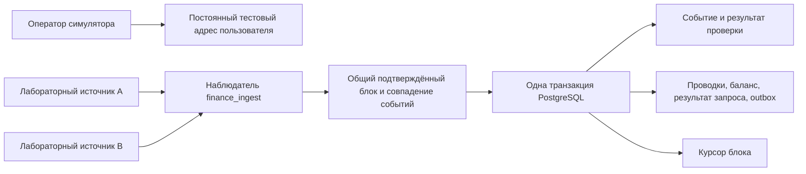

# Проверка поступлений в симуляторе сети

Текущая конфигурация переведена на единую PostgreSQL. Порядок миграции, права, копирование и откат: [Единая база PostgreSQL](../POSTGRES.md). Исторические проверки SQLite ниже относятся к прежним выпускам. Фактическое переключение фиксируется в `deployment/SERVER.md`.

Реализовано 6 октября 2026 года. Адреса, токен и блоки этого этапа относятся к закрытой лаборатории: `tron-sim-v1`, `simulation:usdt-test-v1`, внутренний баланс `USDT_SIM`. Это работающий адаптер симулированных поступлений с постоянным состоянием PostgreSQL. RPC настоящего TRON, кошельки, приватные ключи и реальный USDT пока не подключены.

## Как проходит пополнение



Оператор создаёт финансового пользователя и получает адрес через закрытый HTTP API:

```text
POST /sandbox/wallets/:userId/deposit-address
Authorization: Bearer <сервисный токен>
Content-Type: application/json

{"network":"tron-sim-v1"}
```

Адрес имеет вид `simulation:tron-deposit:<32 hex>`. Он постоянный, уникальный и не переназначается другому пользователю. Повтор запроса, включая одновременные обращения через два API, возвращает тот же адрес. Адрес не является криптокошельком, отправлять на него настоящую криптовалюту невозможно.

Наблюдатель читает два отдельных JSON-источника с разными `sourceId`. Каждый задаёт подтверждённую высоту и блоки. Для обработки выбирается меньшая подтверждённая высота. Блоки и нормализованные события двух источников должны совпадать. Проверяются последовательность высот, хэш предыдущего блока и вычисленный хэш лабораторного блока. Одинаковые дубли событий объединяются, конфликт одного `txId` и `logIndex` останавливает обработку.

Эти файлы моделируют два источника. Разные метки не доказывают независимость реальных провайдеров. Лабораторный хэш вычисляется из JSON с помощью SHA-256 и не является форматом блока TRON.

## Правила зачисления

| Условие | Результат |
| --- | --- |
| Блок ещё не подтверждён обоими источниками | Курсор и деньги не изменяются |
| Источники расходятся или один недоступен | Обработка приостанавливается, спорные блоки не проводятся |
| Контракт `simulation:usdt-test-v1`, scale 6, успешное исполнение, известный адрес, внешний отправитель, положительная сумма | Одно зачисление |
| Другой контракт, включая токен с символом USDT | `unsupported_token`, без зачисления |
| Неуспешное исполнение или другая точность | `failed_execution` или `wrong_scale`, без зачисления |
| Адрес получателя не закреплён за пользователем | `unknown_recipient`, без зачисления |
| Отправитель является нашим депозитным адресом, резервом или горячим адресом | `internal_transfer`, без нового начисления |
| Недопустимая строка суммы, ноль или превышение лимита | `invalid_amount`, без зачисления |
| После зачисления изменён уже подтверждённый блок | Постоянная остановка потока, требуется разбирательство |

Суммы передаются целыми строками минимальных единиц и не преобразуются в JavaScript Number. Лаборатория принимает от одной минимальной единицы; экономический порог настоящего пополнения и учёт поступлений, ожидающих разбирательства, относятся к следующему этапу. Символ токена используется только как метаданные.

Уникальность события задаётся сетью, `txId` и индексом лога. Для зачисления создаётся устойчивый UUID события, связанный с запросом `simulate_deposit`. Событие, проводки, результат операции, outbox и курсор сохраняются одной транзакцией. Если запись блока не удалась, все его зачисления откатываются. Если ответ потерян после commit, следующий процесс читает сохранённый курсор и сверяет уже проведённые блоки, не начисляя деньги повторно.

Наблюдатель использует блокировку PostgreSQL, а процедура дополнительно блокирует строку потока. Два наблюдателя не создают двойное зачисление; второй может получить `busy: true` и повторить проход позже. После разрыва соединения владение блокировкой прекращается. Последние три сохранённых блока проверяются до согласования нового подтверждённого tip. Поэтому расхождение источников на новом блоке не скрывает изменение уже проведённого блока. Такое изменение сохраняет `halted_reason`, оно не снимается автоматически и не создаёт отрицательный баланс пользователя. Отдельный регрессионный тест проверяет одновременное изменение старого блока и расхождение на новом.

## Права и хранение

Текущая версия схемы 3. Переход с версии 1 на 2 добавил четыре таблицы: `deposit_addresses`, `deposit_streams`, `deposit_blocks`, `deposit_events`. Адреса, проведённые блоки и события защищены от изменения и удаления обычными командами. Версия 3 добавила `account_totals`: триггеры поддерживают итоги проводок, отложенные проверки сравнивают их с балансом без повторного сканирования всей истории. Полная сверка отдельно пересчитывает проводки. Эти проверки выполняются с правами владельца, чтобы наблюдателю не требовалось чтение чужих финансовых счетов.

| Процесс | Полномочия |
| --- | --- |
| API, `finance_app` | Существующие операции симулятора, чтение журнала, выдача тестового адреса |
| Наблюдатель, `finance_ingest` | Чтение параметров симулятора и курсора, вызов процедуры блока и остановки потока |
| Мигратор, владелец схемы | Добавление схемы и настройка логинов, рабочим процессам эти права не передаются |

Наблюдатель не получает токен API, пароль `finance_app`, административный пароль или право перевода, вывода и произвольного начисления капитала. Он не имеет прямого INSERT, UPDATE, DELETE или TRUNCATE. Общий аудит `role-safety.sql` учитывает права отдельных колонок, доступные через членство роли без наследования, полномочия серверных файлов и программ, создание объектов и точные сигнатуры разрешённых функций. API проверяет свою роль при готовности и перед авторизованными запросами, наблюдатель проверяет свою роль при запуске, монитор VPS независимо проверяет оба логина каждую минуту. Роли имеют доступ к функции аудита, которая читает только настройки схемы и каталоги PostgreSQL. Наблюдатель остаётся доверенным компонентом проверки поступлений: в лаборатории он может представить синтетический блок. Для настоящих средств нужны независимая проверка источников и сверка с сетью.

Пароль наблюдателя находится в `/opt/royal-finance-secrets/observer-password`, root:1000, 0440. Он создаётся без изменения существующих секретов. Внешняя конфигурация базы не создаёт логин наблюдателя автоматически: когда он понадобится на другом узле, администратор создаёт `finance_ingest` и назначает `royal_finance_observer` с наследованием и без дополнительных полномочий.

Резервная копия версии 3 сохраняет все 14 таблиц, включая адреса, ключи событий, курсор и итоги проводок. Полное восстановление проверяет отпечаток данных, соответствие зачисленных событий финансовым запросам, состояние курсора, оба рабочих логина, итоги по истории и 15 защитных триггеров. Старые копии схем 1 и 2 из 9 и 13 таблиц поддерживаются отдельно. Состояние остановленного потока сохраняется при восстановлении и требует проверки перед возобновлением.

Миграция сохраняет старые счета и операции, изменяя версию метаданных. Текущий образ требует схему 3; прежние образы схем 1 и 2 после миграции не подходят для запуска. Возврат старой копии после новых операций требует согласованного переноса актуальных данных. [Обновление и сохранённые копии](README.md#обновление).

## Запуск проверки на VPS

```sh
cd /opt/royal-finance
python3 deployment/finance/check-deposit-lab.py
```

Проверка создаёт двух пользователей `depositcheck_*`, получает адреса через gateway и сохраняет синтетические источники в `/opt/royal-finance-deposit-lab`. Затем запускает одноразовые контейнеры `finance-deposit-scan` с профилем `deposit-lab`. Они удаляются после каждого прохода; постоянно запущенного наблюдателя реальной сети сейчас нет.

Сценарий проверяет неподтверждённое поступление, расхождение источников, ложный контракт USDT, неуспешное исполнение, неизвестного получателя, внутренний перевод, повтор лога, потерю ответа после commit и одновременный запуск двух наблюдателей. Итоговые балансы: 15 и 7 USDT_SIM, три новых зачисления, курсор продвинут на три блока. Результат: `/opt/royal-finance-state/deposit-lab.json`.

Ручной проход по сохранённым лабораторным источникам:

```sh
docker compose -f compose.finance.yaml --profile deposit-lab \
  run --rm --no-deps finance-deposit-scan
```

Повторный запуск не добавляет средств. Новый запуск полной проверки создаёт новых пользователей и продолжает лабораторную цепочку с сохранённой высоты. Исходники и база до обновления сохранены, прежний образ имеет тег `royal-finance-sim:before-deposits-20261006`.

## Постоянное чтение тестовой сети TRON

После лабораторных поступлений добавлен отдельный наблюдатель Nile в режиме `watch-only`. Он читает настоящие публичные блоки тестовой сети через `https://api.nileex.io` и `https://nile.trongrid.io`. Эти разные API не являются доказательством независимости их инфраструктуры. Для допуска денежных начислений нужны отдельно выбранные и проверенные источники.

Наблюдатель развёртывается отдельным Compose-проектом `royal-tron-reader`. Он получает исходящий доступ к RPC, собственную базу SQLite и публичную конфигурацию. У него нет подключения к финансовой Docker-сети, паролей PostgreSQL, токена симулятора, приватных ключей или HTTP-порта. Он сохраняет события сети, но не начисляет баланс и не отправляет транзакции. Финансовая схема остаётся версией 3.

Проверки адаптера:

- Явная сеть Nile и совпадение genesis с закреплённым идентификатором; mainnet URL запрещён.
- Чтение только `/walletsolidity`, запрет HTTP-переадресаций, предел размера ответа и времени запроса. Запросы каждого источника выполняются последовательно с паузой, временная ошибка чтения допускает один повтор.
- Пересчёт идентификатора блока из protobuf-полей заголовка и идентификаторов транзакций из `raw_data_hex`.
- Один receipt для каждой транзакции блока, без пропусков, чужих идентификаторов и другой высоты или времени блока.
- Для контрактных событий обязательный успешный receipt. Адреса и uint256 декодируются из ABI; суммы остаются целыми строками. События TRC-721 с четырьмя topics не считаются переводами TRC-20.
- Совпадение нормализованных блоков, результатов исполнения и переводов двух API. Перед новыми блоками повторно проверяется сохранённая граница; её изменение любым из источников постоянно останавливает наблюдатель.
- События и курсор записываются одной транзакцией SQLite с WAL и `synchronous=FULL`. Два процесса разделяют аренду записи; истёкший владелец не может записать блок. Потеря ответа после commit не создаёт повторных событий.

Адаптер доверяет ответам выбранных RPC: он не проверяет подпись Super Representative, консенсус и Merkle-root полного сериализованного набора транзакций. Согласование двух ответов и проверка хешей не заменяют собственный узел или независимую проверку полноты цепочки. Адреса, контракты и суммы сохранённых Transfer являются сетевыми наблюдениями; символ USDT и принадлежность токена здесь не назначаются.

## Управление наблюдателем на VPS

Исходники находятся в `/opt/royal-finance`, конфигурация в `/opt/royal-tron-reader-config/nile.json`, данные в `/opt/royal-tron-reader-data/nile.sqlite`. При первом запуске задаётся явная подтверждённая высота начала сканирования. Предыдущий блок сохраняется как якорь без импорта его событий. Старые блоки до выбранной высоты не сканируются. При перезапуске высота и источники должны совпадать с сохранённой конфигурацией; существующий файл не сбрасывается.

```sh
cd /opt/royal-finance
docker compose -f deployment/finance/compose.tron-reader.yaml ps
docker exec royal-tron-reader node reader.js status
docker exec royal-tron-reader node reader.js audit
python3 deployment/finance/check-tron-reader.py
```

Последняя команда действительно останавливает только наблюдатель, проверяет обнаружение остановки монитором, выполняет проход новым процессом и возвращает постоянный контейнер. Она проверяет сохранность прежних блоков и событий, неизменность всех 14 финансовых таблиц и восстановление копии наблюдателя в контейнере без сети. Результат сохраняется в `/opt/royal-finance-state/tron-reader.json`.

Наблюдатель хранит до 20 блоков за проход, ограничивает длительность прохода и быстро продолжает при отставании. При достижении подтверждённой границы он ждёт 15 секунд. Это не обещание пропускной способности: ограничение или недоступность публичного RPC останавливает продвижение и отражается в состоянии. Docker проверяет готовность, минутный монитор VPS требует живой наблюдатель и свежую копию; существующий агент Mac получает ошибки этого монитора.

После успешного прохода каждый час создаётся согласованная копия SQLite в `/opt/royal-tron-reader-data/backups`, хранение 14 дней. Перед публикацией копии проверяются SHA-256, целостность SQLite, непрерывность блоков, события и курсор при открытии отдельного файла только для чтения. Эти копии находятся на том же VPS. Зашифрованное внешнее копирование финансовой PostgreSQL продолжает работать отдельно; сетевой журнал наблюдателя можно заново построить по его сохранённой конфигурации и доступной истории RPC.

## Поступления USDT в отдельный баланс Nile

Для TRON необходимо проверять успешное исполнение по подтверждённому receipt и solidified-состояние, а не ответ отправки или запись индексатора. См. [семантику подтверждений TRON](https://developers.tron.network/docs/confirmation-semantics). Событие Transfer и опциональные метаданные токена описаны в [интерфейсе TRC-20](https://developers.tron.network/docs/trc20-protocol-interface).

Закреплён тестовый контракт `TXYZopYRdj2D9XRtbG411XZZ3kM5VkAeBf` (`41eca9bc828a3005b9a3b909f2cc5c2a54794de05f`) в Nile. Оба выбранных RPC подтверждают genesis Nile и `decimals()=6`; повторяемая проверка: `NILE_TEST_MODE=testnet-only NILE_TEST_NETWORK=nile npx tsx scripts/finance-nile-token.ts`. Адрес контракта опубликован на [официальном кране Nile](https://nileex.io/join/getJoinPage). Тестовые токены не имеют денежной стоимости.

Обработчик `royal-nile-creditor` хранит отдельную SQLite `/opt/royal-nile-test-data/nile-test.sqlite` с активом `USDT_NILE_TEST`. Он не подключён к симулятору `USDT_SIM`, игровым аккаунтам или расходным операциям. Поле `spendable=false` явно запрещает считать этот лабораторный остаток игровыми деньгами. Существующие 14 таблиц PostgreSQL и схема 3 остаются прежними. SQLite используется для закрытой проверки получения тестовых токенов; производственный денежный журнал и его ограниченные роли PostgreSQL остаются отдельной задачей интеграции.

Публичный манифест `/opt/royal-nile-test-config/nile-test.json` закрепляет сеть, контракт, точность, высоту начала и соответствия пользователей адресам. Начало обработки: блок `71591431`, предыдущий блок служит якорем. Ключи созданных адресов находятся только на Mac в `~/.local/share/royal-nile-test-keys`, каталог 0700, файлы 0600, вне исходников и Docker-образов. CLI генерации сохраняет существующий ключ при повторе и выводит только публичные данные. Приватные ключи не копируются на VPS, не передаются наблюдателю и не используются для подписи транзакций. Потеря Mac означает потерю этих тестовых ключей; отдельное резервирование ключей и контур подписи ещё не реализованы.

| Тестовый пользователь | Адрес Nile |
| --- | --- |
| `nile_deposit_001` | `TQXj2m3KDSCbLXZHyQs1YFtmnjGQntfWi7` |
| `nile_deposit_002` | `THRTTT94PkeYu48wKSzMyenCHLTmkru6q8` |

Адреса назначены оператором из созданного локально публичного манифеста. Пользователь не может прислать произвольный адрес через API. Смена владельца или расширение запечатанного манифеста текущим рабочим процессом запрещены. Автоматическая выдача адресов игровым аккаунтам ещё не подключена. Формат TRON-адреса сам по себе не определяет сеть, поэтому эти адреса используются только с явно выбранной Nile. Реальные средства на них отправлять нельзя.

Обработчик читает журнал наблюдателя через mount `read_only` и работает с `network_mode: none`, без портов, ключей и финансовых секретов. Он проверяет хеши сохранённых payload, непрерывность цепочки, успешный результат исполнения, соответствие контракта и известного получателя. Свежесть наблюдателя обязательна: записанная ошибка, отставание или permanent halt блокируют новые начисления. При прекращении работы наблюдателя его состояние устаревает через 180 секунд; уже проверенные подтверждённые блоки до этого могут быть обработаны. Перед новой обработкой сверяются три последних сохранённых блока. Изменение уже принятой истории постоянно останавливает тестовый журнал. Повреждение журнала источника, обнаруженное при запуске нового процесса, также сохраняет постоянную остановку, которая не снимается автоматическим исправлением источника.

Каждое допустимое внешнее поступление создаёт запись с уникальным `(tx_id,log_index)` и две противоположные проводки. Блок, поступление, обе проводки и курсор фиксируются одной транзакцией SQLite с WAL и `synchronous=FULL`. Суммы вычисляются BigInt, а не floating point. Нулевые переводы, mint с нулевого адреса, другой контракт, неизвестный получатель и переводы между нашими адресами не создают новый остаток. Сумма одного поступления ограничена `10^30` минимальных единиц; превышение останавливает обработку. Полный аудит независимо сверяет все допустимые события, их владельцев, обе проводки, курсор и целостность базы.

```sh
cd /opt/royal-finance
docker compose -f deployment/finance/compose.nile-creditor.yaml ps
docker exec royal-nile-creditor node creditor.js status
docker exec royal-nile-creditor node creditor.js audit
docker exec royal-nile-creditor node creditor.js backup
python3 deployment/finance/check-nile-creditor.py
```

Последняя команда останавливает только обработчик, проверяет обнаружение остановки монитором, запускает его снова, проверяет сохранность поступлений и восстанавливает копию в контейнере без сети. Результат записывается в `/opt/royal-finance-state/nile-creditor.json`. Копии `/opt/royal-nile-test-data/backups` создаются каждый час после успешного прохода и проверяются восстановлением с полной сверкой. Хранение 14 дней на VPS. Агент Mac каждые 5 минут получает новую часовую копию, шифрует AES-256-GCM и проверяет её расшифровкой и полным аудитом отдельной SQLite. Сохранённая актуальная зашифрованная копия также проходит полный аудит при каждом повторе. Каталог `~/Library/Application Support/RoyalNileTestBackups`, хранение 30 дней. Сравниваются SHA-256, запечатанный публичный манифест и все результаты аудита. Агент работает, пока Mac включён и не спит. Эти копии не содержат приватных ключей; ключ шифрования остаётся на Mac вне проекта.

Для настоящей сетевой проверки оператор должен получить бесплатные тестовые USDT через официальный кран с CAPTCHA. До поступления и подтверждения блока баланс остаётся нулевым. Синтетические события из автоматических тестов не импортируются в серверный журнал. Доверие к RPC и ограничения проверки консенсуса остаются такими же, как у наблюдателя выше; эта схема не является допуском реальных денег.

Собственное тестовое пополнение и сохранность положительного остатка после перезапуска подтверждены 6 октября 2026 года. Следующий этап: связать выдачу адресов с проверенными игровыми идентификаторами. Для mainnet отдельно нужны ограниченный денежный ingest в PostgreSQL, работа с неподдержанными и отложенными поступлениями, резервирование ключей, контролируемая подпись и завершение эксплуатационных требований.

## Сверка сетевых токенов и журнала Nile

Отдельный одноразовый сервис `royal-nile-reconcile` запускается systemd каждые 5 минут. Он получает только публичный манифест и mount журнала Nile для чтения, без ключей, финансовой сети или портов. Через `VACUUM INTO` создаётся временная согласованная копия в tmpfs, затем полный аудит копии независимо пересчитывает проводки. Исходный журнал не изменяется.

Оба RPC проверяют genesis, точность токена и хеш блока на высоте курсора журнала. Суммы `balanceOf` читаются через подтверждённый `walletsolidity/triggerconstantcontract`: [официальное описание](https://developers.tron.network/reference/triggerconstantcontract). Перед чтением адресов и после него сравниваются высота и хеш подтверждённой границы. Проход принимается только при неизменной границе каждого RPC и одинаковых остатках. У RPC могут различаться текущие подтверждённые высоты: допускается разница до шести блоков, оба источника должны подтвердить общий блок курсора журнала. При одинаковой высоте хеши должны совпадать. Отчёт содержит обе высоты, хеши и поле `sameConfirmedBoundary`; значение `false` не выдаётся за чтение единого блока. Изменившаяся граница или расхождение требуют повторить весь проход, а не объединять части разных попыток.

Сравниваются совокупные токены на всех закреплённых адресах и совокупные обязательства журнала. Суммы хранятся строками и вычисляются BigInt. Перемещение между нашими адресами не создаёт нового обязательства. Избыток токенов только отражается в отчёте, автоматического начисления по избытку нет. Недостаток, ошибки источников, устаревшая сверка свыше 10 минут или изменение начислений после сверки вызывают ошибку общего монитора. Сверка не исправляет проводки, не отправляет транзакции и не останавливает навсегда депозитный обработчик; расходы в этом лабораторном контуре отсутствуют.

Это проверка согласованности ответов RPC. Одинаковая граница вокруг чтения не является криптографическим доказательством привязки TVM-ответа к блоку, проверки консенсуса или независимости провайдеров. Обычный `eth_call` также не даёт исторической привязки: объект с номером или хешем блока проверяет существование блока, но исполняет вызов на последнем состоянии, см. [документацию TRON](https://developers.tron.network/reference/eth_call). При большом количестве адресов чтение всех остатков может не укладываться в неизменную границу; понадобится доступ к снимку TVM-состояния заданного блока, обычного JSON-RPC недостаточно. Сейчас закреплены два тестовых адреса.

`depositObserved=false` при нулевых поступлениях явно отличает успешную сверку нулей от подтверждённого собственного пополнения. Допуск средств к игре и mainnet из этого отчёта не следует.

```sh
cd /opt/royal-finance
docker compose -f deployment/finance/compose.nile-reconcile.yaml build nile-reconcile
python3 deployment/finance/install-nile-reconcile.py
python3 deployment/finance/operations.py nile-reconcile
python3 deployment/finance/check-nile-reconciliation.py
systemctl list-timers royal-nile-reconcile.timer
```

Установщик сначала требует успешную сетевую сверку, затем включает таймер и обязательный контроль. Отчёт: `/opt/royal-finance-state/nile_reconciliation.json`. Проверка изоляции и отрицательных состояний монитора: `nile-reconciliation-check.json`. Проверка меняет только временно сохранённый эксплуатационный отчёт под отдельной блокировкой и возвращает его в `finally`; исходные начисления и финансовая PostgreSQL не изменяются.

## Проверка собственного положительного депозита

`check-nile-deposit.py` сначала читает согласованный временный снимок журнала через отдельный CLI `proof.js` в контейнере сверки с mount для чтения. Выбранное событие должно принадлежать закреплённому пользователю и уже находиться в проверенном журнале. Оба RPC обязаны подтвердить genesis Nile, финализацию высоты события и полностью совпадающий нормализованный блок, включая успешные receipt и логи. Приватные ключи и отправка транзакций не используются. Доверие к RPC сохраняется, проверка подписи SR и доказательства консенсуса не добавлены.

Если собственного поступления нет, результат `nile_deposit_pending`, код завершения 2. Проверка нулей не становится успешным депозитом, обработчик при этом не останавливается. При положительном результате останавливается только обработчик Nile, выполняются два прохода новыми процессами с сохранённым курсором, затем постоянный контейнер запускается в `finally`. Проверяются неизменность всех прежних поступлений и проводок, одна запись выбранного события и две противоположные проводки. Новые самостоятельные поступления допускаются и не считаются дублями выбранного события.

После восстановления healthy создаётся согласованная копия, проверяется положительный баланс в отдельном контейнере без сети и выполняется свежая сверка активов с обязательствами. Отпечаток всех 14 таблиц PostgreSQL должен сохраниться, общий монитор должен вернуться в успешное состояние. Результат: `/opt/royal-finance-state/nile-deposit-proof.json`. Проверка временно прерывает только тестовый обработчик и может вызвать краткий сигнал минутного монитора.

```sh
cd /opt/royal-finance
python3 deployment/finance/check-nile-deposit.py --user nile_deposit_001
# Для проверки конкретной транзакции добавить --tx-id и её SHA-256 идентификатор.
```

Первое собственное поступление: 1000 USDT_NILE_TEST, событие `050266479a54e3d114763f0f78fafa6acaff782c2b315cd299e372eac79f16d4:0`, блок `71593249`. Проверены два повторных прохода, перезапуск, положительная серверная копия и покрытие обязательств сетевыми токенами. У этого тестового баланса по-прежнему `spendable=false`, игровой аккаунт и расходные операции не подключены.

## Привязка лабораторного кошелька к игровому аккаунту

Привязка выполняется оператором по уже существующей почте игрового аккаунта. Адреса сохраняются в прежнем запечатанном журнале, новые ключи не создаются. Для нынешнего этапа доступны только два лабораторных адреса: это ручное назначение тестовых кошельков, а не массовая выдача адресов. Старый баланс адреса становится видимым только явно выбранному аккаунту. Никто не получает кошелёк автоматически при первом открытии окна.

```sh
cd /opt/royal-finance
python3 deployment/finance/nile-account-views.py init
python3 deployment/finance/nile-account-views.py bind --user nile_deposit_001 --email EMAIL
```

`EMAIL` нужно заменить почтой владельца. Утилита читает только ID из существующей базы аккаунтов через параметризованный запрос. Пароль, хеш пароля и сессии не запрашиваются. Неизвестный аккаунт, неизвестный лабораторный пользователь и конфликт владельцев отклоняются. Повтор той же привязки сохраняет исходную запись. Один адрес принадлежит одному аккаунту, смена владельца не поддерживается. Манифест `/opt/royal-nile-account-bindings/bindings.json` принадлежит root, каталог не доступен игре; перед добавлением сохраняется предыдущая версия. Привязка не перемещает токены и не меняет проводки.

`royal-nile-account-views.timer` каждую минуту запускает отдельный контейнер без сети, портов и ключей. Он читает согласованный временный снимок журнала, проводит полный аудит и требует свежую успешную сверку с теми же обязательствами и количеством поступлений. Только каталог `/opt/royal-nile-account-views` доступен контейнеру для записи. Публикация `wallets.json` атомарная. При ошибке публикуется недоступное состояние, старый снимок перестаёт приниматься через 120 секунд, даже если задача не запустилась. Отчёт сверки должен быть не старше 10 минут. После нового поступления показ баланса может ждать очередной сверки до пяти минут.

Игровой контейнер получает только каталог опубликованных представлений с mount для чтения. Настройка сохранена в `/opt/royal/compose.override.yaml`, исходный шаблон: `compose.game-nile-wallet.yaml`. Обычный `docker compose up` читает override автоматически. При явном `-f compose.yaml` для пересоздания игры нужно также передать `-f compose.override.yaml`, иначе mount и настройка будут потеряны. Базовый финансовый контур и его сети не подключаются к игре.

`GET /api/nile-wallet` определяет аккаунт только по действующей сессии. Параметры выбора пользователя отклоняются; все изменяющие методы возвращают 405. Для другого аккаунта ответ `unassigned` без адреса, баланса и истории владельца. Ответы не кешируются. Повреждение, ошибка аудита или устаревший снимок дают 503. Игровые ставки, переводы и вывод тестового USDT не реализованы. Демокошелёк остаётся отдельным активом.

В игре кнопка «USDT · Nile» открывает адрес, точный баланс и последние 50 подтверждённых поступлений. При обновлении старый адрес и баланс скрываются до ответа. Смена аккаунта и закрытие окна отменяют применение прежнего ответа. Окно явно указывает тестовую сеть и запрещает отправку настоящих USDT.

Привязки автоматически копируются на Mac тем же планировщиком раз в пять минут, когда компьютер включён. Каждая версия шифруется AES-256-GCM и проверяется полным расшифрованием. Повторная проверка аутентифицирует существующий шифрованный файл. Удаление или изменение сохранённого владельца относительно последней проверенной версии отклоняется. Копии находятся в `RoyalNileTestBackups/account-bindings`, не содержат почты или ключей. Восстановление требует согласованной копии журнала, закреплённой конфигурации и манифеста привязок; одного журнала недостаточно для восстановления владельцев игровых кошельков. Ключ шифрования сохраняется отдельно от проекта.

Проверки: `npm run test:finance`, `npm run test:auth`, `npx playwright test --config playwright.nile.config.ts`, `node --test deployment/finance/*test.mjs`. Оператор проверяется на VPS командой `python3 deployment/finance/test-nile-account-operator.py`: временные каталоги и подменённое чтение ID, без изменения настоящих привязок. Браузерные положительные сценарии используют ответы-заглушки; настоящий сетевой депозит доказан отдельной предыдущей проверкой. Этот этап не доказывает работу mainnet, массовую выдачу адресов или расходование средств.
