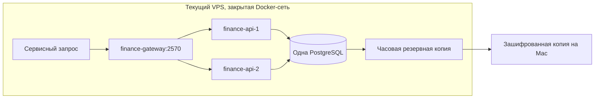
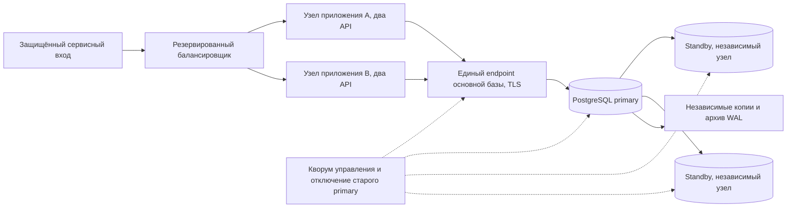

# Архитектура отказоустойчивости финансового контура

Подготовлено и проверено 6 октября 2026 года по московскому времени. Сейчас на одном VPS работают два экземпляра финансового API, закрытый HAProxy и одна PostgreSQL. Второй сервер по решению владельца пока не устанавливается. Все операции используют `USDT_SIM`; эта конфигурация не принимает настоящие деньги.

## Что работает сейчас



У API нет собственного денежного состояния: журнал, остатки, резервы, результаты запросов и outbox находятся в общей базе. Блокировки и уникальные ключи применяются в PostgreSQL, поэтому запросы через разные процессы согласуются между собой. Симулятор не зависит от того, какой экземпляр API обработал повтор.

HAProxy распределяет запросы между двумя API, проверяет `/healthz` и исключает неисправный экземпляр. DNS Docker обновляет адреса контейнеров после пересоздания. Автоматический повтор запроса на другом backend отключён (`retries 0`); повтор финансовой команды выполняет вызывающий сервис с исходным ключом. Механизмы описаны в документации [DNS HAProxy](https://www.haproxy.com/documentation/haproxy-configuration-tutorials/proxying-essentials/dns-resolution/) и [проверок состояния HAProxy](https://www.haproxy.com/documentation/haproxy-configuration-tutorials/reliability/health-checks/).

`/healthz` возвращает 200 только при доступной базе с разрешённой записью. Подключение к standby или с `transaction_read_only=on` возвращает 503. Это помогает исключить API с неподходящим подключением, но не выбирает основную базу и не заменяет защиту от двух активных узлов записи.

Порты API, HAProxy и PostgreSQL не опубликованы на хосте. Сервисный токен доступен только оператору симулятора. Для пользовательских платежей ещё нужны аутентификация игрока, проверка прав на каждую операцию и отдельный защищённый вход в сервис.

| Событие | Текущее поведение |
| --- | --- |
| Один процесс API остановлен | HAProxy направляет следующие запросы к оставшемуся экземпляру |
| Соединение прервалось после проведения операции | Повтор с тем же UUID и телом возвращает сохранённый результат |
| База недоступна или допускает только чтение | API исключается из готовых, денежная команда не подтверждается |
| Потерян весь VPS, база или HAProxy | Требуется восстановление; независимого рабочего узла пока нет |
| Mac выключен или спит | Внешние проверки и копирование ждут возобновления работы Mac |

## Будущая схема на независимых ресурсах



У обоих узлов приложения один логический источник записи. Нельзя поставить отдельную активную финансовую базу на каждом VPS и потом объединять балансы. Все денежные проверки, чтение результата операции и проведение выполняются на действующем primary. Реплики для отчётности подключаются отдельно, когда допустимость задержки чтения определена явно.

Для продолжения записи при отказе одного узла базы и синхронного сохранения подтверждённых операций планируем три узла PostgreSQL: primary и два standby в независимых зонах отказа. Подтверждение commit требует сохранения на primary и как минимум одном подходящем standby. Кластер допускает повышение только узла с необходимыми подтверждёнными данными. При нехватке безопасных реплик запись приостанавливается. Два узла при строгой синхронной репликации не обеспечивают непрерывную запись после потери одного из них. Эти ограничения, а также исключения при нескольких отказах и отмене ожидающего commit описаны в [документации Patroni](https://patroni.readthedocs.io/en/latest/replication_modes.html).

Варианты реализации: управляемая PostgreSQL с проверенными условиями репликации и переключения либо собственный кластер Patroni, кворум управления etcd из трёх участников и механизм принудительного отключения прежнего primary. Участники должны переживать потерю одного хоста; дополнительные контейнеры на том же VPS не создают независимый ресурс. Настройка этих компонентов относится к будущему развёртыванию.

Балансировщик выбирает действующий primary через согласованное состояние кластера. Старый primary теряет возможность записи до открытия нового узла приложениям. После возвращения он присоединяется как реплика, а не становится вторым источником записи. Проверка `pg_is_in_recovery()` в API сама по себе эту гарантию не даёт.

## Готовая конфигурация внешней базы

[compose.external-db.yaml](compose.external-db.yaml) описывает будущий узел приложения: два API, закрытый HAProxy, отдельный выход к внешней PostgreSQL и проверку TLS. Файл прошёл проверку синтаксиса Compose, но сейчас не запущен. Он не создаёт базу, реплики, кворум управления, межсерверную сеть или механизм переключения.

Перед запуском потребуются:

1. `FINANCE_DB_HOST`: DNS-имя единого endpoint primary, совпадающее с сертификатом. Порт и имя базы задаются `FINANCE_DB_PORT` и `FINANCE_DB_NAME`.
2. Закрытая сеть или VPN между сервисами, фильтрация доступа к PostgreSQL и защищённый межсерверный вход. В шаблоне нет опубликованного gateway и готового межсерверного маршрута.
3. Файлы `app-password`, `sandbox-token` и `db-ca.pem` в `FINANCE_SECRETS_DIR`, вне исходников и образов. При миграции отдельно нужен `admin-password`.
4. Схема, созданная владельцем, и логин `finance_app`, которому администратор назначил `royal_finance_runtime` с наследованием. Логин не получает владение схемой, создание ролей, репликацию или обход RLS.
5. Один проверенный образ приложения на всех узлах, согласованный порядок миграций и достаточный лимит подключений базы.

Шаблон задаёт `FINANCE_DB_TLS=verify-full`: проверяются доверенная цепочка и имя сервера. Недоверенный сертификат и неверное имя отклоняются. Параметры `ssl*` и `uselibpqcompat` в URL запрещены: node-postgres может заменить ими отдельно заданный объект TLS. См. [документацию node-postgres](https://node-postgres.com/features/ssl). Для подключения по системным доверенным центрам конфигурация TypeScript допускает отсутствие собственного CA-файла; шаблон внешней базы требует явный `db-ca.pem`.

Рабочий пул по умолчанию ограничен пятью подключениями на API, то есть десятью на узел приложения и двадцатью на два узла. Отдельно учитываются миграции, мониторинг и обработчики. Допустимый диапазон `FINANCE_DB_POOL_MAX`: 1..50.

Проверка будущего файла без запуска:

```sh
FINANCE_DB_HOST=primary.example.invalid \
  docker compose -f deployment/finance/compose.external-db.yaml config --quiet
```

Когда ресурсы подготовлены, профиль `migrate` запускается владельцем схемы один раз, до рабочих API. Мигратор внешнего шаблона не создаёт пароль рабочего логина: подготовка `finance_app`, прав подключения и членства выполняется администратором базы отдельно. На каждом узле нельзя параллельно выполнять несогласованные миграции.

Скрипты `operations.py` сейчас обслуживают локальный проект `royal-finance-sim` и его контейнер базы. После переноса на внешнюю PostgreSQL резервное копирование, восстановление и контроль репликации нужно подключить к новой топологии до переключения. Текущие таймеры не являются готовой системой эксплуатации внешнего кластера.

## Поведение при неопределённом результате

Вызывающий сервис сохраняет UUID запроса и тело до отправки. При тайм-ауте, 503 или разрыве связи он проверяет операцию по исходному ключу либо повторяет тот же запрос. Новый UUID для повторной попытки создавать нельзя. Одинаковый ключ с изменённым телом возвращает 409.

Обрыв соединения не доказывает откат транзакции. Ответ об успехе выдаётся после завершения транзакции базы; при переключении кластера безопасность уже подтверждённых результатов зависит от настроек репликации. Для старого ключа сохраняются исходный ответ и проводки.

Неопределённый вывод сохраняет резерв. Перед реальной подписью будущий worker должен закрепить за попыткой сохранённую транзакцию и право обработки, которое прекращается при потере владения. Повторная обработка сверяет предыдущую попытку в сети. Тайм-аут не разрешает создавать новую выплату или возвращать резерв. Подписывающий контур ещё не реализован.

## Перенос, когда независимые ресурсы будут готовы

1. Создать кластер и проверить TLS, роли, репликацию, резервные копии и отключение старого primary. Внешний контроль должен работать круглосуточно.
2. Остановить приём денежных команд и все обработчики, создающие операции. Сделать финальную согласованную копию исходной базы.
3. Восстановить новую базу и роли, сравнить отпечаток всех таблиц текущей версии, журналы, резервы, ключи повторов, outbox и права рабочих логинов. Начиная со схемы 2 также сохранить адреса, события и курсор поступлений; для схемы 3 проверить итоги `account_totals` по полной истории.
4. Отключить старые финансовые API и возможность записи в прежнюю базу. Перевести все новые экземпляры на один endpoint новой базы. Прежняя база остаётся копией для разбирательства, без рабочих писателей.
5. Запустить новые API, проверить готовность и повтор ранее проведённых запросов. После сверки открыть операции и обработчики.
6. Проверить отказ узла и сетевой разрыв, возврат старого primary, потерю синхронной реплики и восстановление из внешней копии.

После новых записей нельзя просто запустить старую базу для отката: она уже отстаёт. Возврат требует отдельного переноса актуальных данных и повторного исключения двух активных баз. Целевые RPO и RTO задаются и проверяются на выбранных ресурсах; текущая проверка процессов не устанавливает SLA для отказа VPS.

## Проверенные сценарии этапа двух API

- 29 финансовых тестов: конкурентные списания, атомарность, права ролей, повторы, восстановление PostgreSQL, настройки TLS и отказ готовности при подключении только для чтения.
- 16 одновременных одинаковых пополнений через оба API: один сохранённый результат и одно начисление. Изменённая сумма с тем же ключом отклонена.
- Ответ проведённого перевода намеренно отброшен. После остановки одного API повтор через оставшийся экземпляр вернул исходную операцию без второго списания.
- После остановки одного API новый запрос успешно проведён через второй; неопределённый вывод сохранил резерв и отказал в отмене. После возврата первого API оба снова принимают запросы, вывод подтверждён один раз.
- Монитор обнаружил остановленный API, при этом проверки gateway и журнала оставались успешными. После возврата API монитор подтвердил восстановление; результат сохранён в `monitor-failover.json`.
- Отдельная PostgreSQL с TLS: доверенный сертификат принят, недоверенный сертификат и неверное имя сервера отклонены.
- Новая резервная копия восстановлена в изолированном PostgreSQL: совпали все девять таблиц, остатки, резервы, права и защитные триггеры.

На следующем этапе схема обновлена до версии 2: добавлены лабораторные поступления, проверено восстановление всех 13 таблиц и права отдельного наблюдателя. [Правила и эксплуатация поступлений](DEPOSITS.md). Независимые ресурсы по-прежнему не устанавливались.

После ревью развёрнута схема 3. Пройдены 49 финансовых тестов на Node 22, повторена проверка остановки одного API и восстановлены все 14 таблиц из серверной и зашифрованной внешней копий. Готовность и запросы API проверяют текущие права логина, монитор отдельно проверяет обе рабочие роли, включая права колонок и членство без наследования. Транзакции PostgreSQL 17 ограничены 15 секундами вместе с отложенными проверками. [Результаты и ограничения](STATUS.md). Все рабочие контейнеры по-прежнему размещены на одном VPS.

Повторить на текущем VPS:

```sh
cd /opt/royal-finance
python3 deployment/finance/check-multi-instance.py
python3 deployment/finance/check-postgres-tls.py
```

Первая команда действительно останавливает один контейнер API и возвращает его, создаёт двух новых симулированных пользователей и операции. Вторая создаёт временную PostgreSQL с отдельными тестовыми секретами и затем удаляет её. Результаты сохраняются в `/opt/royal-finance-state/multi-instance.json` и `tls.json`. Рабочая база и игра не останавливаются.

Игровой сервер требует отдельного проекта отказоустойчивости: аккаунты пока в SQLite, комнаты Colyseus в памяти. Перенос аккаунтов, владение комнатами, маршрутизация WebSocket, сохранение матчей и переподключение игроков этим этапом не реализованы. [Текущий статус](STATUS.md), [резервные копии и мониторинг](OPERATIONS.md).
