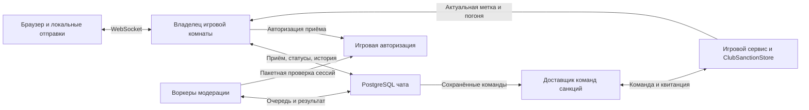

# Надёжная доставка чата Royal на 10 000 игроков

Версия 1.0 от 8 ноября 2026 года. Постановка на разработку. Значения нагрузки, задержек и сроков хранения в разделе 8 являются проектными параметрами приёмки.

## 1. Цель и границы

Поддержать 10 000 одновременно подключённых игроков во всех экземплярах казино и разовую отправку 10 000 сообщений за секунду. Каждая отправка, которую сервер подтвердил как принятую, сохраняется до конечного результата, в том числе во время временной недоступности зависимостей. Обработка возобновляется после их восстановления. Потеря ответа, переподключение и повтор обработки не должны создавать вторую публикацию, второй учёт нарушения или повторную санкцию.

Чат доступен на игровых этажах и в туалете. Канал определяется экземпляром казино и локацией. Игрок получает сообщения, отправленные после начала его текущего визита. В туалете действуют правила чата и предложение маскировки у Жоры. Погоня в туалете не начинается. На улице доступны только статусы собственных отправок, если игроку нужно восстановить результат.

Применяются существующие словари, маскирование и пороги антиспама. Адресат грубого слова не влияет на решение. Подтверждённый спам и 10 грубых слов за 30 секунд используют общую санкцию. Правила поимки, маскировки, оплаты и начисления штрафов берутся из действующей механики. Начальная метка действует 20 минут с суммой 10 виртуальных USDT. Повторная поимка в рамках активной метки добавляет к остатку 10 минут и 5 виртуальных USDT. Списание выполняет существующий общий кошелёк.

## 2. Исходная система

- `LobbyRoom` принимает WebSocket-сообщение, проверяет исходный визит, выполняет антиспам и ставит работу в `ChatQueue`. Очередь общая для комнат одного процесса и ограничена 12 активными аккаунтами и 3 работами на аккаунт. Проверка сессии для отправки обращается к PostgreSQL. [Обработчик](../server/LobbyRoom.ts) · [Очередь](../server/chatQueue.ts) · [Проверка сессии](../server/accounts.ts)
- Квитанции живут в памяти процесса. Срок хранения завершённых результатов составляет 120 секунд. Отклонённая по ёмкости отправка может уже попасть в антиспам. Кнопка повтора в текущем клиенте создаёт новый UUID. [Квитанции](../server/chatReceipts.ts) · [Клиент](../src/ui/SocialUI.ts)
- `RoomChat` сравнивает порядковый номер визита с номером исходной отправки. В памяти хранится до 60 сообщений на локацию. `ClubSanctionStore` уже сохраняет результат нарушения и поимки по ключу события под блокировкой аккаунта. [Визиты](../server/roomChat.ts) · [Санкции](../server/clubSanctions.ts)
- Боевая проекция чата использует одиночный игровой процесс. Проект распределения комнат описывает маршрутизацию к владельцу, но требует интеграции и отдельной приёмки. Стенд ограничен 6 000 синтетических клиентов. Прогон на 5 000 соединений подал 29,09% целевого потока движения и не прошёл приёмку. Из него нельзя вывести ёмкость для 10 000 игроков. [Боевая проекция](../deployment/releases/club-conduct-20261107-v1/backend-projection.json) · [Отчёт стенда](../deployment/WEBSOCKET_CLUSTER.md#этап-11-отдельный-прогон-5000-игроков-на-одном-vps) · [Лимиты стенда](../scripts/load-stand-limits.ts)

## 3. Компоненты и ответственность

- **Владелец комнаты** ведёт состав игроков, серверные визиты и порядок событий внутри экземпляра. Один экземпляр имеет одного владельца с действующей арендой и глобально уникальным поколением `roomEpoch`. При смене владельца создаётся новое поколение. Владелец рассылает сообщения своим WebSocket-клиентам по локациям.
- **Хранилище чата** содержит очередь, квитанции, счётчики модерации, маскированную историю и события для игровых сервисов. Целевой контур использует собственный экземпляр PostgreSQL с отдельными ресурсами, ролями и пулом подключений. Приём подтверждается после фиксации WAL на основном узле и синхронной реплике в другом домене отказа. При потере этой возможности новые отправки переходят в повторяемое ожидание на клиенте. Переключение базы должно исключать работу двух основных узлов. [Репликация PostgreSQL](https://www.postgresql.org/docs/current/warm-standby.html#SYNCHRONOUS-REPLICATION)
- **Воркеры** масштабируются независимо от игровых комнат. Они выполняют локальные правила маскировки и антиспама, сохраняют результат и создают команды для охраны. Приоритет отдаётся первым готовым сообщениям разных аккаунтов. Асинхронное уведомление может ускорить чтение. Периодическое чтение базы восстанавливает работу после пропущенного сигнала.
- **Игровой сервис** остаётся владельцем сессий, санкций, маскировки, поимок и денег. Чат обращается к пакетной проверке через отдельный лимитированный пул авторизации. Роль воркера чата имеет доступ только к базе чата. Команды санкций принимает игровой сервис, используя свои транзакции и правила.

При 30 игроках на комнату нижняя граница составляет 334 комнаты. Фактическое количество владельцев определяется замерами движения, WebSocket и памяти. Развёртывание нескольких владельцев, маршрутизация переподключений и распределённый генератор входят в зависимость приёмки на 10 000.

## 4. Протокол и поведение клиента

### CH-01. Отправка с постоянным идентификатором

После согласования версии протокола сервер сообщает своё время и текущий `visitId`. Клиент создаёт UUIDv7 один раз на действие «Отправить». Время UUID вычисляется относительно серверного времени, полученного при подключении. Перед сетевой отправкой клиент сохраняет в IndexedDB исходный конверт `{messageId, text, roomEpoch, visitId}` в разделе своего аккаунта. Статусы и черновики другого аккаунта скрыты. При сбое записи текст остаётся в поле ввода. Отправка становится доступной после успешного сохранения. [UUIDv7](https://www.rfc-editor.org/rfc/rfc9562.html#section-5.7) · [IndexedDB](https://www.w3.org/TR/IndexedDB/)

Клиент передаёт `chat.send`. Сервер получает аккаунт, комнату и локацию из проверенного контекста сессии. Поля конверта позволяют проверить исходный визит и связать повтор с исходной отправкой. Свежий запрос требует совпадения текущего визита и действующего поколения комнаты. Текст нормализуется действующим обработчиком и проверяется по его ограничению в 300 символов. Отпечаток вычисляется как SHA-256 от UTF-8 JSON-массива `[protocolVersion, roomEpoch, visitId, normalizedText]` в указанном порядке.

| Пакет | Поля |
| --- | --- |
| `chat.ready` | Версия протокола, `serverTimeMs` |
| `chat.visit` | `roomEpoch`, `visitId`, `location`, начальный курсор. Пустое значение закрывает доступ к истории |
| `chat.send` | `messageId`, `text`, `roomEpoch`, `visitId` |
| `chat.result` | `messageId`, `status`, `reasonCode` при ошибке, `publicationId` при публикации, `retryAfterMs` при повторяемом отказе |
| `chat.resume` | До 50 собственных ID за запрос. Ответ содержит результат по каждому ID |
| `chat.history` и `chat.batch` | Запрос содержит `visitId`, `afterCursor` и лимит до 100 записей. Ответ содержит `visitId`, границы диапазона, доступные записи и признак продолжения или сброса |

Обновления результата по WebSocket ускоряют отображение. При переподключении клиент восстанавливает результат чтением квитанции с основного узла базы. Тексты для игрока локализует клиент.

| Состояние | Когда возвращается | Действие клиента |
| --- | --- | --- |
| `accepted` | Исходный конверт и порядковый номер записаны в очередь с требуемой надёжностью | Ждать конечного результата. При переподключении запросить статус по тому же ID |
| `published` | Маскированный текст был записан в историю исходного канала | Сопоставить с публикацией по серверному `publicationId` из квитанции. Текст доступен в пределах действующего визита и срока истории |
| `rejected` | Окончательный результат правил чата или невалидного запроса | Показать понятную причину. Прекратить автоматический повтор |
| `cancelled` | До приёма сменился визит, исходная сессия отозвана, канал закрылся до публикации либо очередь аккаунта отменена решением охраны | Прекратить автоматический повтор. Сохранить доступный черновик на исходном устройстве |
| `retry_later` | Исчерпан технический бюджет, временно недоступно хранилище либо исход коммита неизвестен | Сохранить ID и конверт. Учитывать `retryAfterMs`, наращивать паузу и добавлять случайный разброс |
| `id_conflict` | Такой ID уже записан для другого канонического конверта того же аккаунта | Прекратить автоматический повтор этого конверта |
| `expired` | Квитанция отсутствует и истёк допустимый возраст идентификатора | Предложить вернуть текст в поле. Новый ID создаётся при явной новой отправке |

Обычный ход отправки проходит без технических уведомлений. При длительном ожидании допускается текст «Доставка не подтверждена. Текст сохранён». Локальный таймер переводит интерфейс в ожидание восстановления. Принятая сервером работа при этом продолжается. При публикации клиент удаляет локальную копию. При окончательном отказе или отмене клиент закрывает операцию и оставляет текст для ручного восстановления. Черновик можно удалить явно. Локальное восстановление действует в том же профиле браузера при сохранённых данных сайта.

### CH-02. Повтор, смена комнаты и истечение срока

Сервер ищет квитанцию по `(accountId, messageId)` после проверки текущего аккаунта и до проверки текущего визита и ёмкости. Тот же ID с тем же каноническим конвертом возвращает сохранённое состояние. Тот же ID с изменённым текстом или исходным визитом возвращает `id_conflict`. Результат запроса `chat.resume` доступен своему аккаунту после переподключения из другой комнаты. Он содержит статусы и идентификаторы, тело чата из старой локации в этот ответ не включается.

После потери ответа клиент сначала восстанавливает статусы ограниченным пакетом. `chat.resume` возвращает `not_found` для отсутствующего ID в пределах срока первого приёма. Тогда тот же конверт можно повторить в исходном действующем визите. Отсутствие записи после истечения этого срока возвращает `expired` и не доказывает, что сообщение не было опубликовано. После смены визита текст можно вернуть в поле и отправить явным действием с новым ID. Возраст UUID проверяется только для первой записи. Повтор уже записанной операции возвращает результат до конца хранения квитанции. Удаление квитанции допускается после закрытия окна первого приёма. Просроченный UUID без записи отклоняется, поэтому удалённая квитанция не превращает старый повтор в новую отправку.

## 5. Хранилище и порядок обработки

### CH-03. Записи и транзакции

| Запись | Ключ и основные поля |
| --- | --- |
| `chat_room_epoch` | Глобальный `room_epoch`, владелец, срок аренды и состояние канала |
| `chat_account_lane` | Аккаунт, следующий номер, голова очереди, число ожидающих, токен и срок аренды воркера |
| `chat_request` | Уникальные `(account_id, message_id)` и `(account_id, account_seq)`, отпечаток конверта, временный текст, исходная сессия, `room_epoch`, локация, визит, номер отправки внутри комнаты, время приёма, версия правил, поколение снятия метки, надетый образ либо явное пустое значение, состояние, результат |
| `chat_conduct_window` | Аккаунт, ограниченное окно уникальных отправок, время приёма, признаки повторов и число грубых слов |
| `chat_feed` | Серверный `publication_id`, уникальные `(account_id, message_id)` и `(room_epoch, location, publication_seq)`, исходный номер отправки, маскированный текст |
| `chat_outbox` | Уникальный ID события, тип и адресат, ссылка на запрос, неизменяемые данные команды, время следующей попытки, срок аренды, результат доставки |

1. **Приём.** После проверки доступа короткая транзакция повторно проверяет уникальный ключ, резервирует место в пределах квот, выдаёт следующий номер аккаунта и записывает запрос. Время приёма задаётся сервером и идёт неубывающе в рамках аккаунта. Подтверждение отправляется после успешного коммита. Техническое ограничение входящих пакетов применяется отдельно от модерации. Квоты защищают отдельный аккаунт и общий контур. Проверка квитанций получает собственный бюджет и остаётся доступной при остановке приёма новых работ. Возраст очереди ограничивает допуск новых работ, принятые записи сохраняются до результата.
2. **Захват.** Воркер выбирает только голову каждой готовой очереди аккаунта через `FOR UPDATE SKIP LOCKED`. В короткой транзакции он получает аренду и увеличивает токен обработки. Тяжёлые вычисления и вызовы игровых сервисов выполняются вне этой транзакции. [Блокировки PostgreSQL](https://www.postgresql.org/docs/current/sql-select.html#SQL-FOR-UPDATE-SHARE)
3. **Фиксация.** Перед фиксацией сервер проверяет исходную сессию на основном узле игровой авторизации. Порядок относительно выхода определяется моментом этой проверки. Если отзыв сессии зафиксирован до проверки, ожидающая отправка отменяется. Если после, исходная публикация может завершиться. Потеря WebSocket при действующей сессии сама по себе принятую работу не отменяет. При недоступной авторизации запрос остаётся в очереди. Транзакция фиксирует итог только при совпадении головы и токена аренды. Одновременно записываются счётчики, результат, маскированная публикация либо событие санкции и освобождается место.
4. **Восстановление.** Истёкшая аренда делает голову доступной другому воркеру. Опоздавший воркер с прежним токеном не может записать результат. При неопределённом исходе транзакции следующий обработчик сначала читает сохранённое состояние.

Окна модерации рассчитываются по серверному времени первоначального приёма в порядке аккаунта. Переход между комнатами и переподключение не обнуляют счётчики. Сначала применяется действующее правило антиспама, затем правило грубых слов для сообщений, прошедших антиспам. Каждая уникальная отправка, прошедшая проверку сессии и допущенная к модерации, учитывается один раз, даже если правила запрещают её публикацию. Повтор того же ID, отзыв сессии до модерации и технический отказ до приёма не меняют счётчики. Чистка окон учитывает время старейшей ещё ожидающей отправки аккаунта.

Версия правил сохраняется при приёме. Работоспособность ранее принятых записей проверяется при смене словаря или откате. После конечного результата удаляется исходный текст в очереди. В истории хранится маскированный текст, а данные для сравнения повторов ограничены окном модерации. Содержимое сообщений, секреты сессий и черновики не включаются в журналы, метрики и межпроцессные уведомления.

### CH-04. Публикация и догрузка в рамках визита

У сообщения есть два порядковых номера с разным назначением. Исходный номер владелец комнаты выдаёт до асинхронной обработки попытки, которая приводит к первой успешной записи. Попытка без записи не задаёт границу видимости. При повторе уже принятой отправки используется сохранённый номер. Он определяет право увидеть сообщение. Номер публикации назначается при записи в `chat_feed` в порядке коммитов одного канала. Он служит курсором восстановления.

Сервер проверяет одновременно действующий визит получателя, поколение комнаты, локацию и условие `visitStartSeq < originSeq`. Это условие действует при живой рассылке и при догрузке. Вход после первоначальной отправки не даёт доступа к сообщению, опубликованному с задержкой. Переход отправителя после приёма оставляет сообщение в исходном канале. Переподключение в пределах восстановленного визита позволяет дочитать сообщения по курсору. Новый визит получает новую нижнюю границу.

Владелец читает публикации каналов пакетами в порядке `publicationSeq` и рассылает их только локальным получателям. Начальный курсор фиксируется по позиции владельца в момент входа. Сервер передаёт `roomEpoch`, `visitId`, `fromCursor` и `scannedThrough` для каждого пакета, включая диапазон без видимых сообщений. Курсор клиента продвигается только по непрерывному диапазону текущего визита. Пропуск диапазона вызывает догрузку, а запоздалые пакеты прежнего визита отбрасываются. Повторы удаляются по серверному `publicationId`. Интерфейс по умолчанию показывает до 60 последних доступных сообщений, догрузка в пределах хранения истории доступна порциями. При истёкшем курсоре сервер возвращает явный ответ о сбросе диапазона и текущую доступную историю. Для медленного сокета применяется ограниченный буфер с восстановлением через курсор.

Публикация и закрытие поколения комнаты сериализуются по записи `chat_room_epoch`. Коммит публикации требует действующей аренды поколения. Если публикация успела зафиксироваться, квитанция остаётся `published`. Если поколение закрылось первым, допустимое по правилам сообщение завершается с `cancelled / room_epoch_closed`, черновик остаётся у отправителя. Уже принятые нарушения получают итог модерации и могут оставить метку аккаунта. Погоня в закрытом поколении не запускается. После смены владельца старый канал изолирован, отправитель может восстановить статус без текста из старой истории. `published` подтверждает запись в исходный канал в момент коммита. Доступ к телу определяется визитом и сроком хранения.

Системные сообщения, которые входят в историю локации, получают исходный номер и номер публикации по тем же правилам. Для них сервер создаёт собственные ID, счётчики игроков не меняются. Персональные уведомления об охране и маскировке доставляются отдельно. Чат рядом с игрой использует тот же протокол отправки и восстановления, что и чат в комнате.

## 6. Санкции и защита кошелька

### CH-05. Команда нарушения и применение в игре

База чата одной транзакцией сохраняет отказ в публикации, итог счётчиков и команду с постоянным `eventId`, исходным визитом, исходным надетым образом и причиной. ID команды закреплён за парой аккаунта и ID исходной отправки. Игровой сервис может получить команду несколько раз. Под существующей блокировкой аккаунта он проверяет отпечаток команды, использует `ClubSanctionStore`, сохраняет результат и событие для владельца комнаты. Повтор возвращает записанный результат. Результат об отказе в отправке доступен после коммита в базе чата. Уведомление об установленной метке отправляется после коммита в игровой базе.

Транзакция решения о нарушении закрывает последующие уже принятые сообщения того же поколения снятия метки с отменой и возвращает их места в общий бюджет. До результата применения новые отправки получают `retry_later`. Временная ошибка передачи команды оставляет её в очереди для повтора. Окончательный игровой результат `applied` или `obsolete` снимает ожидание и однократно сбрасывает окна модерации после зафиксированного нарушения.

Для порядка относительно оплаты вводится монотонное поколение снятия метки аккаунта. Игровой сервис выдаёт его при авторизации исходного приёма и обновляет под блокировкой аккаунта при успешной оплате или фиксации окончания активной метки. При повторе и проверке перед публикацией используется сохранённое поколение. Просроченная метка нормализуется один раз под этой блокировкой при первом чтении поколения или применении команды. Команда из предыдущего поколения получает `obsolete` без повторного открытия метки. Повтор оплаты возвращает прежнюю квитанцию без изменения поколения. Снимки для комнат дополнительно используют монотонную версию состояния аккаунта, поскольку номер редакции штрафа начинается заново в каждом эпизоде. Срок новой метки отсчитывается с её записи в игровой базе.

Погоня запускается с постоянным `pursuitId` для применённой команды только в актуальном поколении комнаты, в том же игровом визите и при совпадении действующего эпизода с `sanctionId` команды. Смена скина после отправки не подменяет образ, который мог быть раскрыт. Повтор события не запускает вторую погоню. Если визит закрыт, сохраняется результат для аккаунта, а решение о преследовании при повторном входе принимает штатная охрана. Повтор уже записанной поимки восстанавливает её результат по `pursuitId`. Оплата до поимки прекращает погоню по снятой метке. Поимка, зафиксированная до оплаты, завершает вывод игрока без нового начисления. Уже принятые ставки остаются доступны для штатного восстановления.

## 7. Сценарии приёмки

| ID | Сценарий | Проверяемый результат |
| --- | --- | --- |
| AT-01 | Связь оборвалась до коммита или ответ потерян после него. Клиент перезагрузился и повторил тот же ID | Одна квитанция, не более одного учёта и одной публикации. Клиент восстанавливает конечный статус |
| AT-02 | Две вкладки и два игровых процесса одновременно послали одинаковый ID. Затем один изменил текст | Один приём. Изменённый конверт получает конфликт без модерации. Квитанция доступна только своему аккаунту |
| AT-03 | Очередь, база чата, авторизация и игровой обработчик команд поочерёдно недоступны. Клиент дождался таймера и перезагрузился | Черновики сохранены, повтор использует прежний ID. До приёма счётчики и штрафы не меняются. Принятая работа и записанные команды продолжаются после восстановления |
| AT-04 | Тот же игрок намеренно отправляет повторяющийся текст с новыми ID либо набирает 10 грубых слов в 30 секунд | Действующие пороги срабатывают. Создаётся одно событие нарушения. Слова ниже порога маскируются |
| AT-05 | Воркер остановлен после захвата, до коммита и после коммита. Старый воркер пытается завершить просроченную работу | Работа восстанавливается. Устаревший токен не меняет состояние. Порядок аккаунта сохранён |
| AT-06 | Вход получателя между попыткой без записи и приёмом. Публикация после входа нового игрока. Смена этажа и поздний пакет старого визита | Видимость определяется исходным номером принятой отправки. Нет утечки между комнатами, поколениями и этажами. Курсор восстанавливает допустимый диапазон, в том числе пакет без видимых записей |
| AT-07 | Исходная сессия отозвана до разрешения публикации. Повтор выполнен после входа в новый аккаунт либо после истечения UUID | Отправка отменяется при отзыве. Другой аккаунт не видит квитанцию. Истёкший UUID не принимается заново |
| AT-08 | Нарушение принято до оплаты, решение или команда пришли после. Потерян ответ игровой базы. Нарушитель сменил образ или ушёл в туалет | Старая команда не открывает снятую метку. Новое нарушение после оплаты обрабатывается штатно. Применённая команда раскрывает исходный образ и не запускает погоню в туалете. Повторы оплаты и поимки не увеличивают версию, время или сумму повторно |
| AT-09 | Первичный узел базы чата потерян после ACK. Отдельно владелец комнаты потерян до и после публикации. Медленный сокет и квитанция старше срока истории | Принятые квитанции сохраняются. Действующий визит догружает доступный диапазон. Закрытие поколения до коммита даёт отмену допустимого сообщения. Опубликованный результат остаётся в квитанции, тело недоступно после закрытия канала или истечения истории |
| AT-10 | На фоне нагрузки потерян ответ на ставку и оплату штрафа. Выполнены переподключение и повтор прежнего UUID | Один дебет на операцию, сохранены расчёт и восстановление раунда, итог журнала и баланса совпадает |
| AT-11 | Смена версии клиента, остановка приёма и откат игрового приложения при непустой очереди | Принятые работы и команды продолжают обработку. Статусы и догрузка совместимы с поддерживаемым клиентом. Один аккаунт проходит через один набор счётчиков |

Интеграционные сценарии запускаются с двумя отдельными базами PostgreSQL, несколькими воркерами и двумя владельцами комнат. Проверяются оба порядка каждой гонки и потеря ответа после каждого коммита. На десктопе и телефоне проверяются исходный визит, история, восстановление черновика и отсутствие технической плашки.

## 8. Нагрузка и эксплуатация

| Параметр | Первое проектное значение |
| --- | --- |
| Срок первого приёма UUID | 24 часа от времени UUID. Допуск будущего времени 2 минуты |
| Хранение данных | Квитанции 48 часов после конечного результата. Маскированная история 24 часа. Незавершённые принятые записи хранятся до результата |
| Защита очереди | Начальный резерв от 20 000 ожидающих отправок с контролем возраста и квот по аккаунтам. Отдельный бюджет на чтение статусов и восстановление |
| Постоянный профиль | 10 000 авторизованных WebSocket-сессий через TLS в течение 30 минут. В смешанном прогоне 333 корректных сообщения в секунду, 1 000 движущихся игроков по 30 входных кадров и 60 шагов в секунду и 25 операций кошелька в секунду |
| Цели обычной нагрузки | p95 подтверждения приёма до 250 мс, p95 появления допустимого сообщения у получателя до 1 секунды. Доля технических отказов корректных первых отправок до 0,1% |
| Пиковый профиль | 10 000 новых корректных отправок за секунду поверх смешанного профиля. В здоровой конфигурации все приняты, очередь всплеска разобрана за 5 секунд после окончания всплеска |
| Отказоустойчивость | Остановка одного владельца комнаты, воркера, основного узла базы чата, потеря ответа и массовое переподключение проверяются отдельными прогонами. Сверяются принятые операции и их конечные результаты |
| Защита игры | Сравнение одинакового профиля с нагрузкой чата и без неё. Рост p95 задержки кошелька до 10% от базового прогона. ACK движения p95 до 250 мс и p99 до 500 мс. Ноль повторных и пропущенных списаний |

Частоты движения и кошелька в смешанном профиле являются допущением для первой приёмки. Прогон 10 000 одновременно движущихся игроков оформляется отдельным профилем. Для разбора 10 000 отправок за 5 секунд требуется около 2 000 результатов в секунду сверх фонового потока. При 30 получателях на публикацию всплеск может дать до 300 000 исходящих кадров чата. Генераторы располагаются отдельно от серверов приложения. Для валидного прогона каждый генератор должен подать не менее 99% заданной постоянной частоты, а генераторы пика должны подтвердить все 10 000 попыток в заданном секундном окне. Ступени прогона составляют 1 000, 2 000, 5 000 и 10 000 подключений. Провал ступени требует разбора до продолжения.

В отчёте отдельно учитываются поданные, принятые, опубликованные, отклонённые правилами, отменённые, временно отложенные и оставшиеся без результата операции. Задержка приёма измеряется от отправки клиентом до ACK после коммита. Задержка публикации измеряется до получения допустимым адресатом. При испытании перегрузкой выше проектного пика допустимо управляемое ожидание на клиенте. Критерии целостности составляют ноль потерянных принятых отправок, двойных эффектов и утечек истории.

Мониторинг показывает глубину и возраст старейшей записи, аренды и повторные захваты, отставание доставки, долю технических отказов, ожидание пулов чата и авторизации, задержки игровых тиков и кошелька. При превышении бюджета ограничивается приём нового чата. Обработка уже принятых сообщений и восстановление статусов продолжаются.

## 9. Задачи разработки и порядок ввода

[Подробная декомпозиция по задачам, зависимостям и результатам ревью](chat-delivery-backlog.md). Реализация хранилища начинается после отдельной проверки PostgreSQL и игрового пула авторизации.

| Задача | Содержание | Зависит от | Результат для ревью |
| --- | --- | --- | --- |
| DEV-CHAT-00 | Стенд и проверка ёмкости PostgreSQL чата и игрового пула авторизации | 01.1 для SQL-эксперимента | Отчёт по пику, задержкам, WAL, репликации и влиянию на кошелёк |
| DEV-CHAT-01 | Версия протокола, состояния, схемы конверта и квитанции, IndexedDB, статусы и повтор по ID | Нет | Контракт и тесты AT-01, AT-02, AT-07 на стороне клиента |
| DEV-CHAT-02 | Отдельный PostgreSQL, миграции, приём с квотами, уникальность, срок хранения и захват головы аккаунта | 00, 01.1. Приём зависит также от 04.1 и 05.1 | Интеграционные AT-01, AT-02, AT-03, AT-05 и метрики очереди |
| DEV-CHAT-03 | Перенос правил модерации в воркеры, общие окна по аккаунту, проверка исходной сессии, маскирование | 01.1 для переноса правил. 02 для фиксации результата | Сравнение с действующими тестами правил, AT-04 и AT-07 |
| DEV-CHAT-04 | История по локациям, два порядковых номера, протокол курсора, владелец комнаты и восстановление | 02.1 для поколений. 03.2 для рассылки | AT-06 и часть AT-09 с двумя владельцами |
| DEV-CHAT-05 | Доставка команд, игровые квитанции, поколения снятия метки, восстановление погони и поимки | 01.1 для снимка авторизации. 03.2 для доставки команд | AT-08, AT-10, проверка существующего кошелька |
| DEV-CHAT-06 | Распределение комнат, отдельные генераторы, репликация, метрики и сценарии отказа | 02, 04 | Отчёт AT-09 и полный смешанный профиль до 10 000 |
| DEV-CHAT-07 | Совместимость клиента и сервера, управляемое включение, остановка приёма и откат | 03–06 | AT-11, проверка полного потока на точном пакете |

Сначала устанавливаются совместимые схемы, обработчики команд и чтение квитанций. Затем включается один путь приёма на согласованной группе аккаунтов. В каждой группе действуют общие счётчики независимо от версии клиента. Если старый клиент не умеет использовать этот путь, ему требуется обновление перед отправкой. Перед откатом останавливается новый приём, принятые записи доводятся до результата либо продолжают обрабатываться совместимыми воркерами. Квитанции и события восстановления остаются доступными на весь срок хранения. Включение на бою требует успешной стендовой приёмки, совместимой пары клиент и сервер и штатного процесса выпуска. [Процесс выпуска](release-process.md)
