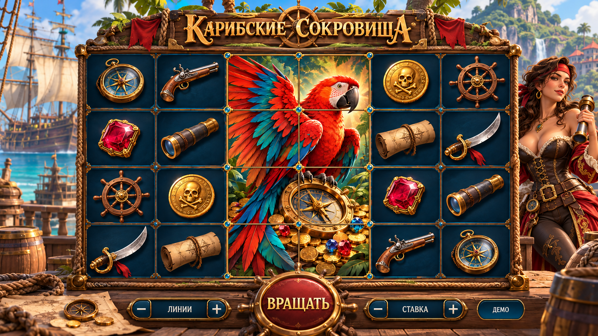

# Карибские сокровища

Порядок реализации и критерии готовности: [план разработки](development-plan.md).
Рабочая механика и математические параметры: [правила версии 1](rules.md).

## Принято пользователем

26 октября 2026 года для новой игры с гигантскими символами выбран третий визуальный концепт «Карибские сокровища». Пользователь попросил сделать взрослую пиратку более сексуальной.

- Визуальный стиль: яркое морское приключение с качественной стилизованной 3D-графикой.
- Окружение: солнечный карибский порт, бирюзовая вода, пальмы и парусные корабли.
- Материалы и цвет: тёплое дерево, канаты, латунь, глубокий синий фон поля и насыщенные красные акценты.
- Визуальный акцент концепта: большой красный попугай над компасом и золотом, занимающий несколько клеток поля.
- Героиня: взрослая пиратка в красном камзоле. Правка делает образ более соблазнительным через облегающий корсет, открытые плечи, выразительный силуэт, уверенную позу и кокетливую улыбку.
- Обычные символы на эскизе: компас, штурвал, сабля, подзорная труба, пистолет, монета, карта и рубин.

## Статус эскиза

Это ориентир оформления. Правила версии 1 квалифицированы, независимый модуль подключён к общему кошельку и настоящему host с чатом. По концепту подготовлены порт и два состояния взрослой героини, обновлены символы и оформление, добавлены анимация и звук. [Итог реализации и ревью](final-review.md); [исторические результаты этапа 3](stage3-verification.md).

Утверждённая основная механика: гигантские символы. Разработка начинается с определения правил и математики; визуальная концепция не задаёт вероятности исходов или денежные выплаты.

## Происхождение изображения

- Инструмент: встроенный ImageGen.
- Тип: правка третьего визуального концепта, показанного в этом чате.
- Исходная композиция: яркий карибский порт, гигантский попугай и взрослая пиратка справа от игрового поля.
- Точный запрос правки: [prompt.txt](prompt.txt).
- При правке сохранены игровое поле, символы, рамка, надписи и кнопки.
- Изображение сохранено без изменений из результата генерации.

## Границы будущего модуля

Игра имеет независимый клиентский модуль `games/caribbean-treasures/` по [правилам модулей](../../game-modules.md). Общие кошелёк, транспорт, сохранение и восстановление раунда остаются у host и backend. Политика RTP зарегистрирована, разрешённые ставки, режимы и полные бонусные продолжения квалифицированы по [правилам квалификации](../../game-math/qualification.md).
