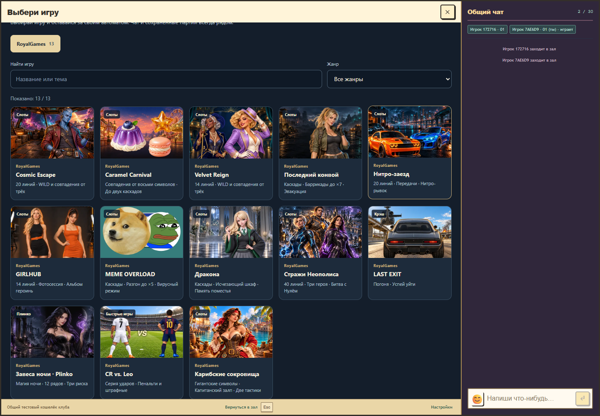
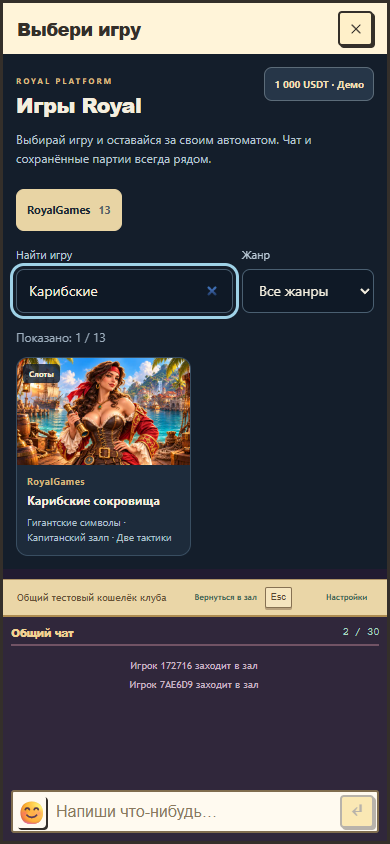

# Обложка «Карибских сокровищ» в каталоге

28 октября 2026 года. Вместо пустой гавани на карточке показана взрослая пиратка из игры с подзорной трубой на фоне карибского порта. Отдельная широкая обложка создана встроенным ImageGen с сохранением утверждённого лица, костюма и окружения. Голова и рука с трубой помещаются в безопасную область карточки.

Общий каталог теперь получает изображение игры из штатного реестра обложек, без прежнего принудительного выбора `harbor.webp`. Размер готового WebP 512×320, 74 208 байт при бюджете 75 000. Весь реестр занимает 1 754 688 байт при бюджете 1 800 000. [PNG-мастер](../../../games/caribbean-treasures/assets/catalog-cover.png), [точный запрос](../../../games/caribbean-treasures/assets/catalog-cover-prompt.md), [оптимизированная обложка](../../../public/assets/royal-catalog/studio-caribbean-treasures.9f55140c4e61.webp).

Проверены воспроизводимый экспорт с `--check`, полная сборка, 7 проверок всех 118 пакетов и один целевой браузерный сценарий настоящего host с чатом: изображение на компьютере и телефоне, поиск, открытие игры, возврат в каталог и восстановление того же принятого раунда без повторного списания. [Компактный отчёт](catalog-cover-verification.json).

Игровой пакет остаётся `1.3.2-734dfee8cfc0`. Математика, анимации, игровые ресурсы, оформление стартовых экранов физических кабинетов и общий кошелёк не менялись. Production не публиковался. Локальный preview оставлен работать.
