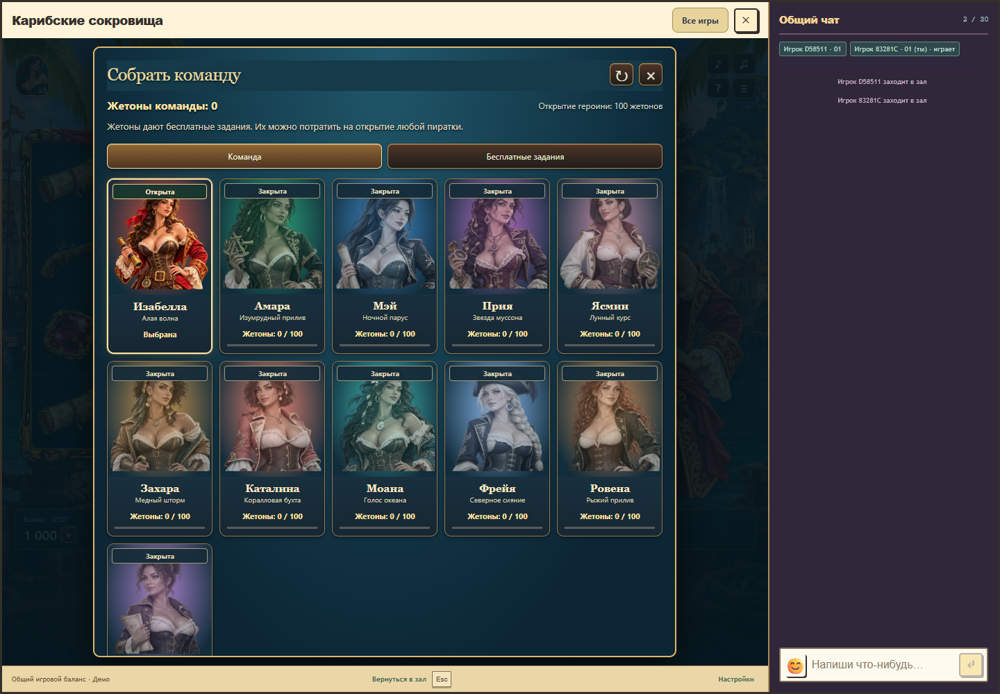
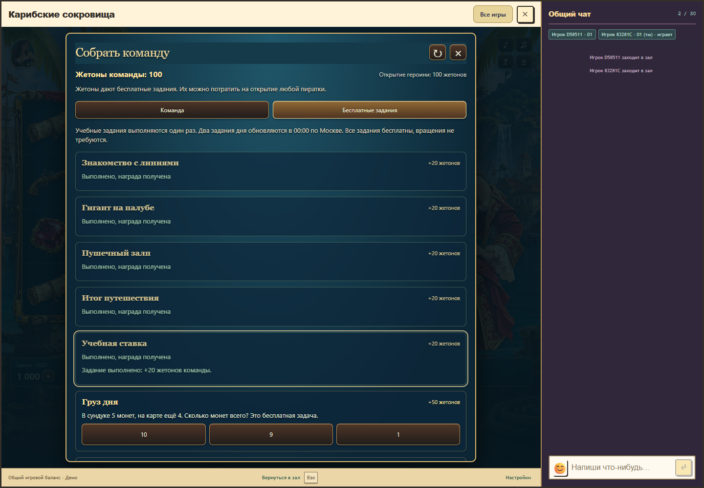
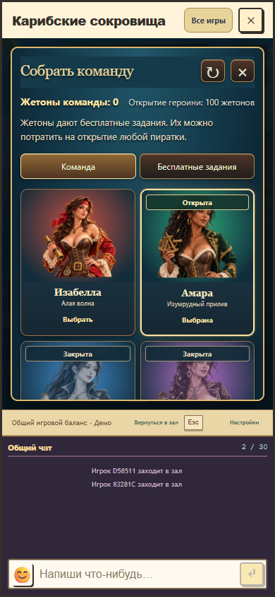

# Карибские сокровища 1.5.0: открытие команды

29 октября 2026 года. Изабелла доступна сразу. Десять новых пираток открываются навсегда за 100 жетонов команды каждая, в выбранном игроком порядке. Пять учебных задач дают по 20 жетонов один раз; два задания дня дают по 50 и обновляются в 00:00 по Москве. Неверный ответ можно исправить. Жетоны являются бесплатными очками профиля и используются для косметических открытий.

В галерее видны открытые и закрытые героини, стоимость, прогресс, вкладка заданий и доступные при прокрутке кнопки обновления/закрытия. Ответ и подтверждённая награда показываются у соответствующего задания. Новое открытие получает короткий тёплый акцент, отключённый при уменьшенном движении. Внешность и восемь реакций каждой героини сохранены.

Владение и выбранный персонаж сохраняются в общей базе аккаунта. Очистка browser storage не сбрасывает коллекцию; другой клиент с тем же аккаунтом читает её с сервера. Старый локальный выбор из 1.4.0 считался бесплатным просмотром и не является доказательством открытия. Сервер проверяет аккаунт, ответ, день, владение и стоимость. Учебная задача и задание дня дают награду только один раз, повторное открытие не списывает очки повторно, одновременные запросы не создают отрицательный остаток. Неопределённый ответ проверяется обновлением коллекции. Страница не блокируется навсегда при сетевом зависании: запрос ограничен десятью секундами.

Коллекция зарегистрирована как действительно не принимающий ставки компонент: [политика](collection-policy.md). Действующая квалификация оплаченной игры, правила/progress 1, все стоимости, выплаты и бонусные продолжения сохранены. Профильные операции не вызывают кошелёк и не расходуют энтропию игры. Недоступность нового API оставляет слот доступным с Изабеллой. Публикация этого клиента требует обновления общего backend перед независимым пакетом; production в этой работе не менялся.

Проверенные исходники `75b24710289f78797ca91a8000712d4705118cac`, основа `a1741cebd6d56b2f030d346951167b9b4d2c31a5`. Пакет `1.5.0-b6716c556288`, API/rules/progress 1/1/1. Результаты: [collection-verification.json](collection-verification.json).

Полная сборка и RTP gate проходят: 12 квалифицированных профилей, 114 неизменённых legacy-модулей. Пройдены 48 тестов оплаченной игры, математики, совместимости и кошелька; 11 тестов аккаунта и новой коллекции; 10 проверок ресурсов и целостности 118 пакетов. Браузер проверяет настоящий host с чатом, открытие за задачи, неправильный ответ, сохранение после очистки browser storage, потерянный ответ открытия во время принятого бонуса, сбой API, все 60 сочетаний новой героини и реакции, отмену загрузки, размеры окна, шапку и освобождение собственных звуковых источников. Мобильное отображение проверено размером окна Chrome, физические телефоны отдельно не тестировались.

В расширенном историческом наборе аккаунтов и кошелька обнаружены прежние несоответствия текущему исходному коду: отсутствуют `server/accountEvents.ts` и `server/accountLeases.ts`, тесты ожидают `events.connect` у исходного `EventEmitter`, а старый тест прямого пополнения ожидает принятия операции, которую неизменённый route уже отклоняет статусом 410. Набор дал 15/21, включая шесть неуспешных записей с родительским тестом. Отсутствие файлов, исходный `EventEmitter` и правило 410 подтверждены в исходной Git-основе. Эти контракты здесь не менялись; не заявляется прохождение всех исторических тестов проекта.

При проверке звуков исправлена область измерения: возвращение в зал создаёт его собственные шаги и эффекты через общий AudioContext. Теперь проверка учитывает источники, созданные пакетом Caribbean, подтверждает ненулевое число созданных голосов и их полное завершение после закрытия. Приведённое отклонение звукового акцента измеряет браузерное планирование относительно расчётного аудиовывода, а не задержку физического динамика.

Локальный API обновлён с предварительной проверкой кандидата. Исходная временная база, вход, денежный баланс и история операций сохранены; проверенные снимки до и после совпали. Локальный preview продолжает работать. После перезапуска залу может потребоваться переподключение: открыть `http://127.0.0.1:5234/`, затем автомат и портрет в шапке.

