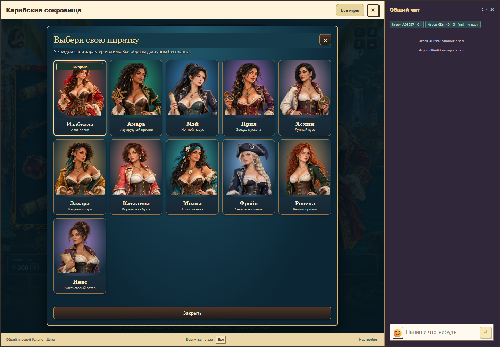
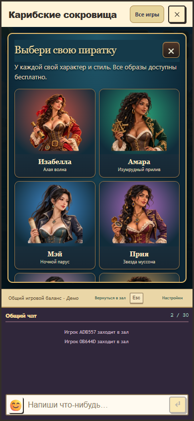
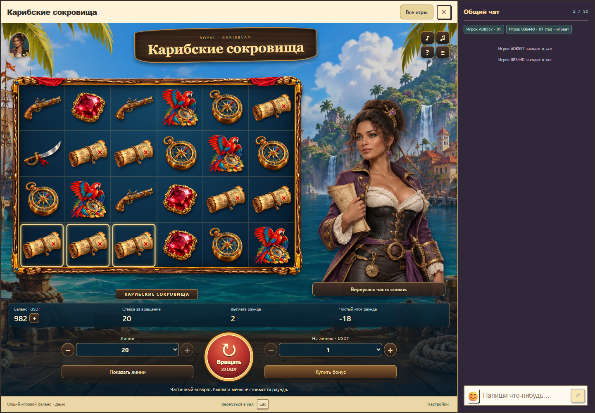

# Карибские сокровища 1.4.0: десять новых пираток

В игре появились десять дополнительных взрослых героинь с индивидуальными лицами, причёсками, костюмами и аксессуарами. Исходная Изабелла сохранена. Все 11 образов выбираются бесплатно через портрет слева в шапке. Выбор запоминается отдельно для аккаунта в этом браузере.

| Героиня | Направление образа | Отличительные детали |
| --- | --- | --- |
| Амара | Афрокарибская внешность | Тёмная кожа, объёмные локоны, золотые бусины, изумрудный камзол, секстант |
| Мэй | Восточноазиатская внешность | Высокий чёрный хвост, тёмно-синий камзол, бирюзовый корсет, свиток |
| Прия | Южноазиатская внешность | Тёмная коса, фиолетовая парча, многослойные золотые украшения, компас |
| Ясмин | Западноазиатская внешность | Короткое гладкое каре, выразительный профиль, белый камзол, астролябия |
| Захара | Североафриканская внешность | Кудри и выбритый висок, охристый камзол с бирюзой, сабля |
| Каталина | Латиноамериканская внешность | Короткое каштановое каре, родинка, коралловый камзол, жемчуг |
| Моана | Полинезийская внешность | Длинные чёрные волосы, более крепкий силуэт, бирюзовый камзол, канат |
| Фрейя | Североевропейская внешность | Светлая коса, голубые глаза, синяя треуголка, серебряная отделка |
| Ровена | Ирландский образ | Медные кудри, веснушки, зелёные глаза и камзол, поясная сумка |
| Инес | Смешанная карибская внешность | Высокая кудрявая причёска, аметистовый камзол, золотой гребень, карта |

Для каждой новой героини подготовлены восемь кадров: ожидание, улыбка при положительном итоге, моргание, внимание к полю, удивление от залпа, приветственный жест бонуса, спокойная реакция на потерю/частичный возврат и радость от крупного положительного итога. Движения, подписи и звук остаются связаны с подтверждённым исходом полного раунда. Персонаж в игровом поле и портрет переключаются вместе после декодирования всего набора. Ошибка загрузки сохраняет текущий образ; недоступный сохранённый образ при открытии заменяется Изабеллой. Закрытие, отмена и смена аккаунта исключают позднюю подстановку чужого выбора.

Использован встроенный ImageGen. [Мастера и точные запросы](../../../games/caribbean-treasures/assets/crew/), [набор запросов](../../../games/caribbean-treasures/assets/crew/prompts.json). Это вымышленные взрослые персонажи; возраст в запросах от 28 до 36 лет. Восемь кадров извлекаются из каждого листа отдельным [воспроизводимым экспортёром](../../../scripts/export-caribbean-crew.mjs). При экспорте исключаются восемь пикселей по краям ячеек, чтобы соседний кадр не оставлял линию. 80 кадров и 11 маленьких превью занимают 8 490 768 байт при отдельном бюджете 12 MiB. Начальная очередь остаётся из 16 изображений; новые наборы загружаются по выбору.

Проверенные исходники: `6437cbdc76b113c9c31e4de14ad7b69d6e7b009a`. Основа `origin/main`: `0fa105418d367c9ec67ec95e1b8e8bbed4cb5ebf`. Пакет `1.4.0-2c6b41ca2da3`, API/rules/progress 1/1/1. Математика, ставки, выплаты, кошелёк, музыка и серверные правила не менялись. Production не изменялся.

[Результаты проверок](crew-verification.json): полная сборка с RTP gate, 48 математических/серверных/кошельковых тестов, 10 проверок ресурсов и целостности модулей, нативные браузерные сценарии выбора всех героинь, 60 сочетаний персонаж/реакция, ошибки загрузки, отмены, восстановления, доступности шапки, адаптивности с чатом и звукового жизненного цикла. Мобильная компоновка проверена размером окна Chrome; физические телефоны и субъективная привлекательность отдельно не измерялись.

Чтобы загрузить обновление локально, закрыть только окно автомата и открыть «Карибские сокровища» из каталога, затем нажать портрет слева в шапке.

