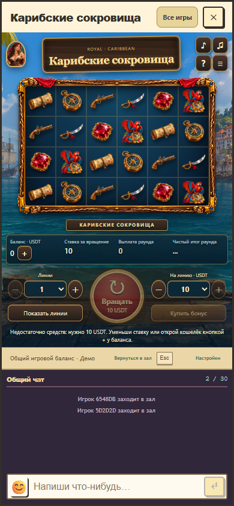

# Исправление вращения при нулевом балансе, версия 1.3.1

28 октября 2026 года. Пользователь воспроизвёл проблему в локальном Royal: одна линия, ставка на линию 10 USDT, баланс 0. Нажатие «Вращать» не давало видимого результата. Сервер правильно отклонял неоплаченную ставку, но автоматическое обновление общего клиента убирало сообщение об отказе.

## Изменение

Кнопка оплаченного вращения теперь недоступна, если подтверждённых средств недостаточно для действующей цены. Постоянная подпись указывает требуемую сумму и предлагает уменьшить ставку либо открыть общий кошелёк кнопкой + рядом с балансом. Игра использует последний баланс общего host, поэтому пополнение обновляет уже открытое окно. Подтверждённый отказ сервера остаётся видимым после фонового обновления и снимается при новой попытке, изменении настроек или баланса.

Проверка средств применяется к оплаченному началу. Выбор тактики и бесплатные продолжения принятого бонуса доступны при нулевом остатке. Цена берётся из прежнего `caribbeanInitialCost`; сервер по-прежнему подтверждает ставку и единственное списание. Отдельный кошелёк не создаётся. Математика, вероятности, стоимость, выплаты, бесплатные серии и API/rules/progress 1/1/1 сохранены.

Для запущенного локального preview добавлена страница `http://127.0.0.1:5234/scripts/caribbean-fund-local.html`. После входа её явная кнопка начисляет 1000 бесплатных демомонет через существующий аутентифицированный тестовый маршрут стенда. Страница находится в инструментах разработки и не включается в production-сборку. Она не включает пополнение на боевом сервере.

## Проверка

Новый браузерный сценарий проходит настоящий host, общий кошелёк и подключённый чат:

1. При балансе 0 одна линия со ставкой 10 недоступна, причина видна на компьютере и телефоне; списаний нет.
2. Кнопка + открывает существующий общий кошелёк.
3. Пополнение до 1 обновляет открытое окно; ставка 10 остаётся недоступной, ставка 1 становится доступной ровно при достаточном балансе.
4. Оплаченное вращение на одной линии списывает 1 один раз. После входа в бонус баланс равен 0, но выбор тактики и шесть бесплатных продолжений работают.
5. Отказ сервера 409 не исчезает после автоматического GET и не создаёт повторного списания; изменение ставки убирает прежнее сообщение.

Результаты итогового общего прогона и версия пакета записаны в [final-verification.json](final-verification.json). Основной набор математики, полного раунда, совместимости, транспорта, ресурсов и кошелька содержит 47 проверок. Тесты всей исторической UI-коллекции не объявляются прошедшими.

Во время ручной проверки исходной локальной учётной записи подтверждены нулевой баланс и исчезающее сообщение; через локальный preview начислены 1000 демомонет. После обновления вкладка запросила повторный вход. Пользователь отложил этот вход, поэтому ручное вращение в его аккаунте не объявляется проверенным. Исправление проверяется отдельными одноразовыми аккаунтами на том же стенде. Локальный сервер оставлен работать по запросу пользователя.
