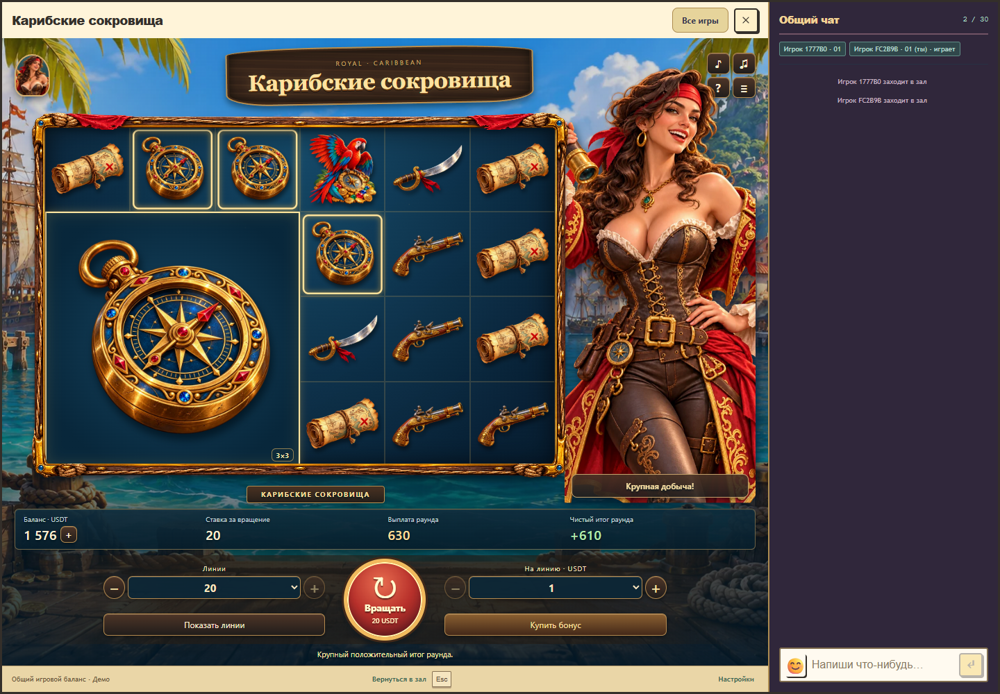
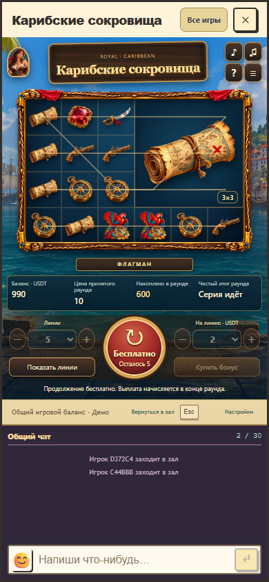

Текущее обновление 1.5.0: [открытие команды за бесплатные задания](collection-review.md), [проверки](collection-verification.json).

Обновление 1.4.0: [десять новых пираток и выбор героини](crew-review.md), [проверки](crew-verification.json).

Исправление 1.3.3: [кнопки над персонажем](header-controls-review.md), [проверки](header-controls-verification.json).

Исправление компоновки 1.3.2: [полный портрет и адаптация окна](framing-review.md), [проверки](framing-verification.json).

# Карибские сокровища 1.3.1: анимации и работа с балансом

28 октября 2026 года. Обновление реализовано по [утверждённому концепту](concept.png) и проверено в настоящем окне Royal с общим кошельком и подключённым чатом. Проверенные программные исходники: `e6b1bfd3162ea7a5340edbf24377c197306bf0f2`, основа `origin/main` при проверке: `d76746b1a5d22a4b5b15c2f2934aea7c052568b5`. Пакет `1.3.1-ab7f323d092e`, API/rules/progress 1/1/1. Production в этой работе не изменялся.

## Исправление вращения при нехватке средств

При нулевом балансе кнопка раньше отправляла ставку, сервер её отклонял, а фоновое обновление сразу скрывало сообщение. Теперь причина видна постоянно, оплаченный старт заблокирован до достаточного баланса, а + рядом с суммой открывает общий кошелёк. Пополнение обновляет уже открытое окно. Подтверждённые отказы сервера сохраняются, неопределённые операции остаются под управлением общего механизма повтора. Бесплатная серия доступна при нулевом остатке. [Подробности и воспроизведение](empty-balance-review.md).

## Новые движения и реакции

Для взрослой героини подготовлены шесть дополнительных согласованных мастеров: моргание, внимательный взгляд на поле, удивление от залпа, открытый жест при выборе бонуса, спокойная реакция на проигрыш и частичный возврат, радость от крупного положительного итога. Вместе с прежними нейтральной и победной позами используются восемь состояний. Между выражениями работает плавный переход; жесты и спокойное дыхание находятся на отдельных слоях. В ожидании героиня моргает и иногда переводит взгляд. На телефоне те же состояния использует портрет в заголовке.

Колонки получают короткую посадку, непрерывный гигант появляется с мягким завершением движения, а залп сопровождается локальной отдачей и ростом до точных координат сервера. Одна реально оплаченная цепочка обводится вне изображения гиганта. Целочисленный счётчик выплаты обновляется плавно. Золотые частицы появляются только при положительном итоге полного оплаченного раунда. Длительности 220/340/380/420 мс выбраны для этой игры и не объявляются научными порогами.

Реакции привязаны к подтверждённой ревизии и событию. Восстановление раунда не запускает их заново. Закрытие, пауза, скрытие, смена аккаунта и открытие модального окна останавливают принадлежащие персонажу таймеры и движения. Уменьшенное движение сохраняет статичное выражение и смысл результата.

[Карточки событий персонажа](../../../games/caribbean-treasures/character-motion.md). [Шесть точных запросов ImageGen](../../../games/caribbean-treasures/assets/character-prompts.md). PNG сохранены в `games/caribbean-treasures/assets/source/`, runtime WebP в `public/assets/caribbean-treasures/`.

Видео длится около 15 секунд, без звука. Это монтаж настоящего окна Royal на выбранных сохранённых серверных сценариях: положительный итог, бонус, залп, крупный итог, частичный возврат, проигрыш и возврат стоимости. Исходы не подставлялись в клиент. Выборка предназначена для проверки представления и не показывает частоту выигрышей или RTP. Экспорт: `node scripts/export-caribbean-motion-preview.mjs <ffmpeg-path> artifacts/work/caribbean-empty-balance` после браузерной проверки.

## Изменения

Шесть плоских SVG заменены объёмными иллюстрированными картой, компасом, пистолетом, саблей, рубином и попугаем. Добавлена деревянная рама с канатами, латунью, синими камнями и красной тканью. Пиратка увеличена до заметной фигуры справа, заголовок оформлен как деревянная вывеска, кнопка вращения стала круглой красной с золотым ободом. Линии и ставка располагаются по её сторонам и переключаются выбором либо кнопками плюс/минус по прежним разрешённым значениям.

Обычная клетка и гигант используют один качественный мастер. Гигант остаётся непрерывным изображением, выигрышные рамки не режут его на клетки. На телефоне портрет переносится в заголовок; поле, денежные значения, управление и общий чат помещаются в окне.

Декоративные полосы вращаются во время ожидания и последовательно открывают подтверждённые колонки. Затем появляются гигант, точное увеличение залпом, короткий тёплый акцент с дымом и целочисленный счётчик накопленной выплаты. Показ можно пропустить. Изменение уменьшенного движения во время вращения немедленно показывает подтверждённый итог.

Звуковое оформление заменено после замечания пользователя о звучании старой мелодии. Фон: готовая инструментальная оркестровая запись **Blackmoor Tides** композитора **Matthew Pablo**, опубликованная на [OpenGameArt](https://opengameart.org/content/blackmoor-tides-epic-pirate-battle-theme) под CC BY 3.0. Длительность петли около 2 минут 16 секунд. Используется опубликованная инструментальная аранжировка. Автор, источник, лицензия и сделанные обработки доступны в правилах игры и [файле указаний](../../../games/caribbean-treasures/assets/audio-credits.md).

Вместо синтеза тонами используются 11 готовых эффектов Kenney и Thimras: дерево, металл, монеты, механизм и скрип сундука, пушечный удар. Источники CC0, точное сопоставление записано в runtime credits.json. Старые осцилляторы и генератор мелодии полностью удалены. Все 12 записей занимают 2 917 441 байт, стерео AAC: 160 кбит/с музыка и 128 кбит/с эффекты. Сохраняется отдельная настройка музыки; под важными событиями она приглушается. Проигрыватель использует общий AudioContext и выход, загружает собственные записи заранее и не воспроизводит старые события после запоздалой загрузки.

[Карточка событий и ограничений](../../../games/caribbean-treasures/feedback.md). [План улучшения по референсу](../../../games/caribbean-treasures/reference-polish.md). [Запросы исходного оформления](../../../games/caribbean-treasures/assets/reference-prompts.md). Шестнадцать runtime WebP суммарно занимают 3 305 236 байт при бюджете 5 MiB.

## Исправления при проверке

| Найденная ситуация | Исправление |
| --- | --- |
| Край увеличенной героини создавал горизонтальный скролл | Границы декорации сохранены внутри игрового окна, проверены desktop и mobile |
| Несколько элементов управления внутри одного label | У каждого select своя явная подпись; кнопки шага имеют самостоятельные названия |
| Первый сэмпл шума мог дать резкий щелчок при старте между границами сэмплов | Начальная громкость собственного голоса явно установлена в ноль до планирования атаки |
| Старое звучание напоминало ранние компьютерные игры | Процедурная музыка заменена на готовую оркестровую запись; эффекты воспроизводятся из подготовленных файлов |
| Ошибка сети или закрытие до окончания декодирования | Загрузка повторяется по следующему действию; закрытие отменяет запросы и исключает поздний запуск музыки |
| Запланированное восстановление музыки после приглушения могло пересечь её выключение | Выключение музыки отменяет её будущие изменения громкости и останавливает только музыкальные голоса |
| Настройка уменьшенного движения меняется во время показа | Ожидания и украшения отменяются сразу, серверный результат сохраняется |
| Номер оплаченной линии начинается с нуля | Новая обводка строится по подтверждённым `wins.positions`, без смещения индекса и дорисовки неоплаченного продолжения |
| Подпись реакции могла остаться после скрытия окна | Контекст видимости сбрасывает позу, подпись и её последовательность; возврат не повторяет событие |

Математика, вероятности, оплаченные стоимости, бесплатные серии, выплаты, прогресс, совместимость и транспорт не менялись. Действующее [доказательство квалификации](../../game-math/qualifications/caribbean-treasures-v1.json) сохраняется: 64 сочетания и 4096 полных серверных воспроизведений. Кошелёк, журнал и сервер остаются общими. Частичный возврат не получает победной фанфары; положительный итог определяется относительно полной принятой стоимости раунда.

## Проверки итоговой версии

| Область | Результат |
| --- | --- |
| `npm run test:caribbean` | 47 / 47: математика, полный раунд, сценарии, ресурсы, представление, протокол, совместимость и кошелёк |
| Математический gate полной сборки | Успех, действующая квалификация сохранена |
| Caribbean в общем журнале Nile | Все три оплаченных режима проверены внутри набора из 47 тестов |
| Независимые модули и ресурсы | 7 / 7, проверены все 118 активных пакетов и хеши их файлов |
| TypeScript игры и `npm run check:finance` | Успех |
| `npm run build` | Успех: RTP, TypeScript, модули, host, backend, reconciliation и payments |
| Chrome, `playwright.caribbean.config.ts` | 11 / 11 в одном итоговом прогоне, без пропусков, повторов и flaky |

Браузерный прогон покрывает настоящий host с чатом на 1440×1000 и 390×844, все наборы линий и ставки, кнопки изменения настроек и их границы, натуральный бонус, обе покупные серии, точную цену, двойное нажатие, потерянный ответ, закрытие и повторное открытие, перезагрузку, смену аккаунта, английский язык, итоговые клетки сервера, залп, пропуск, mute, нулевую громкость, отдельное выключение музыки, скрытие вкладки, переключение уменьшенного движения во время вращения и освобождение буферных источников после закрытия. Дополнительно проверены моргание, взгляд, отсутствие повторной реакции, очистка таймера персонажа, все виды итогов на сохранённых серверных сценариях и видеозапись. Проверки записанных звуков и ошибок их загрузки сохранены.

[Компактный отчёт](final-verification.json). [Каждый измеренный акцент](playback-measurements.json): максимальное абсолютное отклонение и время подготовки приведены в отчёте, инженерная цель этой игры 50 мс выполнена. Это планирование относительно расчётного аудиовывода, а не измерение физического динамика или Bluetooth. [Реакции на сохранённых сценариях](character-measurements.json).

[Аудиоизмерения](audio-measurements.json): 19-секундный offline-рендер настоящего проигрывателя с новыми записями, 44,1 кГц; пик 0,31255 при пределе 1, RMS 0,02571, хвост заканчивается тишиной. Проверены декодирование всех 12 клипов, отсутствие генератора осцилляторов, хеши, размер, границы файлов и фактическое воспроизведение музыки, вариантов дерева и пушечного удара. Максимальный шаг соседних сэмплов записывается как характеристика сигнала; общий старый порог для синтезатора не используется как критерий качества записанных ударных. Наличие и техническая чистота сигнала не подтверждают субъективную приятность.

## Экран внутри Royal

Снимки получены через настоящий host на управляемом тестовом входе в бонус. Они не показывают частоту выигрышей.

## Границы и выпуск

[Музыка и эффекты для прослушивания](audio-preview.wav). Проверка на физических динамиках телефона, проводных наушниках и Bluetooth, оценка утомления и сравнение вариантов участниками пока не проводились. Исторический UI-набор всего репозитория не объявляется прошедшим: эта проверка использует отдельную конфигурацию игры.

Исходники и проверенный пакет готовы. Контракты host/backend и finance runtime сохраняются. Публикация выполняется отдельно по `docs/release-process.md`. [Локальная очистка и исключения хранения](local-storage-cleanup.json).
