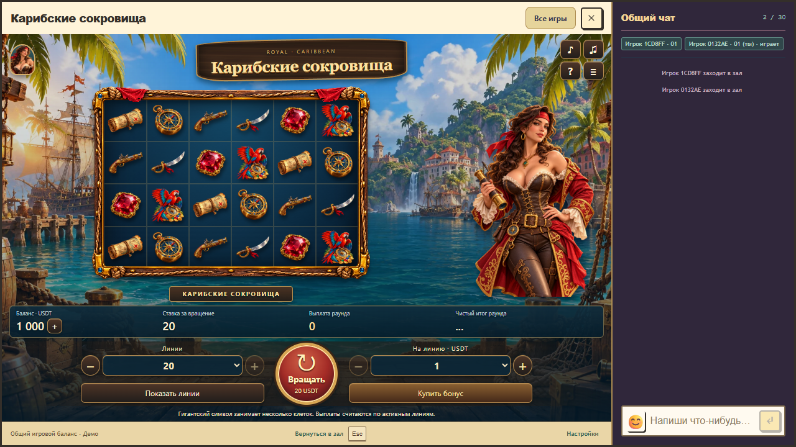
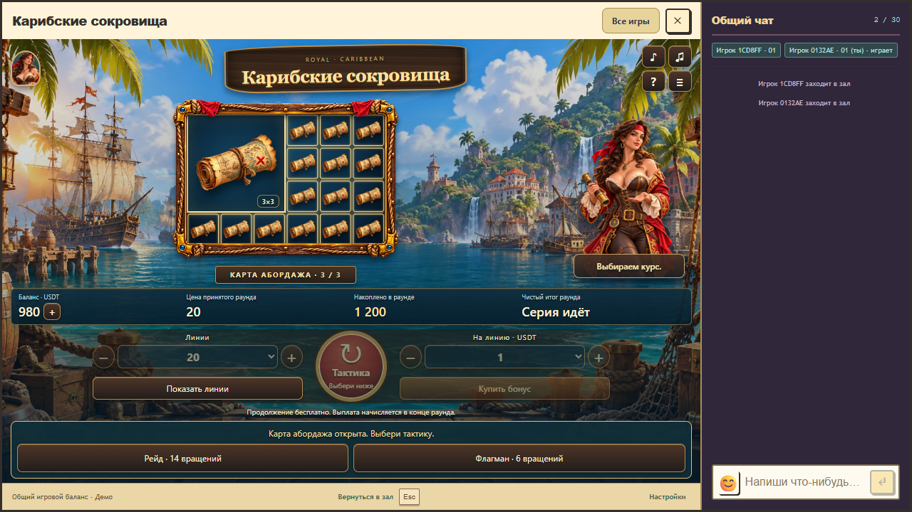
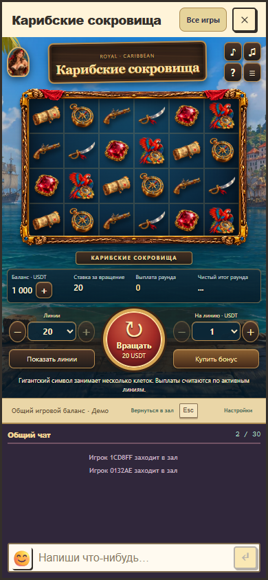

# Исправление обрезания, версия 1.3.2

28 октября 2026 года. Пользователь сообщил об обрезании заголовка и пиратки. Подготовлена проверка настоящего host с подключённым чатом на 11 размерах окна от 342×245 до 1440×1000, включая короткий ноутбук и узкое окно предпросмотра.

## Причина и изменение

Прежняя колонка пиратки имела фиксированную ширину 275 px, высоту 112% поля и заполняла контейнер через `object-fit: cover`. На 1440×1000 обрезались 148,33 px ширины изображения, на 1280×720 обрезались 84,5 px высоты. Выступающий сверху портрет также заходил в область шапки.

Теперь изображение целиком вписывается в область поля. Ширина портрета и место справа от барабанов ограничены одновременно доступными шириной и высотой сцены, вокруг движения есть внутренний отступ. Портрет не выступает над сценой. Восемь выражений, жесты, музыка и правила сохранены; новые растровые материалы не создавались.

Заголовок ограничен своей ячейкой и переносится, а на коротком экране шапка и управление занимают меньше высоты. Для ширины не более 640 px чат расположен под игрой независимо от ориентации. При одновременно малой высоте используется вертикальная прокрутка, чтобы интерфейс оставался читаемым. При 342×245 прежний чат оставлял игре лишь 86 px и возникал горизонтальный выход содержимого на 98 px. Новая компоновка отдаёт игре всю ширину и позволяет прокрутить к управлению и вводу чата.

Прежняя проверка только горизонтальной прокрутки корня не обнаруживала обрезание внутри портрета. Новая проверка измеряет исходное соотношение сторон и фактически видимую область изображения, положение текста, горизонтальные границы и доступность управления и чата в коротком окне. Дополнительно проверено окно выбора бонуса на 1280×720 и завершение принятой серии.

## Результаты

[Измерения и итоговый набор проверок](framing-verification.json). В этом исправлении выполняется целевой браузерный набор: компоновка на 11 размерах, нулевой баланс и одна линия, натуральный бонус и восстановление с чатом, полный показ с залпом и прерываниями, жизненный цикл персонажа. Полный предыдущий набор версии 1.3.1 хранится в [final-verification.json](final-verification.json).

Открытое окно игры сохраняет свою загруженную версию до закрытия. Чтобы получить обновлённую локальную компоновку, закрыть игровое окно и снова выбрать «Карибские сокровища»: общий loader каждый раз проверяет актуальный указатель пакета. Серверное состояние принятого раунда восстанавливается через общий клиент.

Математика, стоимости, вероятности, выплаты, общий кошелёк и контракты 1/1/1 не изменялись. Production не публиковался. Работающий локальный preview и его текущие данные оставлены по запросу пользователя.
