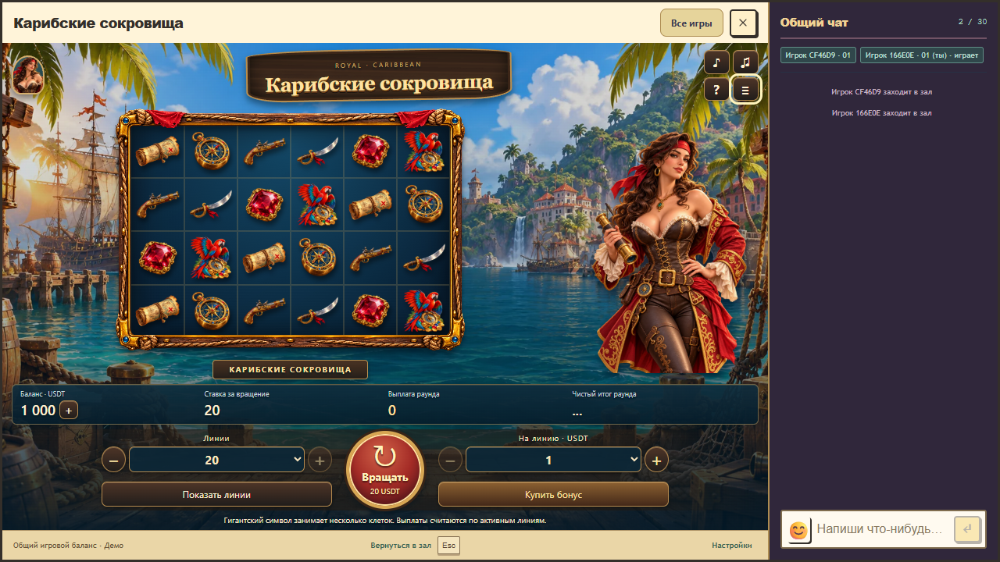

# Caribbean Treasures 1.3.3: доступные кнопки шапки

28 октября 2026 года. Исправлено перекрытие кнопок музыки, звуков, правил и истории пираткой. Шапка располагается выше отдельного слоя игрового поля и персонажа; модальные окна остаются выше шапки. Геометрия, иллюстрации, звук, математика и кошелёк не менялись.

Проверенные исходники: `8cf3fd5a8d1c9799928ca722624bb5e52fbaa739`, основа `d2588ccc449de1e6cb3dac567413b0b5f413e728`. Локальный пакет `1.3.3-54b6b0c0cc94`, API/rules/progress 1/1/1. Production не изменялся.

Новая браузерная проверка воспроизводит перекрытие: временно перемещает непрозрачную часть лица в область кнопок и сравнивает пиксели внутри каждой кнопки с исходным снимком. На прежнем CSS проверка падает, после исправления все четыре области совпадают. Это принудительное положение используется только тестом.

В настоящем host с общим чатом проверены переключатели музыки и звука, открытие и закрытие правил и истории на 1440×1000, 1280×720 и 390×844. Модальное перекрытие проверено отдельно. Эти действия не создают ставок. Повторно прошли существующие проверки компоновки на 11 размерах окна и проверки анимации, залпа, пропуска и освобождения звуковых ресурсов. Нативный браузерный прогон: 3/3, без повторов и пропусков. Ресурсы и целостность модулей: 9/9. Полная сборка, включая RTP gate и TypeScript: успешно.

[Компактные результаты](header-controls-verification.json). Чтобы загрузить исправление в уже открытой локальной игре, закрыть только игровое окно и снова открыть «Карибские сокровища» из каталога.

