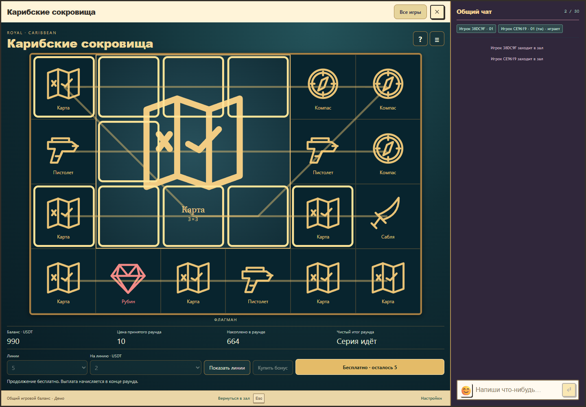
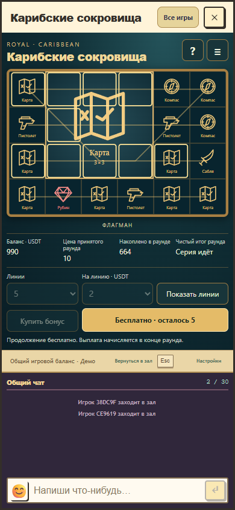

# Этап 3: рабочий модуль и общий кошелёк

Проверено 26 октября 2026 года. Результат: полностью проходимый прототип `studio-caribbean-treasures` внутри настоящего окна Royal, с чатом. Пакет `games/caribbean-treasures/`, версия `0.1.0-de10a45fd62a`, контракты API/rules/progress 1. Ставки и правила версии 1 сохранены.

## Реализация

- Поле 6×4, отдельные гигантские блоки, выигрышные клетки и отображение 1/5/10/20 активных маршрутов.
- Четыре ставки на линию, точная цена покупки, естественный выбор тактики, 14 вращений рейда и 6 вращений флагмана.
- Общие expansion-клиент, сериализация операций, идентификатор неопределённого запроса, аккаунт, кошелёк и сохранение. Отдельного хранилища баланса или сервиса игры нет.
- Серверная проверка принятых параметров, ревизии, воспроизводимого состояния и целочисленного расчёта. Один дебет при старте, бесплатные продолжения, одно окончательное начисление. Резерв определяется принятым числом линий и режимом.
- Блокировка изменения настроек во время серии, восстановление после закрытия и перезагрузки, правила, таблица выплат и история раунда.
- В каталоге появился новый слот. Число физических мест автоматов осталось 12; инвентарь независимых пакетов вырос до 118.

## Выполненные проверки

| Проверка | Результат |
| --- | --- |
| `npm run test:caribbean` | 42 / 42: математика, полный раунд, сохранённые сценарии, протокол, атомарность, повторы, кошелёк и Nile |
| `npm run test:rtp-gate` | 20 / 20: защита квалификации, исходников, покрытия и замороженной legacy-базы |
| `server-tests/finance/nile-native-games.test.ts` и `server-tests/royal-platform.test.ts` через временную PostgreSQL | 13 / 13: прежние native-игры, общий журнал, резерв, откат и каталог |
| `server-tests/independent-modules.test.ts` | 7 / 7: соответствие контрактов всех 118 пакетов и хеши каждого ресурса |
| `npm run build` | Успех: RTP, TypeScript, все пакеты, host, backend, reconciliation и payments |
| `npm run check:finance` | Успех |
| `npx playwright test --config playwright.caribbean.config.ts` | 4 / 4, Chrome, настоящий зал и живой чат |

Браузерные сценарии проверяют натуральный бонус, тактику флагмана, платные рейд и флагман, цену до списания, бесплатные продолжения, окончательный баланс, историю, потерю принятого POST-ответа, повтор того же запроса, закрытие и повторное открытие, полную перезагрузку и смену владельца аккаунта. Компьютер: 1440×1000; телефон: 390×844. Поле занимает доступную область, основная кнопка и поле чата видимы, горизонтального переполнения нет; границы гигантского блока внутри поля. Итоговые изображения осмотрены вручную.

Локальный стенд `scripts/caribbean-preview.ts` использует временную PostgreSQL, настоящий host, общий `DemoWalletStore`, реальный вход и Colyseus-чат. В нём есть изолированные тестовые пополнение и принудительный вход в натуральный бонус. В production API эти маршруты не добавлены. Общий native-журнал Nile проверен отдельно в `server-tests/finance/caribbean-native.test.ts` для всех трёх оплаченных режимов, включая восстановление runtime, резерв, повтор без новой случайности и аудит журнала.

Квалификация повторно получена штатной командой после включения серверного адаптера и транспорта в контролируемые исходники: 64 сочетания линий, ставок, режимов и тактик, 4096 воспроизведений полного раунда. [Доказательство](../../game-math/qualifications/caribbean-treasures-v1.json). `check:rtp` в сборке: 11 квалифицированных политик, 114 неизменённых legacy-модулей без утверждения об их квалификации. Вероятности, выплаты и цены новой игры на этом этапе не менялись.

[13 сохранённых сценариев](scenarios.json) охватывают проигрыш, частичный возврат, возврат стоимости, положительный и крупный итог, блоки 2×2/3×3, край поля, залп, обе натуральные и обе купленные серии. Семена и хеши полного состояния закреплены регрессионным тестом. Эти специально выбранные примеры не являются выборкой для оценки RTP.

## Визуальная проверка

## Оставшиеся этапы

Текущие векторные символы и интерфейс служат проверке механики. Отдельные ресурсы утверждённого карибского концепта, взрослая героиня, постановка анимации, звука и проверка прослушиванием ещё впереди. Этап 4 готовит графику; этап 5 добавляет согласованные события обратной связи по `docs/game-feedback.md`.

На production игра не публиковалась. Первое подключение требует совместимого host/backend с зарегистрированным новым идентификатором; дальнейшие независимые пакеты используют контракт 1. Готовность этого прототипа не заменяет выпускные, боевые и аудиовизуальные проверки готовой игры.
