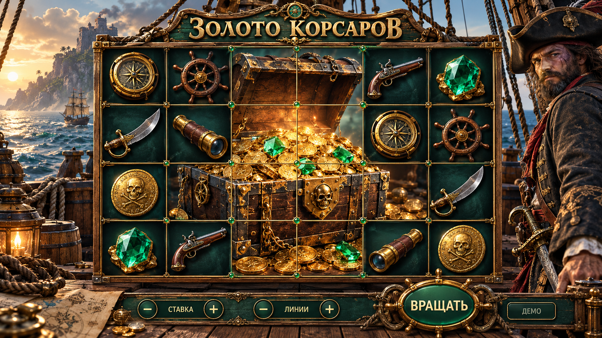

# Золото корсаров

## Принято пользователем

26 октября 2026 года выбрана пиратская тема и первый визуальный концепт «Золото корсаров» для новой игры с гигантскими символами.

- Визуальный стиль: реалистичное морское приключение.
- Окружение: палуба парусного корабля, море и остров на дальнем плане.
- Материалы и цвет: тёмное дерево, состаренная латунь, тёплое золото и глубокий морской зелёный.
- Визуальный акцент концепта: большой сундук с сокровищами, занимающий несколько клеток поля.
- Обычные символы на эскизе: компас, штурвал, сабля, подзорная труба, пистолет, монета и изумруд.

## Статус эскиза

Это ориентир оформления, не готовая игровая реализация. Точное воспроизведение компоновки, персонажа и границ большого символа не утверждено отдельно. Число барабанов, ряды, маршруты и выбор линий, размеры и частоты крупных символов, таблица выплат, бонусы, цены и целевой RTP пока не согласованы.

Утверждённая основная механика: гигантские символы. Разработка начинается с определения правил и математики; визуальная концепция не задаёт вероятности исходов или денежные выплаты.

## Происхождение изображения

- Инструмент: встроенный ImageGen.
- Тип: новый визуальный концепт интерфейса.
- Исходный запрос выбранного варианта: [prompt.txt](prompt.txt).
- Изображение сохранено без изменений из результата генерации.

## Границы будущего модуля

Новая игра получает собственный независимый клиентский модуль по [правилам модулей](../../game-modules.md). Общие кошелёк, транспорт, сохранение и восстановление раунда остаются у host и backend. Перед добавлением игры со ставкой потребуется регистрация политики RTP и квалификация всех разрешённых ставок, режимов и полных бонусных продолжений по [правилам квалификации](../../game-math/qualification.md).
