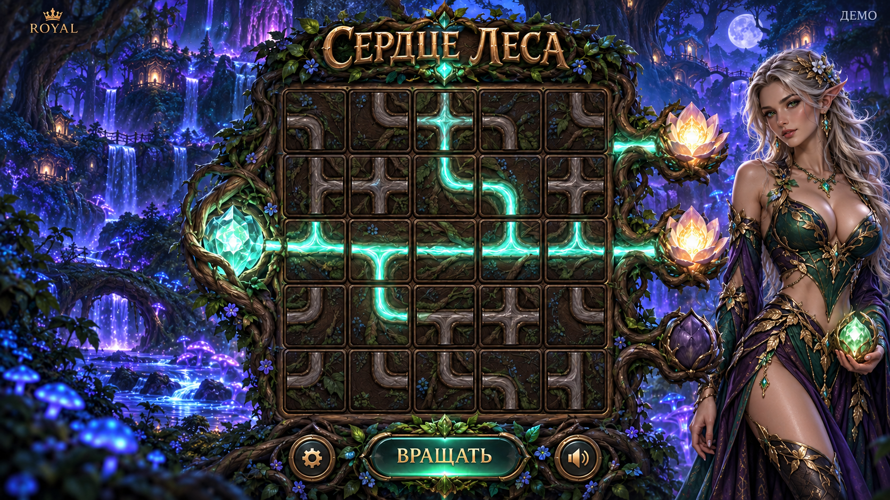

# Сердце леса: выбранный визуальный концепт

26 октября 2026 года пользователь выбрал этот вариант для новой игры Royal: «Отлично, давай её использовать».

## Зафиксированные решения

- Одна взрослая эльфийка с соблазнительным образом: серебристые волосы, заметные заостренные уши, изумрудно-фиолетовый наряд с золотыми растительными деталями.
- Мужской персонаж отсутствует. Эльфийка располагается справа и оставляет поле, маршруты, приемники и управление видимыми.
- Ночной биолюминесцентный лес, древние деревья, водопады, домики среди ветвей и сине-фиолетовая глубина фона.
- Квадратное поле 5 на 5 из отдельных деревянных плиток с корневыми соединениями.
- Слева один источник, светящееся семя. Справа три цветка-приемника. Активные маршруты светятся мятным и бирюзовым, неактивные сохраняют фактуру темной коры.
- Название «Сердце леса», оформление Royal, нижняя кнопка вращения и компактные настройки.

## Использование при разработке

Порядок реализации, проверка математики, анимации и звуки описаны в [плане разработки](development-plan.md).

Первый этап реализован: [спецификация правил и точный расчет модели v1](rules-v1.md). Профиль остается model-only до проверки реального сервера и кошелька.

Это полноэкранный художественный эталон. Для работающего интерфейса фон, персонаж, плитки, поток, цветы и элементы управления готовятся отдельными ресурсами. Нарисованные маршруты являются примером композиции, а игровые соединения и результаты рассчитываются правилами игры.

Будущий модуль использует общий host, кошелек, авторизацию и чат Royal по docs/game-modules.md. Выбор изображения фиксирует визуальное направление. Правила и вероятности модели v1 описаны отдельно; их реализация на сервере и в кошельке еще требует квалификации. Изображение не задает денежный результат.

## Происхождение

Изображение создано встроенным image_gen, затем выбран этот вариант с одной эльфийкой. Финальный запрос и контрольная сумма сохранены в [generation.json](generation.json).

- Файл: approved-concept-v1.png.
- Размер: 1672 на 941 пиксель, 3 132 034 байта.
- SHA-256: 3fb306383487d6abd38e17de4502249aa718340fa18aca2ee37ec2fa18807cbc.
