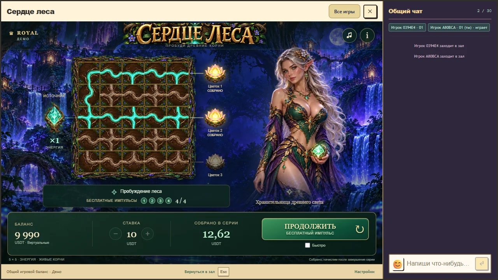
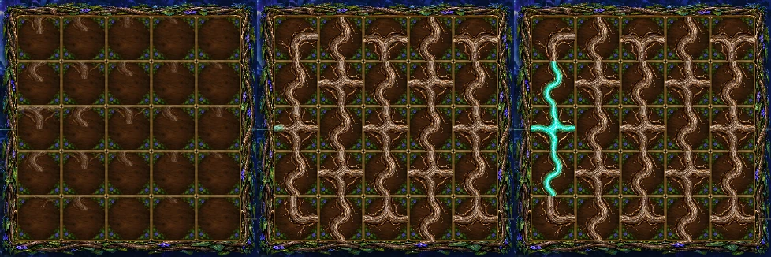
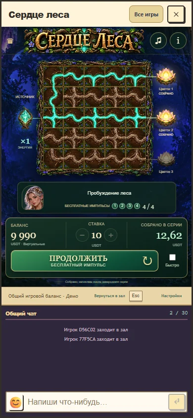

# Сердце леса: неподвижные рамки и появление поля

Исправлены два замечания пользователя. В прежнем атласе вместе с корнем находились фон, золотая рамка и угловые растения. Они поворачивались целиком, а активная клетка допускала выход изображения наружу и подъем. Новая подложка остается на месте; поворачивается только прозрачный корень внутри обрезанной области клетки. Сетка, рамки и границы теперь не двигаются во время поворота.

Прежнее появление поля использовало смещение всего на 8 пикселей и непрозрачность от 0,5. В открытом пользователем просмотре уменьшенное движение и быстрый режим были выключены. Новая последовательность заметнее: старые незакрепленные корни уходят вниз за 140 мс, затем новые входят сверху с наклоном и задержкой от строки источника за 620 мс. Быстрый режим использует 60 и 280 мс. Непрозрачность начинается с нуля, путь составляет 110% высоты клетки. Закрепленные корни бонуса сохраняют положение. Подложки остаются видны на протяжении всей последовательности. Пока API отвечает, кнопка и поле показывают ожидание, сохраняя прежний результат.

Это реальные снимки браузерного сценария. Длительности являются художественными решениями для игры, не универсальными порогами восприятия. Измерения фактических CSS-преобразований фиксируют движение на 62,7 пикселя для клетки высотой 57 пикселей, промежуточную прозрачность и неизменные границы подложки. В нормальном, беззвучном и быстром вариантах записаны соответственно 40, 33 и 16 кадров входа. У трех закрепленных корней бонуса сохраняются непрозрачность, угол и положение во время следующего появления.

Прозрачный слой корней и неподвижная подложка созданы встроенным image_gen по прежнему стилю. Перед WebP-кодированием клетки атласа обрезаны на 12 исходных пикселей с каждой стороны, чтобы все разрешенные контакты точно доходили до края. Проверка пикселей подтверждает те же четыре базовые формы и все разрешенные и запрещенные порты в обоих состояниях света. [Запросы, исходные изображения и хеши](board-v5-assets.json) сохранены вместе с ресурсами `public/assets/forest-heart/v4/roots.webp` и `tile.webp`.

Все 14 браузерных сценариев и 3 проверки рисунков и графа прошли. Проверены настоящий host с чатом на desktop и телефоне, нормальное и быстрое движение, mute, закрепление, поворот, пауза, пропуск, reduced motion, повтор операции, восстановление, точная выплата и один дебет за полную серию. Сборка и TypeScript проходят. Полная сборка повторена на объединенном коммите 81194d5. Следующая синхронизация main принесла только дополнительные независимые изменения клиента Caribbean, его проверок и отчетов; исходники Forest Heart, общего host и финансовой и математической логики не изменились. После нее повторены сборка Forest Heart и общий RTP gate, пакет сохранил тот же хеш e8e961722e67. RTP gate подтверждает 13 профилей, отдельно остаются 114 неквалифицированных legacy-позиций.

Математика, ставки, вероятности, бонусы, выплаты и кошелек этой правкой не менялись. Новая квалификация из-за оформления не требуется. Пауза, пропуск и восстановление показывают подтвержденное поле без дополнительной операции. Точная версия, коммиты и измерения находятся в [board-v5-verification.json](board-v5-verification.json). Технические проверки не заменяют художественную оценку пользователя.

[Фактический локальный просмотр](board-v5-local-preview.webp) оставлен на localhost:5296. Для восстановления входа выполнена повторная авторизация того же синтетического аккаунта и открыт отдельный адрес localhost. Сохранены баланс 10 023,1 и предыдущая выплата 6,31; новая ставка при ручной проверке не размещалась. На 127.0.0.1 были ошибки авторизации, при этом отдельная проверка API с новой тестовой сессией проходила. Код авторизации не изменялся. Исходники сохранены в ветке `codex/forest-heart-visual`, production не публиковался. [Учет временных материалов](board-v5-cleanup.json) содержит условия их удаления и сведения о сохранении в GitHub.
