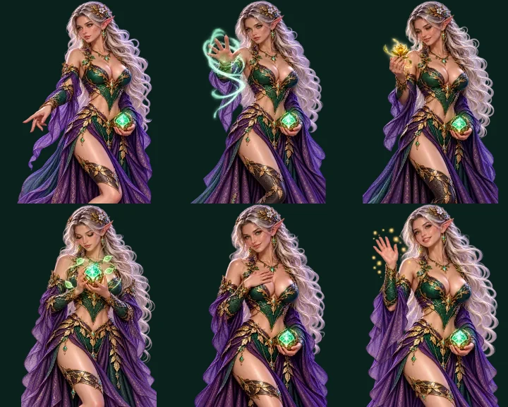
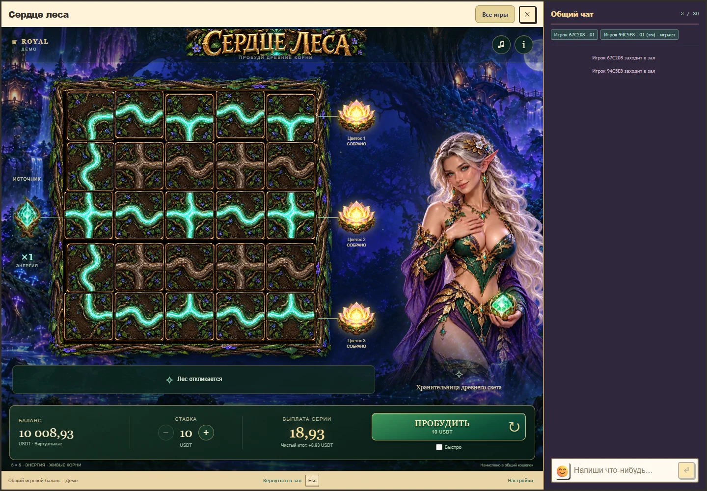
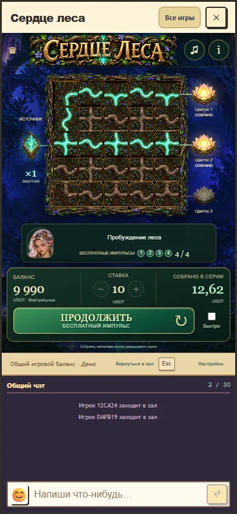

# Сердце леса: живая эльфийка, 28 октября 2026

Версия клиента 1.4 заменяет два статичных изображения набором из семи поз и отдельного кадра моргания. Эльфийка смотрит и указывает на поле при выборе, направляет энергию ладонью, принимает цветок, поднимает кристалл при входе в бонус, прикладывает руку к груди при положительном итоге и поднимает ладонь при крупном результате. Характер, костюм и лицо исходного взрослого персонажа сохранены как ориентир.

Волосы, нижняя ткань и корпус получают разные небольшие движения через деформируемую сетку; лицо остается опорой. Моргание меняет только мягкую область вокруг глаз, не переключает одежду или руки на другой кадр. Позы переходят друг в друга за 320 мс. Это иллюстрированный персонаж с деформацией и переходами, полной скелетной или трехмерной анимации здесь нет. Длительности и амплитуды являются художественными решениями для этой игры, не научными порогами.

Реакции запускаются в существующих точках звукового акцента подтвержденных событий. Открытие цветков получает короткую общую паузу 520 мс, 180 мс в быстром режиме. Более длинные реакции персонажа не блокируют управление. Частичный и нулевой возврат не вызывают праздничную позу. Повтор ответа и восстановление истории не повторяют реакцию результата. Пауза, пропуск оформления, смена аккаунта и закрытие убирают временную реакцию. Уменьшенное движение отключает деформацию, переходы и моргание.

Для каждого кадра используются новые ресурсы с прозрачностью, созданные встроенным image_gen. Первые атласы содержали фрагменты соседних фигур по краям. Шесть событийных поз отдельно исправлены тем же инструментом, затем выровнены и оптимизированы. Финальные восемь WebP занимают 1 366 654 байта. [Все запросы, исходные пути, правки и хеши](character-v4-assets.json) находятся рядом с отчетом; игровые ресурсы сохранены в `public/assets/forest-heart/v3/`.

Все 12 браузерных сценариев прошли в общем Royal host с чатом, включая моргание, последовательность реакций, отсутствие празднования потерь, остановку кадров при паузе и reduced motion, изображение при потере WebGL и восстановление рендера. Пройдены 42 проверки математики, серверного протокола, кошелька и совместимости, 9 проверок модулей и рисунков, 23 проверки RTP gate. Полная сборка и TypeScript проходят. Размер буфера адаптируется к области персонажа, например 446×535 в desktop-проверке и 150×180 в эмуляции телефона, вместо постоянных 640×768. Физические телефоны, расход батареи и производительность их GPU не измерялись.

Сохранены математика и выплаты «Сердца леса», включая исходные ставки, бонус и право выбора. Свежий main потребовал объединить общие контракты с текущими Neopolis v4 и защитами Last Exit. После проверки независимых ветвей заново выполнена штатная квалификация Forest Heart: 10 752 полных серверных раунда и 11 сценариев общего PostgreSQL-кошелька. Также заново выполнены 4096 квалификационных раундов Caribbean на объединенных общих файлах, без изменения его таблиц и правил. Доказательства созданы квалификатором, legacy-база не менялась. Итоговый gate подтверждает 13 профилей и отдельно отмечает 114 неквалифицированных legacy-позиций.

Расчетный сдвиг кадра относительно слышимого акцента в сохраненной последовательности достигал 17,854 мс. Это измерение Web Audio и callback кадра, не физического звука. Субъективная оценка выразительности остается за пользователем. [Точные проверки, версия и исходный коммит](character-v4-verification.json) позволяют воспроизвести результат.

[Фактический локальный просмотр](character-v4-local-preview.webp) открыт на порту 5296 с синтетическим балансом 10 000. Исходники сохранены в ветке `codex/forest-heart-visual`; production не публиковался. Учет временных файлов и условий их удаления: [character-v4-cleanup.json](character-v4-cleanup.json).
