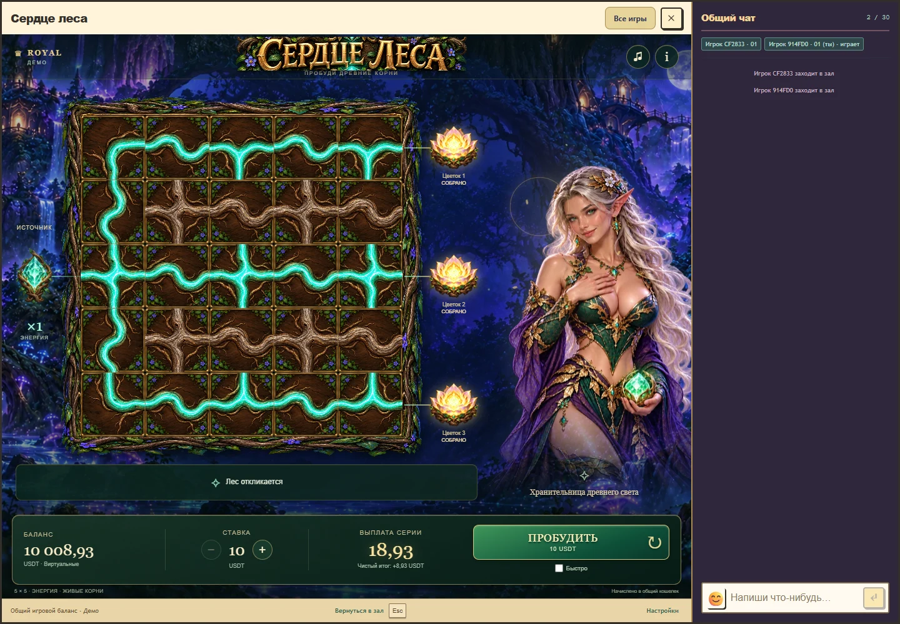
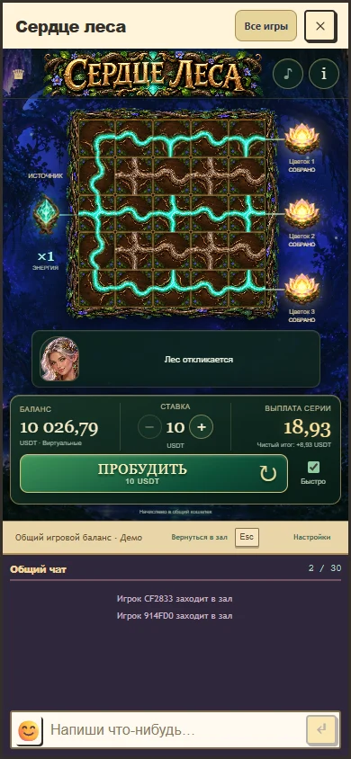

# Сердце леса: реакции эльфийки 1.6

При подтвержденном пробуждении эльфийка теперь готовит жест еще во время появления корней, затем ведет рукой поток к полю. При положительном итоге всей оплаченной серии она заметно поднимает плечи, кивает и отвечает теплым светом. Крупный положительный итог сохраняет прежний порог и получает более широкий жест. Частичный возврат, возврат ставки и нулевой результат не получают победного празднования.

Изменения используют принятые изображения персонажа. Добавлены локальные движения руки, верхней части тела и головы; волосы и ткань продолжают двигаться отдельно. Стопы закреплены. Это деформация иллюстрации и переходы между изображениями, а не полноценный скелет или 3D-персонаж.

При прерывании перехода сохраняются все видимые веса позы, а новый жест начинается с текущего положения. Раньше переход выбирал одну из двух предыдущих поз по границе 50%, что могло давать скачок. Одинаковые реакции на несколько цветков больше не начинают движение заново. Возврат в спокойную позу длится 640 мс; действия остаются доступны по прежним правилам.

Активная анимация стремится к 60 отрисовкам в секунду, спокойное состояние к 30. Текстуры с нулевым вкладом не выбираются шейдером. Размер буфера остается адаптивным. Измеренная частота и изменения между кадрами записаны в [отчете](character-v6-verification.json); это локальные измерения браузера, не обещание производительности физических телефонов.

Проверяется настоящий Royal host с общим чатом, принятыми серверными исходами и кошельком. Сценарии охватывают обычный режим, mute, быстрый режим, положительный и крупный итог, отсутствие празднования потерь, паузу, skip, reduced motion, потерю WebGL, восстановление и повторное открытие. Тайминги и сила жестов являются художественными решениями; технические проверки не заменяют оценку пользователем.

[Локальное превью](http://localhost:5296/?room=aji8XeaT1) сохраняет существующий синтетический баланс и последний итог. При ручной проверке новые ставки не отправлялись. Production не публиковался. Математика, кошелек, цены, звуки и исходные изображения не менялись.
