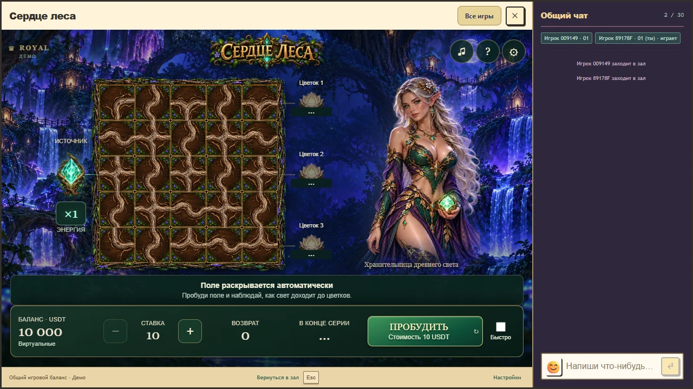
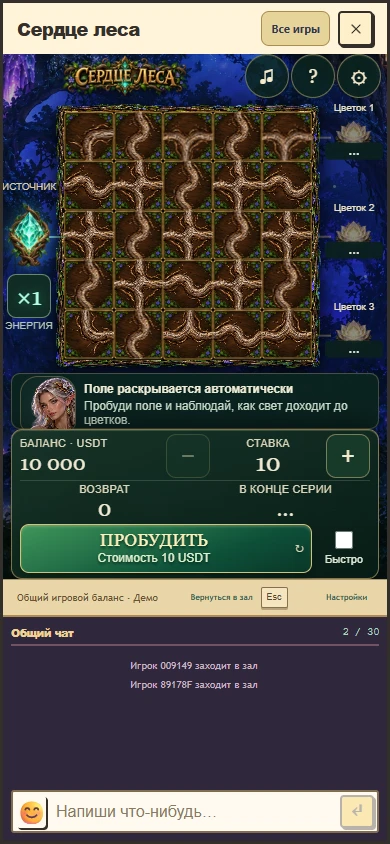

# Сердце леса: верхняя часть 1.8.1

Логотип теперь показывается целиком. Убраны отдельная затемненная полоса, повторный подзаголовок и большой промежуток перед полем. Высота верхней части зависит от высоты окна, а поле, статус и управление образуют единую композицию.

Три сценария прошли: английские правила и узкое окно; результаты, стоимость действий и настройки; последовательная смена 13 размеров с чатом, бонусом и восстановлением принятого раунда. Проверены размеры в Chrome, физический телефон не использовался. TypeScript, сборка пакета и проверка RTP прошли. Математические исходники, кошелек, звуки и алгоритмы анимаций сохранены.

Это локальный вариант для просмотра. Подробности: [header-v8.1-verification.json](header-v8.1-verification.json). Предыдущее исправление общего host также требуется при будущей публикации.

Временные материалы сохранены: предыдущая автоматическая проверка отклонила удаление с причиной `blocked by policy`. Повторное удаление не предпринималось. Активный локальный просмотр сохраняется до окончания проверки пользователем.
