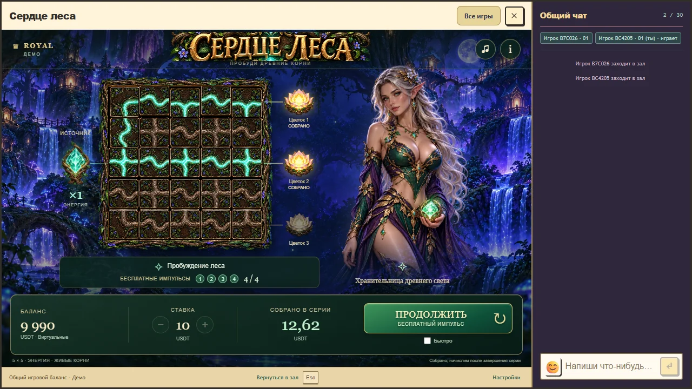
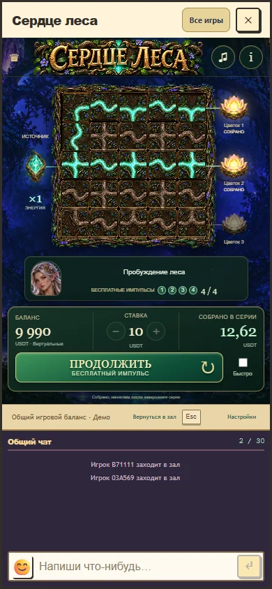
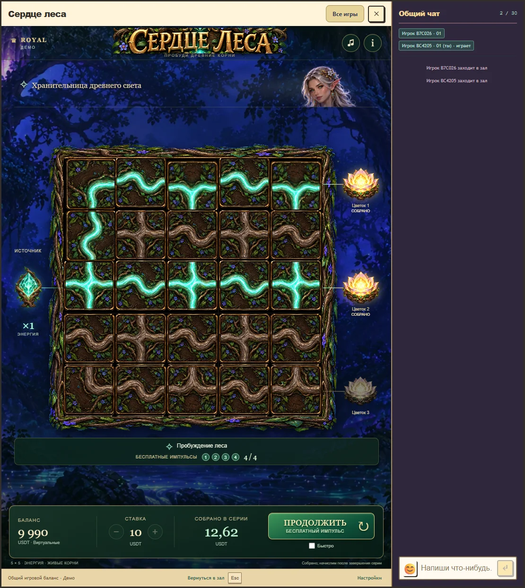

# Сердце леса: интерфейс, движение и звук 28 октября 2026

Клиент 1.3 отвечает на замечания об однообразном звуке, анимациях и распределении элементов. Название занимает верхнюю строку, источник и три цветка стоят у соответствующих входа и выходов поля, инструкция и бонус имеют отдельную панель. Баланс, ставка, подтвержденная сумма серии и запуск собраны в нижней панели. Широкое окно отводит эльфийке отдельную колонку; высокое окно использует портретный баннер; телефон переносит небольшой портрет в подсказку. Образ и ресурсы выбранного лесного оформления сохранены.

Поворот принятого корня дополняет небольшой подъем плитки. Появление поля расходится от строки источника; свет следует взаимным соединениям. Впервые собранный цветок кратко раскрывается с пятью частицами. Счетчик плавно показывает уже подтвержденную целочисленную сумму; финальный положительный акцент совпадает с окончанием счета. Восстановленная партия показывает итог сразу. Пропуск, пауза и reduced motion сохраняют результат без повторного празднования. Длительности являются художественными решениями, не научными порогами. Полной скелетной анимации эльфийки здесь нет, используются две позы с плавным переходом.

Авторская музыка теперь содержит четыре фразы, паузы, разные рисунки арфы, флейту и три прохода инструментовки. Полное сочетание развивается примерно 152 секунды; бонус добавляет мягкую перкуссию. Дерево, шорох коры, вода, стеклянный цветок, листья и струнная каденция дают событиям разные материалы и огибающие. Подробности и последовательность эффектов: [дизайн звука](audio-v3-design.md), [новые эффекты](audio-v3-effects.wav), [прежние эффекты при таком же RMS](audio-v3-effects-before.wav), [55 секунд музыки](audio-v3-music.wav). Все звуки синтезированы модулем и используют общий аудиоконтекст Royal.

Итоговая проверка: 10 браузерных сценариев прошли в полном host с чатом. Проверены desktop, телефон 390×844, узкий телефон 320×780, короткое и высокое окна, RU/EN, принятие выбора, бонус, точное начисление, повтор UUID после потери ответа, закрытие и открытие, восстановление, mute, нулевая громкость, выключение только музыки, пауза и пропуск. В 209 снятых кадрах есть 28 промежуточных углов поворота, 90 промежуточных состояний потока и 32 промежуточных значения счетчика. Расчетный сдвиг кадра от слышимого акцента достигал 69,667 мс на этом стенде; это не измерение физического звука на устройстве.

Цифровая запись эффектов и музыки не содержит клиппинга, отмена освобождает голоса и хвосты. Сравнение эффектов выровнено по RMS 0,035. Эти измерения проверяют сигнал и жизненный цикл, но не доказывают приятность музыки или узнаваемость эффектов на слух. Прослушивание пользователем и проверка физических устройств остаются отдельной оценкой. Технический проход также не заменяет художественного одобрения.

Математика, выплаты, вероятности, ставки, бонусные правила и кошелек не менялись. Полная сборка, проверка TypeScript и действующий RTP gate проходят: 13 квалифицированных профилей, 114 неизмененных legacy-позиций без статуса квалификации. Дополнительная квалификация из-за оформления не требуется. Сохранены контракты API 1, rules 1, progress 1. Точные хеши, измерения и проверенный коммит: [layout-v3-verification.json](layout-v3-verification.json).

[Фактический локальный просмотр](layout-v3-local-preview.webp) открыт в обычном зале на порту 5296, с новым синтетическим аккаунтом и тестовым балансом. Изменения сохранены в ветке `codex/forest-heart-visual`; production не публиковался. Учет временных файлов и действующего ограничения очистки находится в [layout-v3-cleanup.json](layout-v3-cleanup.json).
