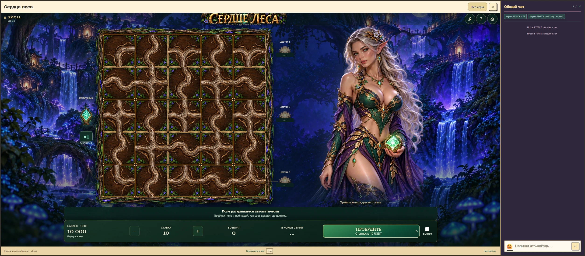
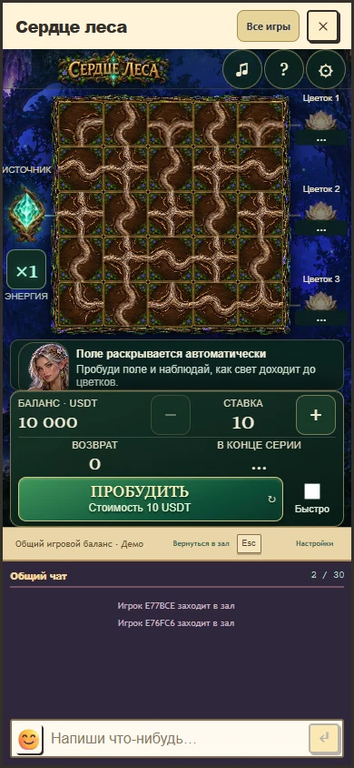
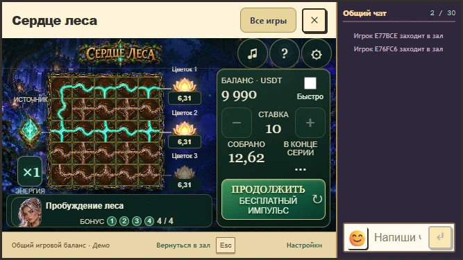

# Сердце леса: адаптация окна 1.8

Исправление представления от 30 октября 2026 года. Математика, ставки, бонусные продолжения, кошелек, звуки и алгоритмы анимации сохранены. Игровое окно и подключенный чат остаются общими с Royal.

Общий масштабировщик ошибочно ограничивал iframe игры шириной 1120 CSS px. На размере из обращения проверка воспроизвела 1021 неиспользованный пиксель. Теперь iframe получает всю область своего host, а поле и персонаж рассчитывают размеры вместе. Изображение эльфийки сохраняет пропорции и начинается на одной высоте с полем. При возврате из телефонного режима порядок колонок больше не меняется.

В коротком горизонтальном окне управление расположено справа от поля. Стоимость следующего действия, бесплатный импульс и оставшиеся бонусные поля остаются видимыми. На узких портретных экранах используется компактный портрет, на высоком планшете отдельная композиция с персонажем над полем. Настройки и общий чат доступны во всех проверенных размерах.

Проверены 13 размеров от 320x780 и 667x375 до 2560x1440, последовательные повороты и возврат к широкому экрану, бесплатный выбор корня и восстановление принятого бонуса. Полный предыдущий прогон прошел 17 игровых, звуковых и анимационных сценариев; заключительная расширенная проверка покрыла финальные изменения вертикальной композиции и панели короткого окна. Это эмуляция размеров в desktop Chrome, физический телефон не проверялся. Подробности, версии и хеши: [responsive-v8-verification.json](responsive-v8-verification.json).

Публикация требует совместного обновления общего клиентского `GameViewport` и пакета игры. Самостоятельная установка только пакета не снимает ограничение старого host. Подготовлен локальный вариант для просмотра; производственная публикация в эту запись не включена.

