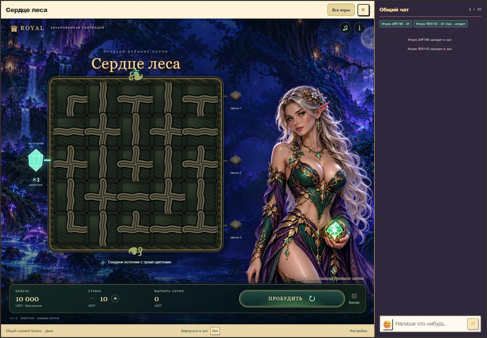
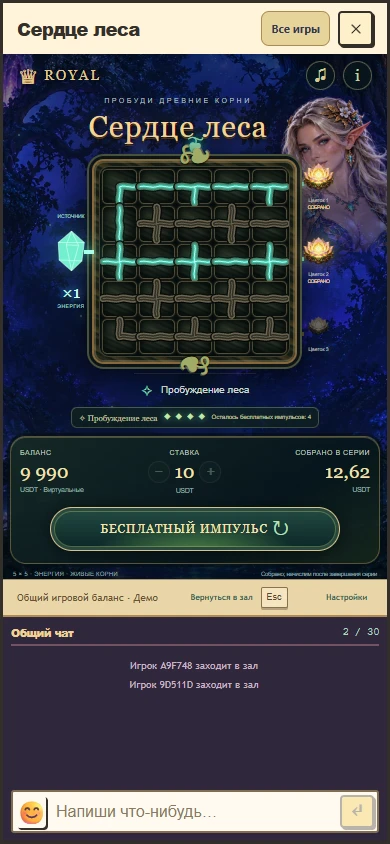

# Сердце леса v1: итог разработки и проверки

26 октября 2026 года. Реализована игра в независимом модуле games/forest-heart, с выбранной взрослой эльфийкой, ночным лесом, отдельными ресурсами, анимацией потока и оригинальным звуком. Игра доступна в каталоге существующих автоматов Royal в этой версии исходников. Двенадцать физических мест зала сохранены. Production-публикация не выполнялась; первый выпуск требует совместимых host/backend и игрового пакета.

Игровой путь: каталог Royal → независимый модуль → общий ExpansionClient → /api/demo-wallet/expansion → транзакция PostgreSQL и общий кошелек → проверенная история поля → анимация и итог. Тестовый стенд использует настоящий host, авторизацию, комнату, WebSocket и подключенный чат; это не отдельная страница с макетом игры.

## Проверенные границы

| Граница | Результат и свидетельство |
| --- | --- |
| Каталог и загрузчик | Своя identity, правила 1, прогресс 1, API 1; проверены манифест, хеши ресурсов и отсутствие серверного кода в пакете |
| Клиент → API | Передается заголовок поддерживаемых правил; используются общий транспорт и сохраненный UUID; неверная выплата в ответе не подтверждает операцию |
| API → данные | Одно списание, бесплатный выбор и четыре бесплатных продолжения; резерв и итоговое начисление сохраняются транзакционно |
| Восстановление | Выбор и бонус переживают смену каталога, закрытие и повторное открытие, а также полную перезагрузку страницы; потерянный ответ повторяется с исходным UUID после перезагрузки |
| Данные → поле | Контакты и подсвеченные клетки сверены с независимым union-find расчетом; сохраненные закрепления не меняются |
| Поле → итог | Промежуточная сумма подписана как сумма серии; кошелек получает одно начисление в конце; частичный возврат и ноль не получают празднование прибыли |
| Настоящий host | Desktop 1440×1000, мобильные размеры 390×844 и 320×780; чат остается подключенным, на основном мобильном размере кнопка бонуса видна без прокрутки |
| Анимации | Открытие плиток, поступательное освещение графа, раскрытие цветков, смена двух поз эльфийки, спокойное дыхание и огоньки; уменьшенное движение, пауза и пропуск украшения |
| Звук | Общий AudioContext/output, отдельная оригинальная тема и сигналы событий; mute, нулевая громкость и пауза отменяют принадлежащие модулю голоса; восстановление и повтор не озвучивают прежнюю награду |
| Язык | Русские и английские управление, правила, суммы и сообщения игры |

Семь браузерных сценариев прошли. Дополнительно восстановление бонуса и потерянного ответа повторно проверено с полной перезагрузкой страницы. Принудительные редкие события создавались только на локальном стенде с временным PostgreSQL, через настоящий серверный движок и денежный журнал. Такие маршруты не импортируются production-приложением. Синтетические стартовые средства проведены обычной операцией общего кошелька; ответа с выдуманным балансом нет.

## Математика и сборка

Вероятности, ставки, выплата цветка, способность и бонус не менялись. Точный RTP лучшей стратегии остался 95,994233480111%; при постоянном пропуске 93,077684967843%. Максимальная полная выплата осталась 946,5 ставки. [Штатная квалификация](../../game-math/qualifications/forest-heart-v1.json) заново выполнена с актуальными исходниками транспорта и представления: 10 752 полных серверных раунда, все ставки и стратегии, 11 сценариев общего кошелька. Это сверка runtime, а не статистическая оценка RTP.

Прошли 9 математических тестов, 20 проверок RTP gate, 37 серверных и денежных проверок, 7 проверок модулей, 3 проверки устройства зала и 7 браузерных сценариев. TypeScript, отдельный пакет и общая сборка проверяются штатными командами. Сборка включает 118 модулей. Legacy baseline и математические исходники прежних игр не менялись.

```text
npm run test:forest-heart-math
npm run test:forest-heart-server
npm run test:forest-heart-ui
npm run qualify:rtp -- --game studio-forest-heart --write-proof
npm run check:rtp
npm run test:rtp-gate
npm --prefix games/forest-heart run build
npm run build
```

Полный браузерный стенд запускает npm run preview:forest-heart. Он использует собственную временную базу и не читает .env. Автоматизированный сценарий выдает только синтетические стартовые средства через свой локальный служебный маршрут.

## Измерения звука и границы вывода

Численные результаты: [verification.json](verification.json). Цифровой рендер оригинальной темы длительностью 12 секунд имеет конечные отсчеты без перегрузки; после destroy принадлежащих партитуре голосов остается 0. [Аудиопример](audio-preview-v1.wav) создан тем же кодом ForestScore, который работает в игре.

Синхронизация использует getOutputTimestamp с учетом доступных outputLatency/baseLatency. Измерена разница между расчетным временем вывода и вызовом DOM-акцента; это не физическое акустическое измерение. Цель локального стенда: не более 80 мс. Число измерений и полученный максимум записаны в JSON. На одном прогоне вместе с тяжелыми финансовыми тестами и трассировкой DOM цель была превышена. Финальный прогон измерений выполнен без этой фоновой нагрузки и без записи DOM-трассы, которая искажает время кадра. Порог не расширялся.

Техническая исправность не доказывает приятность звука. Субъективное сравнение вариантов, реальные динамики телефона, проводные наушники и Bluetooth в этой проверке не использовались. Мобильные проверки выполнены в размерах браузерного окна Chrome, а не на физическом телефоне.

Общие предупреждения стенда о стороннем cat JSON в public, необработанном типе сообщения pvp у служебного держателя комнаты и закрываемом WebSocket относятся к существующему host/стенду. Ошибок JavaScript игры или недостающих ресурсов Forest Heart в проверенном сценарии нет. Сборка сохраняет прежнее предупреждение Vite о размере общего JS chunk.

## Визуальное свидетельство





Исходные художественные запросы, встроенный image_gen и хеши оптимизированных ресурсов: [assets-v1.json](assets-v1.json). Фон, обе позы и цветок хранятся в public/assets/forest-heart/v1 и входят в собственный пакет игры. Поле, контакты, закрепления и подсветка строятся кодом из подтвержденных правил.
