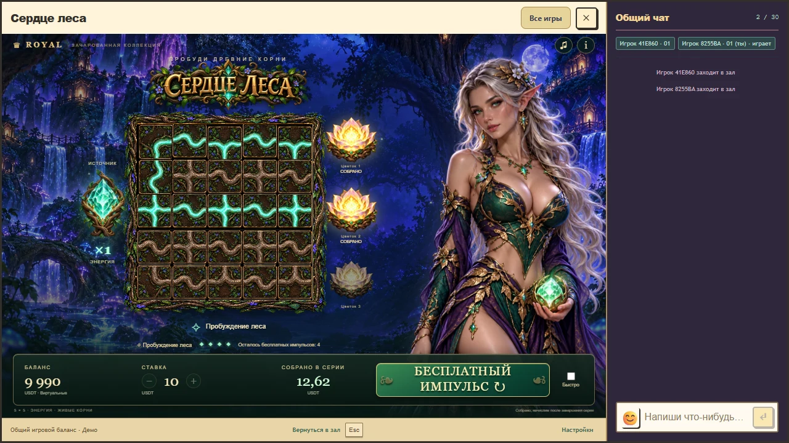
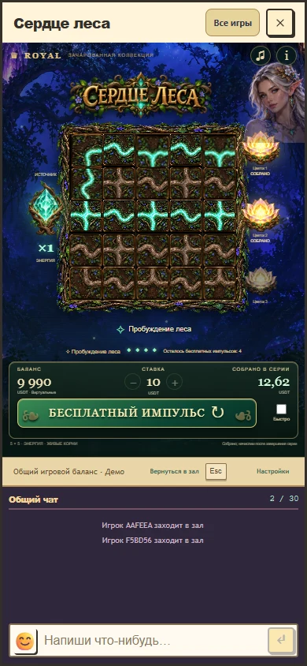

# Сердце леса: переработка визуала 27 октября 2026

Пользователь отклонил первое оформление: оно далеко от выбранного концепта, формы корней и анимации не подходят. Клиент 1.1 заменяет контурные трубы на рисованное дерево с живыми изгибами, добавляет оплетенную корнями рамку, золотое название, кристалл в древесной оправе и более крупные цветки. Образ одной взрослой эльфийки и ночной лес сохранены.

Это работающая игра в общем окне Royal с чатом. Изображения ниже сняты в host, а не в отдельном макете.

При повороте движется только выбранная подтвержденная плитка. Остальные остаются на месте. Свет заполняет рисованный корень постепенно от входящего соединения и распространяется по взаимно соединенным клеткам. Тонкие ветви и фактура остаются видимыми. Вместо раскачивания целого персонажа используется спокойное смешение двух поз. Полной скелетной анимации персонажа в этой версии нет. Карточка событий и выбранные длительности находятся в [README модуля](../../../games/forest-heart/README.md).

Проверены окно 1280×720, desktop 1440×1000, высокое окно 1110×1244 и эмуляция телефонов 390×844 и 320×780. Поле, кнопка запуска и подключенный чат остаются доступны. Проверка непрерывного движения наблюдает промежуточные углы одного корня и промежуточное заполнение светом. Все 4096 полей независимо проверены на совпадение освещенных клеток; повороты рисунков сохраняют исходные порты.

Математические файлы игры, выплаты, вероятности, ставки, бонус и решения игрока не изменены. Точный RTP при оптимальном решении остается 95,994233480111%. После объединения свежего main с Caribbean Treasures и текущими общими службами повторно выполнена штатная квалификация 10 752 серверных раундов и 11 сценариев PostgreSQL-кошелька. Для Caribbean также заново выполнены его 4096 квалификационных раундов: проверены отдельные ветви обработки, сохранены настройки, цены и прежняя позиция его capability-флага, флаг Forest Heart добавлен в конец. Доказательства созданы штатным квалификатором. Замороженная legacy-база не расширена.

Пройдены 103 отдельных проверки: 9 математических, 27 gate, 47 кошелька и совместимости, 12 модулей/каталога/рисунков и 8 браузерных сценариев. После последней правки места для бонусной строки повторены два затронутых браузерных сценария desktop/mobile и непрерывного поворота. Полная сборка host, backend и 119 модулей проходит действующий RTP gate. В браузере дополнительно проверены один дебет и одно начисление за полную серию, потеря принятого ответа, повтор того же UUID, восстановление, закрытие и открытие, пауза, пропуск оформления, reduced motion, mute и RU/EN. Стенд завершает PostgreSQL один раз после всех workers, включая замену worker после ошибки.

Технические измерения, версия пакета и точный проверенный коммит сохранены в [visual-v2-verification.json](visual-v2-verification.json). Синхронизация звука измеряет расчетное время вывода Web Audio и callback кадра. Это не акустическое измерение. Цифровая запись не клиппирует и освобождает собственные голоса; приятность звука, реальные динамики телефона, проводные наушники и Bluetooth здесь не оценивались.

Первый проход обнаружил гонку диагностического getState при загрузке host и раннее завершение стенда после ошибки. Ожидание готовности и завершение стенда исправлены, проверки повторены на объединенных исходниках. Старые сообщения host о walk-v3 JSON и необработанном pvp остаются вне области визуала этой игры; ошибок загрузки ресурсов Forest Heart нет.

Художественное соответствие остается предметом оценки пользователя. Технический проход не заменяет его одобрение нового оформления. Версия доступна локально; production не публиковался. Исходные запросы и хеши четырех новых ресурсов находятся в [assets-v2.json](assets-v2.json). Удаленные временные материалы и исключения для активного локального просмотра записаны в [visual-v2-cleanup.json](visual-v2-cleanup.json).
