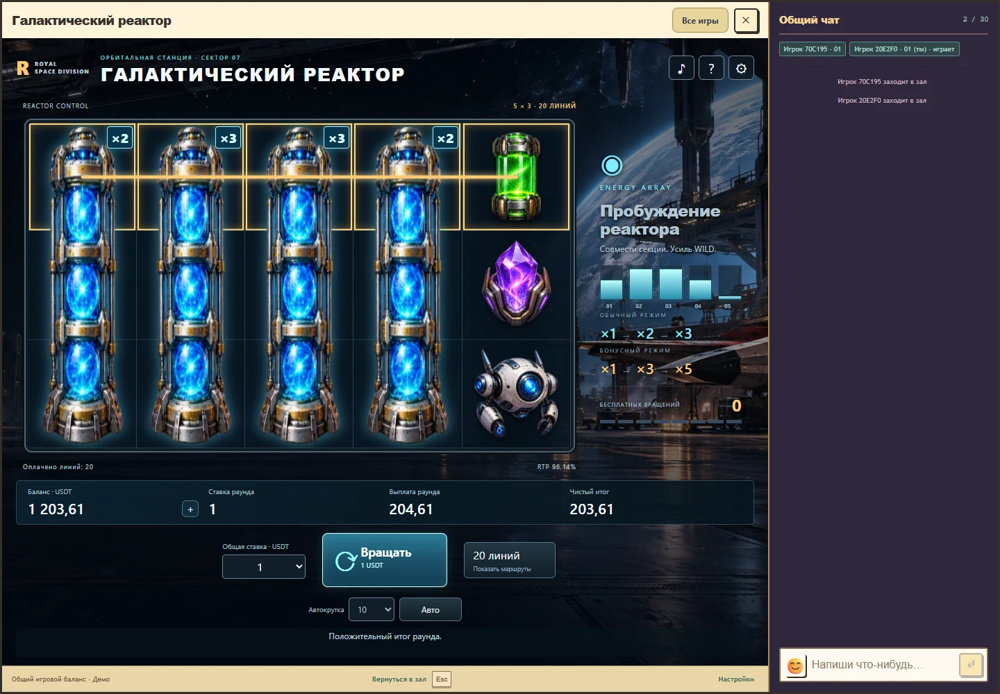

# Галактический реактор, версия 1

Реализована первая версия второй игры согласованной серии. ID `studio-wild-nudge`, модуль `games/wild-nudge/`, контракт API/rules/progress `1/1/1`. Космический ангар, восемь оригинальных символов, вертикальный энергетический WILD и портал следуют выбранному ориентиру «Звёздные войны».

## Первая рабочая версия

Сервер принимает одну ставку за полный раунд и начисляет итог один раз через общий кошелёк Royal. Поле 5×3, двадцать линий, доводка WILD и восемь бесплатных продолжений реализованы на всех шести ставках. Будущие остановки не передаются клиенту. Восстановление, повторы UUID, конкуренция, резерв, владелец и нативный финансовый runtime проверены на реальном PostgreSQL.

Есть конечная автокрутка 10/25/50/100 платных раундов, «Стоп», пропуск представления, правила и таблица выплат, быстрый режим, уменьшенное движение, музыка, эффекты и общая громкость. Клиент показывает подтверждённый путь доводки. Авто не возобновляется после паузы, ошибки или закрытия. Host сохраняет подключённый чат.



[Мобильное окно с чатом](preview-mobile.webp). Снимки сделаны на одноразовых тестовых аккаунтах; результат на первом снимке задан сценарным тестом и не является обещанием выплаты.

Точный RTP полного раунда **96,137192293385%**, одинаковый для всех ставок. Профиль первой версии имеет статус `qualified`: [серверное доказательство](../../game-math/qualifications/wild-nudge-v1.json) включает независимый точный расчёт, 640 состояний sampler, 3072 полных серверных раунда из двух seed и проверки общего кошелька. Офлайн-модель ниже намеренно остаётся `mathematical-model-only` и не заменяет это доказательство.

Финальные ресурсы находятся в `public/assets/wild-nudge/`. Точные успешные промпты встроенного image_gen, пути, размеры и хеши сохранены в [assets.json](../../../games/wild-nudge/assets.json). Оригинальная 32-секундная атмосферная музыка воспроизводится из [скрипта](../../../scripts/render-galactic-score.mjs); карточки событий и границы технической проверки аудио: [feedback.md](../../../games/wild-nudge/feedback.md).

```powershell
npm run test:wild-nudge-math
npm run test:wild-nudge-runtime
npm run check:rtp
node scripts/build-game-module.mjs --game wild-nudge
npm run preview:wild-nudge
# Во втором терминале, пока запущен стенд:
npm run test:wild-nudge-ui
```

Стенд: `http://127.0.0.1:5237`, настоящий host и отдельная временная PostgreSQL. Сценарии и пополнение одноразовых аккаунтов доступны только в тестовом скрипте, в приложение не включены. Ctrl+C или POST `/__test/nudge/stop` останавливает стенд и удаляет его базу. Данные остальных локальных стендов не затрагиваются.

Итоги: [v1-verification.json](v1-verification.json), [ревью общих исходников](shared-source-review.md), [план](development-plan.md). Версия подготовлена для пользовательской проверки. Публикация на боевой сервер является отдельным совместимым выпуском host/backend.

Временный стенд остановлен, обе его одноразовые базы удалены штатным завершением. Последующая очистка журналов и устаревших пакетов отклонена автоматической проверкой разрешений с причиной `blocked by policy`. Оставшиеся пути, размеры, свободное место и условие очистки: [local-storage-v1.json](local-storage-v1.json). Освобождение места этой отклонённой командой не заявляется.

## История первого математического этапа

Следующие записи описывают состояние до серверной реализации первой версии.

Первый этап второй игры из согласованной последовательности: гигантские символы, доводка WILD, переменная высота, расщепление. Технический идентификатор `studio-wild-nudge` и папка `wild-nudge` являются рабочими. Пользователь выбрал визуал в стиле «Звёздных войн». Название, конкретные персонажи и финальный эскиз ещё не выбраны.

## Выбранное визуальное направление

30 октября 2026 пользователь указал: «Визуал я хочу чтоб был в стиле звездных войн». Ориентир для оформления: кинематографичная космическая опера, масштабные корабли и станции, технологичные ангары, тёмный металл, звёздный фон, голографические панели и контрастное энергетическое свечение.

Предлагаемая композиция: поле 5×3 встроено в консоль космической станции, за ним виден ангар или космос. Графитовые панели отделяют символы от фона; холодные синие и голубые индикаторы сочетаются с красными и фиолетовыми энергетическими акцентами. Кандидаты обычных символов: энергетический клинок, шлем пилота, дроид, звездолёт, эмблема флота и кристалл. Эти конкретные предметы и палитра являются предложением для эскиза, а не отдельным утверждённым набором ресурсов.

Доводку можно оформить как совмещение вертикального энергетического реактора с тремя секциями поля. Каждый подтверждённый шаг повышает видимый заряд WILD и его множитель. Бонус получает более насыщенное оформление режима усиления. Направление и число шагов берутся из результата движка. Подробные анимации, звук и карточки событий готовятся на этапе графики по `docs/game-feedback.md`; визуальные эффекты не задают новых случайных исходов. Математические параметры первого этапа сохраняются.

## Математический этап

30 октября 2026 подготовлены правила, чистый математический движок и независимая точная проверка полного оплаченного раунда. Поле 5×3, двадцать фиксированных линий, доводка трёхклеточного WILD на один или два шага и восемь бесплатных вращений с усилением доводки. Подробности: [правила](rules-v1.md), [математическая модель](math-model.json), [выборочная характеризация](characterization.json), [этапы разработки](development-plan.md).

Точный RTP этой кандидатной модели **96,137192293385%** при цели 96% ±0,2 процентного пункта. Вклад обычного поля 88,236863911152%, вклад полного бонуса 7,900328382233%. Одинаковая отдача доказана для всех шести ставок без потерь от округления. Этот результат относится к заданным полосам, таблице, линиям и восьми бесплатным продолжениям.

Профиль зарегистрирован как `model-only`. Это завершённый математический этап, но ещё не квалифицированная игра для выпуска. Серверный источник случайности, сохранения раундов, общий кошелёк, восстановление запросов и совместимость игрового окна будут проверены на следующем этапе. Защита RTP отклоняет попытку включить эту модель в запускаемый каталог. Никакой новый денежный маршрут или отдельный баланс не создан.

В независимой выборке из 250 000 полных раундов любая выплата наблюдалась в 56,5112%, положительный чистый итог в 17,2664%, вход в бонус в 0,7352%. Наблюдаемый RTP 95,751396% и его приближённый интервал не заменяют точное ожидание. Большая часть ненулевых выплат меньше ставки; такие результаты нельзя оформлять как прибыль. Это свойства проверенной модели, а не гарантия отдельной игровой сессии.

```powershell
npm run analyze:wild-nudge -- --verify
npm run test:wild-nudge-math
node --import tsx scripts/game-math/wild-nudge-characterize.mjs --verify
npm run check:rtp
```

Исходники: [движок](../../../src/shared/wildNudgeMath.ts), [точные параметры](../../../src/shared/wildNudgeData.json), [независимый расчёт](../../../scripts/game-math/wild-nudge-reference.mjs), [полный анализ](../../../scripts/game-math/wild-nudge-model.mjs). Квалификация настоящего сервера через `qualify:rtp` остаётся условием будущего подключения; офлайн-отчёт не выдаётся за такое доказательство.

Итоговые проверки и их область: [stage1-verification.json](stage1-verification.json). Временный подбор параметров и дубли журналов удалены после проверки сохранения исходников в GitHub; размеры, замеры свободного места и исключения: [local-storage.json](local-storage.json).
