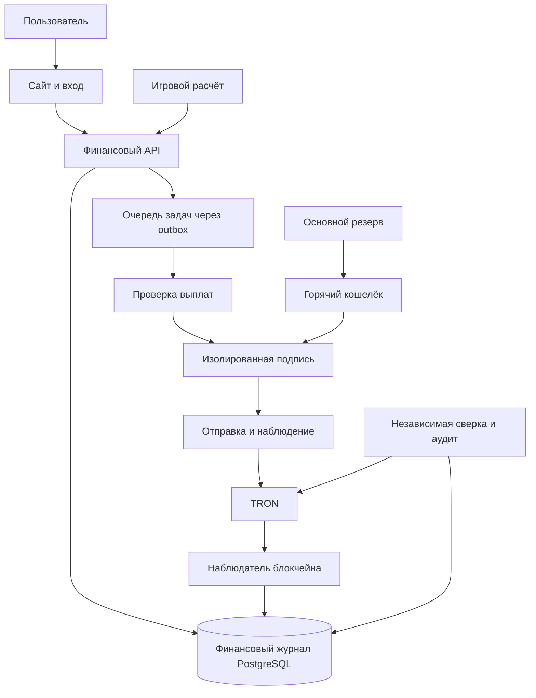

# Финансовое ядро Рояля

Проект архитектуры от 5 октября 2026 года. Пользователи вносят USDT, играют на внутреннем балансе, переводят средства другим игрокам и выводят их. Средства хранятся под контролем сервиса. Общий резерв покрывает обязательства перед игроками, а отдельный журнал определяет принадлежность каждой суммы.

Первый этап реализован на симулированных средствах: PostgreSQL, двойная запись, переводы, резервы, расчёт игры, идемпотентность и outbox. Запуск и границы реализации описаны в [инструкции](financial-core-implementation.md). Реальные криптокошельки и подпись транзакций относятся к последующим этапам.

Следующий реализованный этап добавляет постоянные тестовые адреса, отдельного наблюдателя, проверку двух лабораторных источников и атомарное сохранение события, зачисления и курсора. Финальность, ложные токены, повторы, сбои и восстановление проверены в симуляторе. [Реализация поступлений](../deployment/finance/DEPOSITS.md). RPC настоящей сети TRON ещё не подключён.

Цель защиты: исключить двойное списание и повторные выплаты, обнаруживать подделку учёта и ограничивать ущерб при компрометации одного компонента. Гарантии полной неуязвимости нет. Это проект для последующей реализации и проверки, не готовая платёжная система.

## Начальные решения

| Вопрос | Предлагаемое решение |
| --- | --- |
| Актив и сеть | USDT в TRON, одна явно указанная сеть |
| Единица внутреннего баланса | USDT без обещания обмена на USD по фиксированному курсу |
| Хранение | Общий резерв сервиса, отдельные адреса пополнения пользователей |
| Игры и переводы | Внутренние операции в базе, без отправки в блокчейн |
| Учёт | Двойная запись и неизменяемые проведённые операции |
| База | Отдельная PostgreSQL для финансового сервиса |
| Ключи | Изолированная система подписи или согласованный кастодиальный провайдер |
| Автоматические выплаты | Небольшой горячий кошелёк и независимые лимиты |
| Основной резерв | Отдельное хранение, несколько независимых одобрений |

Сеть TRON является рабочим предположением. Перед окончательным выбором сравнить стоимость пополнения, активации адресов, сбора средств и вывода на ожидаемых суммах. Другие сети и активы добавляются через адаптеры после первой версии.

Контракт USDT и точность суммы фиксируются в реестре активов после проверки официальных данных. Символ токена не является идентификатором: токен с названием USDT и другим контрактом не зачисляется. [Официальный список контрактов Tether](https://tether.to/en/supported-protocols/).

## Текущий проект

`server/index.ts` запускает Express, Colyseus, авторизацию и демокошелёк в одном процессе. `server/accounts.ts` использует SQLite и хранит сессии с периодом жизни 30 дней. `server/demoWallet.ts` реализует атомарный игровой расчёт и повтор операций по UUID, но разрешает бесплатное начисление монет. `server/demoWalletRoutes.ts` доверяет обычной пользовательской сессии для операций кошелька.

Для реальных средств выделяются другой сервис, другая база и отдельные права. Демобаланс не конвертируется в USDT. Текущие ID аккаунтов можно использовать как внешние ссылки, но финансовые записи не удаляются каскадно при удалении игрового профиля.

Royal Coins остаётся тестовой игрой. Внешний iframe Luelon не подтверждает реальные ставки или выигрыши. Для подключения платных игр нужен проверяемый серверный протокол расчёта и оценка правил игры, максимальных выплат и резервов.

## Компоненты и границы доверия

Финансовый API принимает пользовательские намерения. Браузер не задаёт отправителя, итоговый баланс, факт депозита или выигрыш. Вызовы от игрового расчёта аутентифицируются отдельной сервисной учётной записью с узкими правами и лимитами.

Подпись, проверка выплат, резерв и аудит располагаются в отдельных контурах с разными административными доступами. Разные контейнеры на одном сервере с одним root-доступом не дают такой изоляции.

Наблюдатель блокчейна имеет право инициировать зачисление только на основании проверенного поступления. Он не может подписывать вывод. Финансовый API не может подписывать вывод или напрямую исправлять проведённые записи. Сервис подписи не имеет произвольного публичного API для отправки транзакций.

Компрометация игрового сервера может создать ложный выигрыш даже при честном журнале. Поэтому нужны отдельные бюджеты игр, максимальные выплаты и независимая проверка результатов либо подписанные расчёты согласованного провайдера. Проверка подписи провайдера не заменяет лимит ущерба при компрометации его ключа.

## Модель угроз

| Сценарий | Основной контроль | Остаточный риск |
| --- | --- | --- |
| Подмена суммы или результата в браузере | Серверные правила и разрешённые поля запросов | Ошибка серверной проверки |
| Повтор запросов и параллельные списания | Уникальные ключи, блокировки, одна транзакция | Ошибка схемы или обход общего пути записи |
| Кража сессии | Второй фактор и подтверждение параметров перевода или вывода | Кража устройства и второго фактора |
| Взлом сайта или игрового сервера | Отдельные финансовые полномочия и бюджеты игр | Злоупотребление разрешёнными запросами |
| Подделка RPC или webhook | Проверка подтверждённого состояния через независимые источники | Общий сбой источников или самой сети |
| Взлом финансовой базы | Независимый аудит, сверка и лимиты подписывающего контура | Подделка правдоподобной истории до обнаружения |
| Взлом подписывающего контура | Ограниченный горячий остаток, отдельный резерв | Потеря доступного горячего остатка |
| Действия администратора | Разделение ролей и двойное одобрение важных действий | Сговор или компрометация нескольких ролей |

Изоляция ключей не доказывает законность операции. Если подписывающий сервис доверяет любому запросу финансового API, взлом API позволяет вывести средства без кражи ключа. Поэтому подписывающий контур применяет независимую политику.

## Денежные величины

Суммы хранятся как целое количество минимальных единиц актива. Для USDT предполагается масштаб 6, который проверяется при настройке контракта. Пример: 20 USDT представлены как 20000000 единиц. PostgreSQL хранит `NUMERIC(78,0)` с ограничениями, TypeScript обрабатывает `bigint`, API передаёт десятичные строки. Для денег запрещены `float`, `double` и JavaScript `Number`.

Проверяются положительность, максимальная сумма и точность. Округление лишних знаков не выполняется молча. Комиссии и лимиты задаются в этих же единицах. TRX для сетевых расходов учитывается отдельным активом и не смешивается с USDT.

## Двойная запись

Каждая проведённая операция содержит минимум две проводки. Внутри одного актива сумма дебетов равна сумме кредитов. Ниже дебет и кредит используются в бухгалтерском смысле. Кредит увеличивает обязательство сервиса перед пользователем, дебет уменьшает его.

| Операция | Дебет | Кредит |
| --- | --- | --- |
| Подтверждённое пополнение А | Криптоактивы сервиса | Доступный баланс А |
| Перевод А игроку Б | Доступный баланс А | Доступный баланс Б |
| Резерв на вывод А | Доступный баланс А | Резерв вывода А |
| Подтверждённый вывод | Резерв вывода А | Криптоактивы сервиса |
| Окончательно отменённый вывод | Резерв вывода А | Доступный баланс А |
| Резерв ставки | Доступный баланс А | Резерв игры А |
| Завершение ставки | Резерв игры А | Расчётный счёт игры |
| Начисление выигрыша | Расчётный счёт игры | Доступный баланс А |
| Возврат незавершённой ставки | Резерв игры А | Доступный баланс А |
| Внесение капитала оператором | Криптоактивы сервиса | Капитал оператора |

Расчётный счёт игры допускает состояние, соответствующее убытку оператора, только в пределах выделенного бюджета. До принятия ставки проверяется покрытие максимально возможного выигрыша; резерв этого покрытия освобождается при расчёте. Правила игры определяют, включает ли выплата возврат ставки, и эти правила фиксируются для каждого раунда.

Комиссия пользователя и фактический сетевой расход оформляются отдельными проводками. Например, пользователь резервирует сумму вывода плюс фиксированную комиссию USDT, а сеть списывает TRX из отдельного бюджета сервиса. Разница между сбором и затратами не скрывается в изменении баланса.

В примере А вносит 100 USDT и передаёт Б 20: обязательства равны 80 и 20, активы остаются 100. Если игра дополнительно начисляет Б 10, обязательства становятся 110. Двойная запись покажет расход оператора, но не создаст криптовалюту. Для выплаты этих 110 нужен заранее внесённый капитал.

Проведённые операции не редактируются и не удаляются. Исправления делаются компенсирующей операцией со ссылкой на исходную. Кэш балансов пересчитывается из журнала. Ограничения ролей и триггеры защищают записи от обычного приложения; администратор базы всё ещё может изменить данные, поэтому нужен независимый аудит.

## Схема данных

| Таблица | Назначение и ключевые ограничения |
| --- | --- |
| `assets` | Актив, сеть, контракт, точность, статус приёма и вывода |
| `financial_users` | Ссылка на игровой ID, ограничения, состояние проверок; без каскадного удаления истории |
| `ledger_accounts` | Счета пользователей, активов, резервов, игр, комиссий и капитала |
| `journal_transactions` | Вид операции, автор, версия правил, ссылки на источник, время проведения |
| `journal_entries` | Счёт, актив, сторона и положительная сумма; с проведением родительской операции |
| `account_balances` | Материализованный баланс; изменяется только при проведении журнала |
| `idempotency_requests` | Уникальность по субъекту, области операции и ключу; хэш запроса, результат, ID операции |
| `deposit_addresses` | Неизменяемое соответствие адреса пользователю, сети и среде |
| `chain_events` | Уникальность по среде, сети, txID и индексу события; блок, контракт и результат проверки |
| `deposits` | Ссылка на событие, статус и единственная операция зачисления |
| `game_rounds` | Уникальный ID раунда, ставка, версия правил, результат, резерв и единственный расчёт |
| `transfers` | Отправитель, получатель, сумма, подтверждение и операция журнала |
| `withdrawals` | Зафиксированные адрес, сумма, комиссия, резерв, статус и версия |
| `withdrawal_attempts` | Попытки отправки, txID, подписанные данные, срок действия и результаты проверки |
| `withdrawal_approvals` | Одобрение конкретного хэша намерения, исполнитель, время и срок действия |
| `outbox_events` | Задачи, созданные атомарно вместе с финансовой операцией |
| `audit_events` | Инициатор, причина и параметры действий; копия во внешнем хранилище |

Единственная процедура проведения блокирует затронутые счета в стабильном порядке, проверяет сумму проводок, доступный остаток, бюджет игры и уникальность источника, затем сохраняет журнал, баланс и outbox одной транзакцией. Прямые записи в финансовые таблицы для приложения запрещены.

Базовый режим: `READ COMMITTED` и `SELECT FOR UPDATE` на всех изменяемых счетах. Общие лимиты и бюджеты имеют собственные блокируемые строки. Все пути записи используют эту процедуру. Взаимоблокировка приводит к ограниченному повтору всей транзакции с тем же ключом; внешние вызовы внутри неё не выполняются. [Блокировки PostgreSQL](https://www.postgresql.org/docs/current/explicit-locking.html).

При одновременном повторе запроса уникальное ограничение и блокировка записи обеспечивают один результат. Тот же ключ с другим телом возвращает конфликт. Ключи значимых денежных операций сохраняются на срок финансовой истории, а не только на время жизни сессии.

## Пополнение

1. API выдаёт адрес, закреплённый за финансовым пользователем, сеть, актив и правила минимального пополнения. Адреса не передаются другому пользователю после закрытия профиля.
2. Наблюдатель сканирует блоки и сохраняет кандидатов. Сохранённый курсор и перекрывающий повтор сканирования исключают пропуски при перезапуске.
3. Проверяются контракт, фактический получатель, сумма, успешное выполнение и подтверждённое состояние сети. Для значимых решений используются независимые источники; расхождение останавливает зачисление.
4. После проверки одна транзакция создаёт пополнение и проводки. Уникальный идентификатор события исключает повторное начисление.
5. Сбор средств на общий резерв выполняется отдельно. Он меняет расположение активов, но не создаёт второе пополнение пользователя.

TRON различает отправку, включение в блок, результат выполнения и solidified-состояние. Зачисление требует успешного результата в solidified-состоянии; ответ об отправке и запись индексатора недостаточны. [Семантика подтверждений TRON](https://developers.tron.network/docs/confirmation-semantics).

Webhook провайдера запускает проверку, но сам по себе не доказывает поступление. Хэш, введённый пользователем, не даёт права на зачисление. События собственных кошельков при сборе и пополнении горячего кошелька классифицируются как внутреннее перемещение.

Неподдерживаемый токен или сеть не зачисляются автоматически. Суммы ниже порога сохраняются как ожидающие разбирательства, с отражением соответствующего обязательства в сверке. После подтверждённого зачисления при аномалии сети аккаунт ограничивается, случай разбирается отдельно; автоматическое создание отрицательного доступного баланса запрещено.

Депозитные адреса генерируются кастодиальным провайдером или отдельной системой ключей. Публичная часть допускает выдачу адресов без ключей подписи, если выбранная схема это поддерживает. Изоляция депозитных ключей нужна так же, как и изоляция ключа выплат. Сбор требует бюджета сетевых ресурсов и проверки назначения.

## Переводы между игроками

Отправитель определяется сессией. Пользователь подтверждает стабильный ID получателя, сумму, актив и одноразовое намерение. Для чувствительного перевода нужен второй фактор, привязанный к хэшу этих параметров, а не общее подтверждение входа. Одноразовое намерение нельзя использовать для другого адресата или суммы.

Проверяются ограничения обоих пользователей, достаточность доступного остатка, частота и совокупные лимиты. В одной транзакции блокируются счета отправителя и получателя, списывается сумма у первого и начисляется второму. При параллельном переводе, ставке и выводе один и тот же остаток недоступен дважды.

Переводы требуют второго фактора и при последующем выводе получателем: иначе злоумышленник обойдёт защиту вывода через захваченный аккаунт. Поддержка не вправе переносить остатки вручную. Возврат ошибочного перевода является отдельным процессом с основанием и контролем полномочий.

## Игровой расчёт

Финансовый сервис создаёт раунд и резерв ставки до запуска оплаченной игры. Неизвестный раунд, чужой пользователь, несоответствие ставки и повторный расчёт с другим результатом отклоняются. В резерве игры нельзя использовать деньги для переводов или вывода.

Результат приходит только из доверенного серверного расчёта. Журнал привязан к ID раунда, версии правил и доказательству источника. Расчёт ставки и выигрыша проводится одной транзакцией; повтор возвращает прежний результат. На доступный баланс не начисляется произвольная сумма из браузера.

При потерянном ответе сначала проверяется статус раунда. Возврат ставки допустим только после перехода в окончательную отмену, исключающую поздний расчёт. Тайм-аут сам по себе не является доказательством отмены. Поздние ответы и повторные callback проходят через ту же машину состояний.

Для каждой игры задаются максимальная ставка, максимальная выплата, сумма одновременно зарезервированного покрытия и общий бюджет. Смена правил не изменяет уже принятые раунды. Независимый монитор проверяет аномальный объём начислений.

## Вывод и неопределённый результат

Нормальный путь: `reserved → review → approved → signing → submitted → confirmed`. Окончательный отказ до подписи: `reserved/review → rejected`, с возвратом резерва. Неясный результат подписи или отправки: `signing/submitted → unknown`; резерв сохраняется. Доказанный отказ выполнения: `submitted → failed`, после отдельной проверки отсутствия иных действующих попыток.

1. Пользователь подтверждает адрес TRON, сумму и комиссию вторым фактором. API резервирует полную сумму и создаёт outbox одной транзакцией.
2. Проверка выплат проверяет намерение, ограничения, новый адрес, задержки, повторное использование подтверждения и накопленные лимиты. Большая выплата требует двух независимых одобрений.
3. Одобрение связывается с ID вывода, пользователем, адресом, сетью, контрактом, суммой, комиссией и сроком. Изменение любого поля аннулирует одобрение.
4. До отправки сохраняются тело транзакции, txID, подписанные байты и срок действия. Система подписи обеспечивает восстановление результата по ID попытки, если ответ потерян.
5. Отправляющий worker повторно отправляет те же подписанные байты, а не создаёт новый платёж при каждом повторе задачи.
6. Наблюдатель проверяет фактическую успешную передачу нужного токена на зафиксированный адрес в solidified-состоянии. Только после этого резерв погашается.

Одна пустая RPC-выдача или тайм-аут не разрешает вернуть резерв либо отправить вторую транзакцию. Замена допускается после истечения срока исходной транзакции и доказательства по подтверждённой цепочке, что она не была исполнена и уже не может исполниться. Все попытки связываются с одним выводом, проверяются под блокировкой; при сомнении требуется разбирательство.

Расход TRX учитывается даже при неуспешном выполнении. Отдельно контролируются максимальная стоимость сети, доступные ресурсы и остаток горячего кошелька. Пользователь видит состояния «проверяется», «отправляется», «подтверждён» и «нужна проверка» без ложного обещания успеха.

## Ключи и контроль выплат

Горячий кошелёк хранит только объём, допустимый к потере по бюджету риска. Основной резерв пополняет его с независимым одобрением; автоматического неограниченного пополнения нет. Если лимит исчерпан, выплаты ждут, а правила ожидания показаны пользователю.

Ключи хранятся в системе аппаратной или распределённой подписи либо у согласованного кастодиана. Перед выбором проверить поддержку TRON, восстановления, резервных копий и политики подписания. Ключи, seed-фразы и подписанные секретные материалы не попадают в исходный код, браузер, `.env` сайта, логи или переписку.

Система подписи декодирует транзакцию самостоятельно и разрешает только заранее определённый вызов перевода нужного токена, назначение и точную сумму из одобренного намерения. Произвольные вызовы контрактов, изменение разрешений аккаунта и выдача token allowance не допускаются через путь выплат. Сбор средств с депозитов имеет отдельную политику с фиксированным назначением.

Подписывающий контур хранит собственные счётчики лимитов и выполненных попыток. Он не доверяет отметке `approved`, полученной только из потенциально скомпрометированной финансовой базы. Нужны независимо проверяемые подтверждения пользователя, результаты контроля и отдельные одобрения там, где они предусмотрены.

При компрометации финансового сервиса злоумышленник всё ещё может пытаться создать правдоподобный ложный баланс. Лимиты, независимая сверка и отдельные одобрения уменьшают ущерб, но не доказывают отсутствие такой атаки. Для первой версии предлагаются ручные независимые одобрения всех реальных выплат до проверки системы и настройки допустимого бюджета автоматизации.

## API первой версии

| Метод и путь | Назначение |
| --- | --- |
| `GET /api/wallet` | Доступный остаток, резервы, актив и состояние ограничений |
| `GET /api/wallet/entries?cursor=...` | История с устойчивой пагинацией |
| `POST /api/wallet/deposit-address` | Выдача адреса для выбранного разрешённого актива |
| `POST /api/wallet/transfer-intents` | Фиксация параметров перевода для подтверждения |
| `POST /api/wallet/transfers` | Исполнение подтверждённого перевода |
| `POST /api/wallet/withdrawal-intents` | Расчёт комиссии и фиксация параметров вывода |
| `POST /api/wallet/withdrawals` | Резерв подтверждённого вывода |
| `GET /api/wallet/operations/:id` | Состояние операции только её владельцу |
| `POST /internal/game-rounds` | Резерв ставки и покрытия выплаты |
| `POST /internal/game-rounds/:id/settle` | Расчёт доверенного результата |
| `POST /internal/game-rounds/:id/cancel` | Окончательная отмена с проверкой состояния |

Денежные POST-запросы требуют `Idempotency-Key`. Сервер сохраняет нормализованный хэш всех значимых параметров. Есть явная защита от CSRF для cookie-сессий, запрет записи через GET, проверка принадлежности каждой операции и лимиты запросов. CORS не является аутентификацией.

Для денег нужна короткая финансовая сессия и отдельное подтверждение чувствительных намерений. Идентификатор пользователя не принимается как доказательство полномочий от игрового прокси. Финансовый сервис проверяет доверенное удостоверение с аудиторией, сроком и защитой от повторов либо валидирует сессию через выделенный контур входа. Подмена игрового прокси не должна давать право выдавать финансовые удостоверения.

Внешнего `POST deposit` с произвольной суммой не существует. Административные корректировки не используют пользовательские маршруты и требуют основания, компенсирующего счёта и независимого одобрения.

## Сверка и аварийное восстановление

Проверки выполняются постоянно и полной сверкой регулярно. Контролируются равенство проводок, восстановление кэша балансов, отсутствие отрицательного доступного остатка, соответствие депозитов цепочке и соответствие каждого вывода не более чем одной успешной отправке.

Обязательства включают доступные остатки, резервы ставок, резерв вывода и подтверждённые, но ещё не зачисленные поступления. Активы учитываются на депозитных адресах, горячем кошельке и основном резерве без двойного учёта перемещений. Для единого момента сверки выбирается общий подтверждённый срез цепочки; выплаты между отправкой и подтверждением учитываются согласно их статусу. Сетевой бюджет TRX и покрытие будущих максимальных выигрышей рассчитываются отдельно.

При недостаче покрытия или расхождении цепочки и журнала прекращаются новые рискованные операции и автоматические подписи. Сбой игрового процесса не останавливает независимое наблюдение депозитов и выплат. Аварийные переключатели отдельно отключают новые ставки, переводы и вывод; уже отправленные транзакции продолжают проверяться.

Outbox допускает повторную доставку. Все потребители идемпотентны. События аудита копируются в хранилище с отдельными правами и защитой от изменения. Хэш-цепочка в той же базе без внешнего закрепления не защищает от администратора этой базы.

PostgreSQL требует восстановления на момент времени, шифрованных резервных копий и регулярной проверки восстановления. Резервные копии базы не заменяют резервные копии ключей. После восстановления выплаты блокируются, сначала пересканируется цепочка и проверяются все незавершённые попытки. Старый worker и новый worker не могут одновременно подписывать: используется смена поколения исполнителей и её проверка в подписывающем контуре.

## Проверки перед реальными средствами

| Проверка | Ожидаемый результат |
| --- | --- |
| Несколько одновременных списаний одного остатка | Успевают только операции, покрытые средствами |
| Повтор ключа и ключ с другим телом | Один результат либо конфликт, без новой проводки |
| Повтор события блокчейна и два события одной транзакции | Каждое разрешённое событие учитывается один раз |
| Поддельный USDT, другая сеть, неуспешное выполнение | Нет начисления |
| Сбой после фиксации журнала до ответа API | Повтор возвращает исходную операцию |
| Сбой после подписи или отправки | Восстановление исходной попытки без второй выплаты |
| Тайм-аут RPC и неизвестный вывод | Резерв остаётся заблокированным |
| Гонка отмены игры с поздним результатом | Один окончательный исход |
| Ложный выигрыш с игрового сервера | Проверка источника и бюджет ограничивают начисление |
| Подмена адреса после одобрения | Подпись отклоняется |
| Злоупотребление правами финансового API | Нет произвольного доступа к подписи и резерву |
| Изменение учёта администратором | Расхождение обнаруживается независимым аудитом |
| Восстановление старой копии базы | Сверка цепочки предотвращает повторный вывод |
| Восстановление ключей и основного резерва | Контролируемый доступ без единственного незаменимого владельца |

Проверки дополняются независимым аудитом архитектуры и реализации, проверкой зависимостей, доступов и эксплуатационных процедур. Работа с настоящими деньгами начинается только после выполнения критериев, выбора допустимого бюджета риска и урегулирования применимых требований.

## Этапы реализации

1. Реализовать отдельное ядро учёта PostgreSQL без реальных ключей: суммы, счета, проводки, резервы, идемпотентность, outbox и конкурентные проверки.
2. Добавить адаптер сети с симулятором и отдельной тестовой средой. Тестовый токен не называется настоящим USDT; сеть и данные изолированы от production.
3. Реализовать пополнения, сканирование и сверку. Проверить повторы, пропуски, ложные токены и восстановление курсора.
4. Реализовать переводы, подтверждения второго фактора и ограниченный серверный игровой расчёт.
5. Добавить вывод, независимое одобрение, подпись и обработку неопределённых результатов. Проверить восстановление после каждого шага.
6. Подключить выбранную систему ключей или кастодиана, эксплуатационные лимиты и аудит. Провести контролируемый запуск с малой суммой и ручными выплатами.

## Решения до подключения кошельков

| Решение | Почему требуется |
| --- | --- |
| Собственные ключи или кастодиан | Определяет создание адресов, подпись, восстановление и стоимость |
| Окончательная сеть | Определяет адаптер, подтверждения и эксплуатационные расходы |
| Размер капитала и горячего остатка | Определяет покрытие выигрышей и максимальный ущерб |
| Пороги, комиссии и сроки вывода | Определяют намерения, проверки и пользовательский интерфейс |
| Правила игр и максимальные выплаты | Определяют резервирование риска и серверный расчёт |
| Два независимых владельца контроля | Нужны для резерва, крупных выплат и изменений политики |
| Юрисдикции и разрешённые пользователи | Определяют допуск к операциям и требования партнёров |

Первый этап не зависит от окончательного выбора провайдера или системы ключей. Он может быть реализован и проверен полностью на симулированных средствах.
