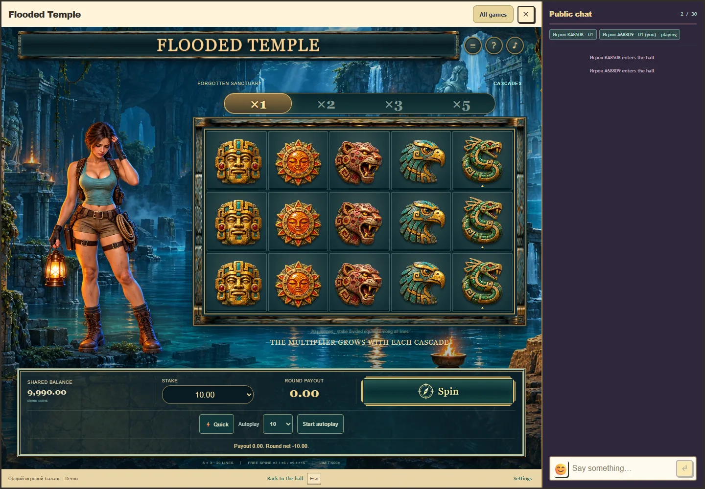

# Flooded Temple: каскадный интерфейс, этап 3

29 октября 2026 года. Пакет 0.8.0, API 1, правила 2, прогресс 2. Новые раунды используют поле 5 × 3 и 20 фиксированных линий. Героиня, затопленный храм и кинематографическая музыка сохранены. Production не изменён.

Кнопка вращения делает одну ставку в общем кошельке Royal. Интерфейс по порядку показывает только подтверждённые сервером выпадения: символы, выигравшие клетки, множитель, выплату каскада, общую сумму и бесплатные вращения. Если раунд превышает 16 выпадений, клиент автоматически запрашивает продолжение без дополнительной ставки. Бонус приостанавливает основную цепочку и возвращается к ней после всех бесплатных вращений. Счётчик бонуса относится к ещё не начатым бесплатным вращениям.

Быстрый режим сокращает представление принятого результата. Автоспины считают 10/25/50/100 платных стартов, включая все каскады и бонусы каждого раунда. Остановка отменяет будущие ставки, а принятый раунд завершается. Закрытие, пауза, скрытие окна и смена аккаунта останавливают серию. Неизвестный ответ требует явного повтора той же операции, её UUID сохраняется. Переоткрытие активного бонуса продолжает сохранённую цепочку, завершённого раунда показывает итог без повторного празднования.

Адаптер модуля распознаёт принятый активный раунд v1 и незавершённую старую операцию. Он открывает прежнее представление для завершения экспедиции по исходным правилам, затем переключается на каскады перед следующей ставкой. Исторический завершённый v1 не возвращает старую механику. Серверный протокол v1 сохранён для совместимости.

Общий клиент объявляет `X-Royal-Temple-Rules: 2`. Каталог и пакет согласованы с правилами/прогрессом 2/2. Каскадный профиль теперь основной, комнатный профиль сохранён в `versionProfiles` с ключом 1. Вероятности, выплаты, ставки и лимиты движка этапа 2 не изменены. Штатно пересоздано доказательство v2 из-за изменения хеша общего клиента. На двух независимых потоках по 200 млн полных раундов оценка RTP повторилась: 95,998765125%, 95% интервал [95,9342409764%; 96,0632892736%]. Это статистическая оценка, не точный аналитический RTP. Все шесть ставок используют однородные пути этих же 400 млн раундов.

Новый прозрачный атлас из девяти каменных символов создан встроенным `image_gen`. Режим, точный prompt, порядок ячеек, экспорт и SHA-256 записаны в [cascade-art.json](../../games/flooded-temple/cascade-art.json). Финальный ресурс: `public/assets/flooded-temple/cascade-symbols.webp`, 1200 × 1200, 573 768 байт. Изменены только размер и формат через Sharp. Источник не копирует символы референсной игры.

Представление включает базовое появление символов, подсветку выигравших клеток и реакции существующих шести поз. Итоговая реакция и звук сравнивают полную выплату со всей исходной ставкой. Частичный возврат не отмечается как прибыль. Восстановление тихое, reduced motion отключает движение. Подробное разрушение, стабильное визуальное дозаполнение, временная шкала звуков каскада и бонусная режиссура относятся к этапу 4. Нынешние художественные длительности не объявляются научными порогами; предпочтение звучания и комфорт не измерялись.

Проверены RU/EN, правила и все 20 схем линий, клавиатура, размеры клеток от 44 px, отдельная область героини и доступность кнопок. На низком окне поле ограничено доступной высотой, панель управления не закрывает нижний ряд. На телефоне используется компактный портрет над полем.

Проверки:

- 47 математических, кошельковых, HTTP, клиентских и финансовых тестов Temple.
- 29 тестов ворот RTP; проверка реестра: 14 квалифицированных профилей и 114 неизменённых legacy-модулей вне квалификации.
- 7 проверок независимых модулей, инвентарей и хешей ресурсов.
- 10 браузерных сценариев нового интерфейса: RU/EN, отзывчивость, точные кадры, одинаковый результат quick/normal, предел 500×, частичный возврат, потерянный старт и продолжение, длинный бонус, старый v1, конечная серия авто, пауза/закрытие/аккаунт и реальный Royal с чатом.
- Дополнительная проверка окончательного оформления на 1440 × 1000, 1000 × 760, 768 × 1024, 390 × 844 и 360 × 740. Реальный host с чатом проверен на 1440 × 1000, 1000 × 1100, 768 × 1024 и 390 × 844. Проверки чата подтверждают подключение, геометрию и доступность ввода; сообщения от имени пользователя не отправлялись.

Точные команды, результаты, версия пакета и хранение временных файлов: [машинный отчёт](flooded-temple-cascades-stage3-verification.json).

Локальный стенд: [каскады 0.8.0](http://localhost:5227/tests/fixtures/temple-preview.html?lang=ru&version=0.8.0). Используется отдельная временная PostgreSQL и тестовый баланс. Обычное ручное превью использует случайность сервера. Повторяемые исходы разрешены только на этом стенде с явным тестовым заголовком. Старый стенд 127.0.0.1:5226 сохранён для ранее открытой версии и принятых демонстрационных раундов. Другой hostname отделяет авторизацию двух стендов.

