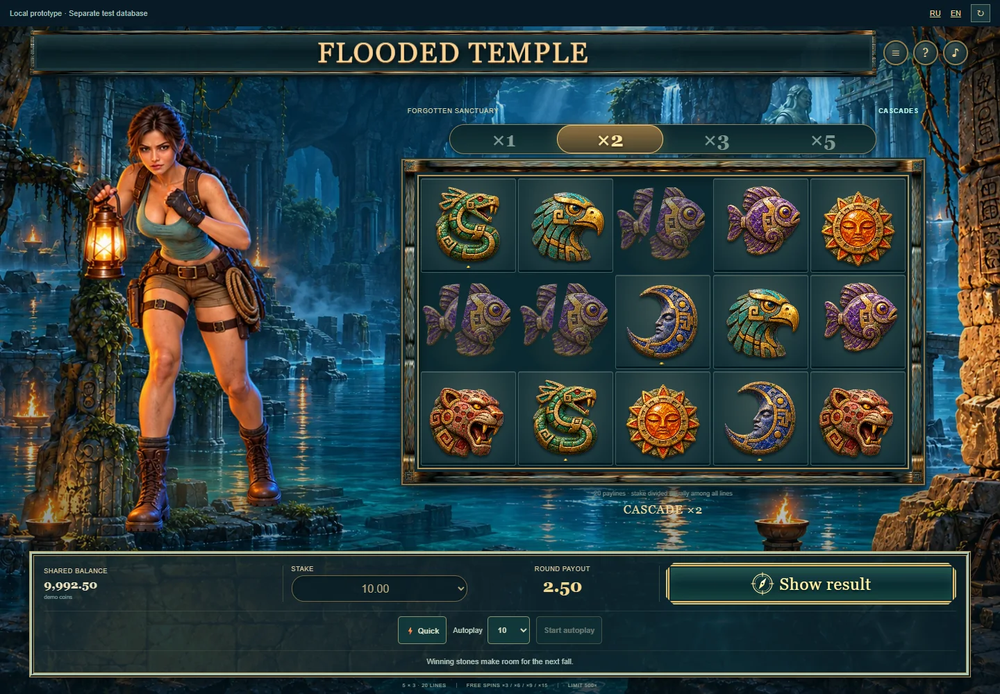

# Flooded Temple: анимации и звук каскадов

29 октября 2026 года. Этап 4, пакет 0.9.0. API 1, правила 2 и прогресс 2 сохранены. Таблица выплат, вероятность, бесплатные вращения, ставки и предел выплаты не менялись. Production не изменён.

Каскад показывает посадку, подсветку линий и точное увеличение накопленной суммы. Затем разрушается только объединение выигравших клеток. Оставшиеся камни сохраняют порядок в столбце и падают на фактическое число пустот; новые появляются сверху. До получения следующего подтверждённого поля камни не уничтожаются. Базовое поле с бонусом сохраняется целиком и разрушается при возвращении из бесплатных вращений.

Движение, счётчик, жесты героини и звуковые акценты используют одну временную шкалу. Шкала учитывает output timestamp общего AudioContext или оценку задержки. Застрявший основной поток растягивает следующие фазы, не выбрасывая подтверждённые поля; просроченные звуки не запускаются пачкой. Частицы ограничены областью поля и максимумом 60 узлов. Подсветка имеет одиночную мягкую огибающую, без мигания всего экрана. Быстрый и reduced motion режимы сохраняют тот же денежный итог.

У героини есть наблюдение за падением, удержание равновесия, защитный жест при разрушении, реакция на сбор, обнаружение реликвии и возврат внимания к храму. При смене разных иллюстрированных поз используется один силуэт с движением небольшой 2D-сетки. Это убирает двойное изображение, возникавшее при смешивании двух разных силуэтов. Персонаж остаётся в своей области слева; телефон сохраняет компактный портрет. Празднование связано только с положительным итогом всего оплаченного раунда. Частичный возврат получает спокойный отклик и явный отрицательный net.

Добавлены семь записанных материальных миксов: три варианта посадки камней, два разрушения, бирюзовая печать бонуса и возврат в основную цепочку. Использованы имеющиеся CC0-записи камня, шагов, воды, защёлки, колокола и chimes. Новых внешних аудиофайлов не загружалось. Музыка Scott Buckley «Memories Of Stone» и её атрибуция сохранены. Выход, громкость, mute и AudioContext принадлежат общему Royal.

[Карточки событий](../../games/flooded-temple/cascade-feedback.md) описывают смысл, фазы, акценты и прерывания. [Генератор миксов](../../scripts/design/temple-cascade-audio.mjs) воспроизводит новые WAV побитово. [Манифест](../../games/flooded-temple/cascadeSounds.json) содержит измеренный главный транзиент внутри выбранного окна акцента, peak и RMS. Все параметры длительности и интенсивности являются художественными и инженерными решениями этой игры, а не научными порогами восприятия.

Пауза, скрытие, смена аккаунта, закрытие и пропуск отменяют принадлежащие модулю частицы и будущие звуки. Пропуск не создаёт дополнительную ставку. Восстановление показывает историю тихо; подтверждение уже восстановленного ответа не повторяет церемонию результата. Общий кошелёк продолжает хранить UUID незавершённой операции. Автоспины останавливаются на тех же событиях, что в 0.8.0.

Проверки представления покрыли 2048 подготовленных раундов: 2967 полей, семь бонусов и возвратов, четыре межоперационных продолжения. Для каждого поля проверены точные серверные символы, соответствие оставшихся камней, целые суммы и отсутствие изменения исходных данных. Это регрессия представления, а не новая статистическая оценка RTP.

Браузерные сценарии покрывают посадку, распад, сумму, порядок всех подтверждённых полей, звук, mute/нулевую громкость, паузу/скрытие/skip, reduced motion, длинный бонус из 20 бесплатных вращений в двух операциях, возврат в храм, восстановление v1/v2, автоспины, RU/EN, клавиатуру и настоящий Royal с подключённым чатом. Скриншоты и краткие измерения включены в [машинный отчёт](flooded-temple-cascades-stage4-verification.json).

В настольной проверке четырёх акцентов использовались output timestamp и оценка задержки; фактические задержки приведены в машинном отчёте. В длинном бонусе проверены ещё 40 последних акцентов. Цель теста 120 мс является инженерной проверкой этого стенда. Эти измерения не подтверждают физическое совпадение звука на всех устройствах. Сравнение приятности звучания, динамиков телефона, проводных наушников и Bluetooth не проводилось.

При обновлении main сохранён Forest Heart. Его совместимость находится перед параметром Temple в общих внутренних вызовах; HTTP-заголовки и поля NativeCommand раздельны. Проведены проверки Temple, Forest Heart и Caribbean, включая изоляцию флагов. Из-за новых общих исходников штатно пересозданы доказательства Temple v1/v2, Forest Heart и Caribbean. Результаты, анализ и воспроизводимые проверки первых трёх существовавших моделей совпали с прежними. Оценка каскадов на 400 млн полных раундов осталась 95,998765125%; это статистическая оценка с прежним доверительным интервалом. Замороженная legacy-база не расширялась.

Превью: [локальная версия 0.9.0](http://localhost:5227/tests/fixtures/temple-preview.html?lang=ru&version=0.9.0). Сохранены отдельная тестовая база и ранее принятые демонстрационные раунды. Следующий согласованный этап 5: итоговая приёмка перед отдельным решением о публикации.

[Семь секунд новых Foley-миксов без музыкального мастера](../assets/flooded-temple/cascade-foley-preview.wav).
