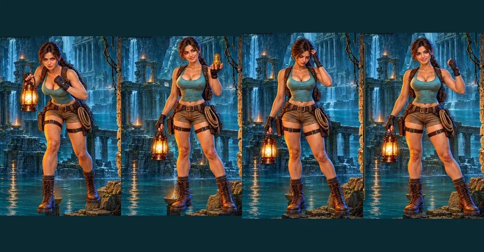

# Flooded Temple: character and animation, 0.5.0

## Design

This iteration preserves the approved adult, front-facing explorer, flooded temple, cinematic score and confirmed game rules. The former single floating portrait is replaced with six identity-matched illustrated poses and a small textured mesh. The mesh moves the head, shoulders and lantern while keeping the lower legs planted. This is animated 2D illustration, without a skeletal 3D model or facial motion capture.

The character element and GPU resources survive board renders. One bounded frame callback drives the idle clock. Confirmed event gestures read the existing presentation timeline offset. Pose changes dissolve over 220 ms. The three quiet idle clips are breathing, looking across the temple and settling her posture. They do not suggest a future outcome or a better route. These durations and intensities are artistic and engineering hypotheses for this game, not scientific thresholds.

| Event and condition | Explorer | Board and main accent | Interruption |
| --- | --- | --- | --- |
| Waiting for reply | Studies the temple; no success pose | Existing neutral waiting mask | No outcome before confirmation |
| Confirmed map row | Surveys the ruins | Row lands at 72 ms | Same shared timeline |
| Confirmed travel and arrival | Watches the passage | Compass leans into travel, settles on arrival at 22 ms | Skip shows confirmed room |
| Confirmed chest | Small smile and discovery gesture | Prepare, lid crossfade at 120 ms, light and amount follow | Collection is not final wallet credit |
| Confirmed lever and gate | Braces, watches stonework | Lever moves first, gate releases at 75 ms, four dust motes | Bounded owned decorations |
| Selected rope / confirmed crossing | Prepares, then leans into attachment | Rope extends and tensions at 420 ms, then travel | Selection is cosmetic; same move confirmation |
| Confirmed relic | Surprised discovery pose | Lift and light accent at 160 ms; new map reveals next | No wallet celebration |
| Complete paid round, payout above stake | Restrained success, larger gesture for existing big tier | Existing exact result and synchronized sound | Skip sends no request |
| Complete paid round, zero or partial return | Thoughtful, modest disappointment | Neutral result | No celebration or retry encouragement |
| Stake returned | Calm settling pose | Existing return signal | Full original stake comparison |
| Recovery or reopen | Neutral idle | Existing final board, quiet recovery | No replayed gesture sequence |

Reduced motion displays a static pose, without mesh movement, dissolve, idle callback or particles. Host pause, dialog, hidden page, close and account change stop owned callbacks. WebGL loss uses the current static image, with restoration of resources when available. Closing releases textures, buffers, shader program, event listeners and the owned context. A small cropped portrait remains visible above the board on phone layouts, away from room hit targets and action controls.

## Sources and mathematical reconciliation

Six poses were generated with the built-in imagegen tool from the existing explorer reference. Prompts and export provenance are recorded beside the artwork. No outside music, new sound or new reward probability is introduced.

Before this iteration, main advanced to `05f28d0`. The clean feature was merged with those changes, including Neopolis rules 4 and current Caribbean audio. Conflicting common protocol additions were reconciled to preserve both Temple rules 1 and Neopolis rules 4. Shared wrapper changes required fresh Temple and Caribbean mathematical qualification. Their mathematical engines and parameters are unchanged; both proofs were regenerated with the normal qualifier, without altering the legacy baseline or weakening the gate. The Caribbean reviewed-source fingerprints were updated only after checking that the merged wrapper diff adds the already qualified Temple routing and does not change Caribbean pricing, settlement or transitions.

## Verification

The complete 24-scenario browser run passed on package `0.5.0-4d86e1400cd6`. Subsequent changes only fix portrait containment and remove inherited phone opacity/masking. The final package is `0.5.0-b9aceb3eec57`, source SHA-256 `b9aceb3eec575cc0f93c79dd1a8a401e1ab8cc635baf6963ca1397d8f24bc781`, with 33 verified payload files and 19,165,762 bytes. Its module typecheck/build, RU/EN layouts and real host with connected chat were checked again. Viewports: 1440 by 1000, 1000 by 760, 390 by 844 and 360 by 740. Rooms remain at least 44 px high, controls stay reachable and there is no horizontal overflow.

The profile suite passed 30 tests, the RTP gate 27, shared Neopolis/Caribbean wallet compatibility 14, and module contract/byte inventory checks 7. `check:rtp` verifies 13 registered profiles and reports 114 legacy modules as unqualified. The full application build passed in 23,419 ms before the final portrait CSS adjustment; the final independent module build passed with the same API/rules/progress contracts 1/1/1. The existing host bundle-size warning remains.

New browser scenarios check actual pose transitions, three quiet idle clips without network requests, a stable canvas across board renders, pause and dialog freezes, reduced motion without a frame loop, silent reopening, account changes, GPU resource disposal, context loss fallback and restoration. A first combined build/browser run exposed a late rope cue under load. The audio scheduling horizon now includes 180 ms beyond the asset/device lead, without replaying expired cues. The regression deliberately blocks the main thread for 200 ms during rope preparation and confirms one scheduled rope cue and the exact final amount. This margin is an engineering choice, not a perceptual threshold.

Two real-host harness waits were corrected: the diagnostic bridge can appear before Phaser creates the player, and the old default five-second assertion could expire before the longer confirmed base sequence finished. The harness now waits for a readable online snapshot and allows 15 seconds for the expedition/idle presentation, while preserving all wallet, chat, restoration and error assertions.

Rendered browser-clock accent skew was at most 20.57 ms in the baseline, 19.80 ms with simulated 200 ms device latency and 49.99 ms under CPU 4x. One 90 ms arrival phase in the baseline had no separate rendered frame; the next confirmed room and final result remained correct. These are observations of particular runs. They do not measure speaker/Bluetooth output or prove subjective smoothness.

The 24.58-second [silent capture](../assets/flooded-temple/animation-preview.mp4) shows real prepared demo rounds with intentional pauses for inspecting the reactions. It is visual evidence, not a timing measurement or a soundtrack preview. No browser page errors were observed during the capture. See the [machine-readable report](flooded-temple-character-verification.json) for exact package versions and scope.

[Real desktop host with chat](../assets/flooded-temple/animation-host-desktop.webp), [real phone host with chat](../assets/flooded-temple/animation-host-mobile.webp), [phone portrait above the board](../assets/flooded-temple/animation-mobile-portrait.webp).

Final artwork lives in `public/assets/flooded-temple/character/`; the six files total 642,950 bytes. The built-in imagegen prompt and technical atlas export are in [the provenance record](../assets/flooded-temple/character-animation-prompts.json). Physical listening, subjective animation preference and audience enjoyment are outside automated technical verification.

## Review and storage

The local preview uses a separate disposable PostgreSQL and demo coins. It remains available at `http://127.0.0.1:5226/tests/fixtures/temple-preview.html?lang=ru&version=0.5.0`, terminal session 7918, frontend PID 1624 and backend PID 12480. Stop the owned wrapper with Ctrl+C after user review so it cleans up its database. The managed checkout remains active for this feature while another chat has work in the primary checkout. No deployment was made.

Only this iteration's temporary captures/helpers and obsolete 0.5.0 package builds are cleanup candidates. Earlier denied paths are excluded and must not be retried. See the [storage inventory and result](flooded-temple-character-storage.json) for preservation commit, exact removed sizes, free-space measurements and active exceptions.

Source and required assets were pushed to `codex/flooded-temple` at `1713f0df317409efd8b9985af512d7a04c205a0b`; the exact remote SHA was checked with `ls-remote`. `work:sync` confirmed main baseline `05f28d08c99182a886e8e7e72e6bf97eb7916587` with no missing main commits.

Cleanup of five owned targets, 93,242,310 bytes, was rejected before execution by automatic approval review: `blocked by policy`, without a detailed reason. Removed folders, files, archives and bytes are all zero. No physical space reclamation is claimed. These five targets were not retried and join the earlier excluded denial scopes; resolving this storage exception requires a policy change outside this task.
