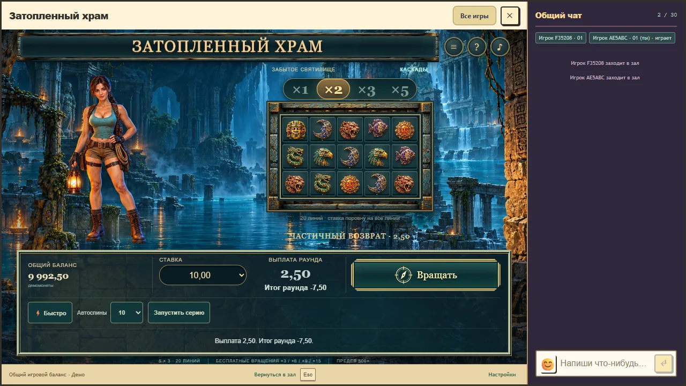
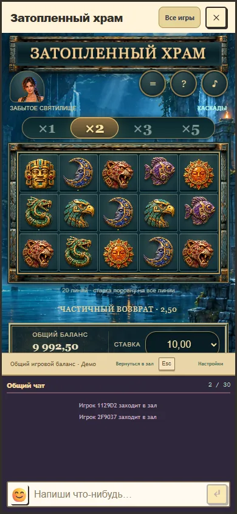

# Flooded Temple 0.9.6: continuous character reactions

Implemented and visually reviewed on 30 October 2026. The approved front-facing explorer now uses independent head, body, arm, lantern, blink and smile channels on the existing illustration. Idle has breathing, an occasional glance and blinking. Falls draw her attention down the board; stone separation produces a small brace; line evaluation receives an attentive nod. Bonus discovery and a completed large profit have different gestures. Three deterministic variations change the emphasis of head and arm motion without using game entropy.

Reaction changes retain both position and velocity. The next cascade therefore changes the movement target without resetting the pose. Boots remain planted, and movement has room inside the existing left lane. Phone layout retains its compact portrait above the board. New paid starts clear the previous result gesture before waiting for a response. Pause holds the frame, reduced motion is still, account changes clear motion, and reopening does not replay a reward. Legacy expedition clients retain their original six-pose presentation.

This is 2D mesh animation of the existing art. It does not provide a new skeleton, a full turn or an independently painted face. Enlarged captured frames exposed an initial eyelid distortion, which was replaced with a local skin/lash overlay and reviewed again. Gestures remain restrained to preserve the illustration and board readability. These curves and timings are game-specific design choices; technical checks do not establish subjective enjoyment or certify physical devices.

Final package: `0.9.6-0991b4ae7a91`, API/rules/progress 1/2/2. The source and manifest digests, unchanged media inventory and compact measurements are in [the verification record](flooded-temple-character-life-verification.json). Development reconciled the existing Temple branch with main `99b5114d8711dbe649eff6ad618d8fd7fc19800d`, retaining concurrent host, Forest Heart, skin and deployment changes.

All 12 browser scenarios passed together. Three new cases inspect actual WebGL pixels during idle, a partial return, bonus discovery and a completed large profit, including quick mode. They also exercise pause, reduced motion, account reset, quiet reopen, WebGL context loss/restore and disposal. The existing nine cases cover confirmed stone motion, connected Royal chat at 1280 by 720 and 390 by 844 in both speeds, full free-spin continuations, recovery and exactly ten quick autoplay starts. Synthetic accounts and disposable databases were used, with no production wager or chat message.

The partial-return case recorded 98 portrait samples with 98 distinct upper-region hashes, a peak blink of 0.886 and no smile. The 31-fall bonus recorded 491 samples, separate discovery and large-result clips and the exact 30250-unit payout. Each portrait case retained one sampled boot-strip hash and visible bounds inside the canvas. Royal cabinet and character bounds changed by zero CSS pixels; the narrow iframe separately moved one pixel from pointer-focus scrolling. These are sampled rendering results, not a frame-rate or physical-device guarantee.

All 60 Temple mathematical, wallet, transport, presentation and compatibility tests passed. Module typechecking, all 7 module/resource checks and the final full application build passed. `check:rtp` verified 18 registered profiles; 114 frozen legacy identities remain explicitly unqualified. No probabilities, paytables, multipliers, free-spin awards, stake costs, RNG, accepted-round rules, settlement or qualification evidence changed. The 39 packaged media files, including all recordings, are byte-identical to 0.9.5.

The local stand remains on port 5233 with the existing isolated database and cookie namespace. Its loaded immutable module was checked as `0.9.6-0991b4ae7a91`, and the displayed balance was 10000.00 demo coins. No spin was started in the user's preview during this task. The local update has not been installed in production.

Two additional narrow-host runs passed after adding an explicit in-viewport portrait assertion and top-of-game captures in both speeds. The compact portrait remains above the field while chat stays connected below the game.

Source was pushed and the exact remote branch `codex/flooded-temple` verified at `fbd707f0f2a7e1811c20e70e39a409f9064a3186`. The final synchronization retained main `aed09286a21e315cb506b1befc754f5a7b4eecd2`; its additional changes were deployment records, release-input review and a release-tooling test, with no Temple or runtime host changes. The verified Temple package and its media inventory stayed unchanged.

Temporary ownership is recorded in `artifacts/work/temple-character-life/OWNER.txt`. After remote preservation, cleanup removed 109 task-owned files totaling 47180796 bytes and 13 emptied directories. The obsolete package roots were `module-dist/studio-flooded-temple/versions/0.9.6-866e8d728fe4/` and `module-dist/studio-flooded-temple/versions/0.9.6-3ad9d7e12c37/`; the other files were inspection crops, transient portrait/host captures and test/build logs under the owned scope, including its emptied `captures/` directory. Two useful host captures were preserved in this report's tracked assets. Removed archives: 0, 0 bytes. No archive, source staging copy or dependency copy was created.

Measured C: free space was 201170042880 bytes immediately before removal and 201217490944 after. Volume changes may include concurrent activity; these readings do not assign physical-space recovery solely to this task. The active `0.9.6-0991b4ae7a91` package, normal current build outputs, existing preview database and compact reports remain available. Preview data and its current package stay while the user's local review is active. Earlier rejected targets and other chats were excluded and not retried. The inventory, content hashes and cleanup result remain in the owned scope.
