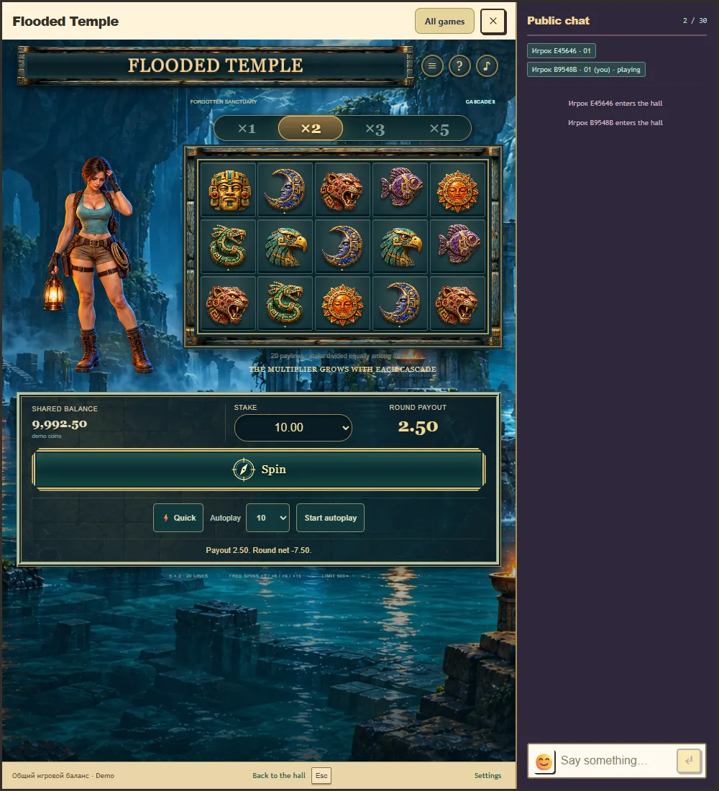

# Flooded Temple: устройства, управление и звук

29 октября 2026 года. Второй пункт итоговой приёмки. Пакет 0.9.2, контракт API/rules/progress 1/2/2. Техническая браузерная часть пройдена; физические телефоны, динамики, проводные наушники и Bluetooth пока не проверены. Production не изменён. Правила, вероятности, выплаты и ранее принятые раунды сохранены.

## Исправления

В телефонной раскладке кнопки истории, правил и звука имели область нажатия 29 на 29 CSS-пикселей. Теперь она составляет 44 на 44; ряд поднят внутри прежней шапки. Размер поля, каскады и место героини сохранены. Проверены касания, доступ к управлению при прокрутке, переход между портретной и альбомной ориентацией и reduced motion. На узком экране высокий игровой контент остаётся прокручиваемым.

Планировщик звуков просматривал только текущую и следующую фазу. При короткой немой проверке поля и сведениях о задержке аудиовыхода 300 мс итоговый нейтральный сигнал назначался на 15 мс позже необходимого начала и пропускался. Теперь он рассматривает подтверждённые будущие сигналы в пределах временного горизонта. Общий бюджет десяти источников, отмена при прерывании и отсутствие повторного воспроизведения сохранены. Длительности визуальных фаз не менялись.

Отказ загрузки музыкального файла обнаружил ещё одну ошибку: диагностический флаг показывал воспроизведение при позиции 0 и отсутствии данных. Теперь фактическое воспроизведение и резерв источника различаются. После ошибки запись повторно загружается по следующему нажатию игрока. Во время отказа подтверждённая игра и записанные эффекты продолжают работать. Проверено восстановление музыки с продвижением позиции после снятия сетевого отказа.

## Измерения и границы

| Проверка | Результат |
| --- | --- |
| Chrome, обычный бонус из 31 выпадения | 3576 межкадровых интервалов, p95 7,2 мс, максимум 48,7 мс; растяжений временной шкалы нет. |
| Chromium, 390 на 844, DPR 3, touch, CPU 4x | 2292 интервала, p95 21,3 мс, максимум 139 мс, 18 интервалов длиннее 50 мс; подтверждённые выпадения сохранены, шкала не зависала. |
| Edge, обычный каскад | Отдельно проверены декодирование записей, общий аудиовыход и тот же денежный итог. |
| Цифровой микс, общая громкость 100% | В двух длинных прогонах измерено более 2,5 млн отсчётов на профиль при 48 кГц. Пики 0,2076 и 0,2241; отсчётов с абсолютной амплитудой не меньше 1 нет. |
| Оценка задержки 300 и 700 мс | Все четыре сигнала короткого каскада назначены вовремя; suspend, mute и resume не повторяют старые сигналы. |
| Графический контекст | При потере WebGL остаётся изображение героини; после восстановления снова доступны шесть текстур и прежний подтверждённый результат. |
| Настоящий Royal | Desktop и телефонная эмуляция с подключённым чатом, доступным вводом, вращением и закрытием/переоткрытием. Сообщений от имени пользователя не отправлялось. |

Эмуляция работала на Windows с NVIDIA GeForce RTX 4070 Laptop GPU через ANGLE/D3D11. Замедление CPU не воспроизводит мобильный GPU, нагрев, энергосбережение или Safari. Это не измерения физического Android или iPhone. Период кадров определяется и частотой настольного дисплея; приведённые числа не обещают такой результат на телефоне.

Задержка 300/700 мс подставлена в метаданные AudioContext. Физический звуковой тракт при этом не задерживался. Проверка подтверждает расчёт времени запуска и поведение при прерывании, а не синхронизацию конкретных Bluetooth-наушников.

Цифровой микс измерен AudioWorklet до общего лимитера, с беззвучной измерительной ветвью. Наличие сигнала, отсутствие цифрового клиппинга и контроль количества голосов не подтверждают приятность звучания. Музыка Scott Buckley «Memories Of Stone», её лицензия и исходные записи эффектов сохранены. Новые звуковые файлы не добавлялись.

## Страница физического прослушивания

`npm run preview:temple:devices` запускает отдельную временную PostgreSQL и локальный стенд на 5233/2633. [Страница проверки](http://localhost:5233/tests/fixtures/temple-device-review.html?lang=ru) предлагает три повторяемых примера: частичный возврат, 20 бесплатных вращений и предел 500×. Подготовленная случайность работает только в явно включённом тестовом стенде. В production такой игровой выбор не добавлен.

Выбор следующего примера не меняет уже принятый раунд или его продолжение. Повторы запроса используют прежний UUID. Отдельное имя cookie стенда сохраняет авторизацию других локальных превью; правила origin и авторизация production не менялись.

На реальном устройстве нужно выбрать пример, нажать «Вращать» в самой игре и прослушать его при известной системной громкости. В раскрывающейся форме указываются модель, вывод звука, понятность события, баланс музыки и эффектов и замечания о резкости, задержке или утомлении. Замечания скачиваются локальным JSON, без отправки на сервер. Флажок прослушивания является подтверждением пользователя, а не автоматическим заключением о качестве.

Подключённого Android-устройства при инвентаризации ADB не было. Для полного закрытия этого пункта остаются физические устройства и прослушивание через выбранный вывод. Вопрос об имеющихся моделях и наушниках направлен пользователю; положительный результат прослушивания не предполагается без ответа.

## Воспроизводимость

`npm run test:temple:devices` проверяет 11 браузерных сценариев на свежем стенде 5232/2632. `npm run test:temple` включает регрессии планировщика, отказа музыки, изоляции cookie, математики и общего кошелька. Полная сборка и RTP-gate дополняют проверку. Точные результаты, пакет и ограничения находятся в [машинном отчёте](flooded-temple-device-acceptance-verification.json).

[Телефонный экран, прокрученный к управлению и чату](../assets/flooded-temple/device-acceptance-phone.webp).
