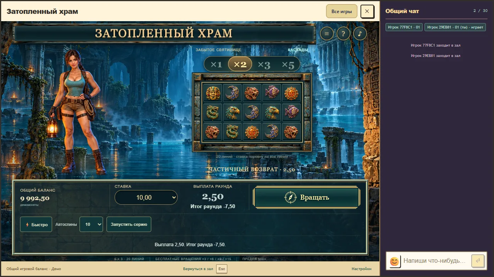
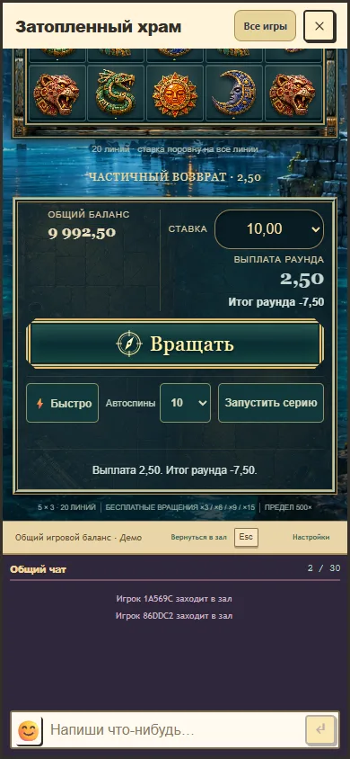

# Flooded Temple 0.9.4: spin motion repair

Verified on 30 October 2026, from the synchronized development baseline `c4e1bab9c6fe08c08508465ab3077aef985af450`. Local package: `0.9.4-08826707418d`, source hash `08826707418db2cb8e260ddd471f17fd060e8a65933b2525ae2e442273375560`. Contracts remain 1/2/2. This is a local presentation update, not a production installation or a newly prepared production release.

The reported spin jerk had three causes. Rebuilding the entire markup replaced the cabinet and controls on transport and feedback updates. Adding the round-net row resized the console and changed the desktop cabinet width from 413.328125 to 402.421875 CSS pixels in the initial 1280 by 720 fixture reproduction. In the narrower Royal host, a wrapping caption moved the cabinet another 4.875 pixels. The character also instantly selected different illustrated silhouettes on consecutive beats.

The cabinet, cells, controls, effect layer and heroine canvas now remain mounted. Net, autoplay-note, caption and status space is reserved before text arrives. The six source portraits are preserved; the cascade character uses one anchored illustration with eased gaze and gesture intensity. This is restrained illustration movement, not skeletal animation. The saved v1 expedition retains its previous portrait presentation.

The previous incoming grid placed each column's new stones at the same offscreen position. Its accelerated descent kept most movement above the clipping edge, making the symbols appear nearly at rest. New columns now start with proper row spacing and enter the visible field earlier, easing into the same recorded landing accent. Survivors still descend by the exact confirmed vacancy count. Event durations, sound files, accepted grids, paytables, probabilities, stakes, wallet rules and operation UUIDs are unchanged. Motion parameters are game design choices, not scientific perception thresholds. See the [event specification](../../games/flooded-temple/cascade-feedback.md).

Verification:

- Five browser scenarios passed on the final package: normal fixture, actual connected Royal host at 1280 by 720 and 390 by 844, quick/reduced/pause/quiet reopen, and a complete 31-fall bonus with one paid start. The first three passed together; after correcting test-only scenario resets, the last two passed separately. No production account, wager or chat message was used.
- Cabinet and heroine geometry relative to the game root changed by zero CSS pixels in both host profiles. The narrow iframe scrolled one CSS pixel when pointer focus moved to its primary control; this is recorded separately from internal layout. The top stone had 23 distinct moving visible positions on desktop and 9 on the narrow profile. These are captured samples, not a physical-device performance guarantee.
- The ordinary fixture and host cases retained the same cabinet, portrait canvas and primary-button DOM nodes throughout the accepted round. Bonus continuations retained the final confirmed grid and exact 30250-unit payout.
- All 56 Temple mathematical, wallet, compatibility, transport and feedback tests passed. `check:rtp` verified 18 registered profiles; 114 unchanged legacy identities remain explicitly unqualified. No qualification proof or baseline was edited.
- Final full application build, module typecheck and all 7 independent-module/resource tests passed. The catalogue inventory assertion now includes the already integrated Hong Kong Warrior alongside Temple: 122 identities, matching the catalogue and module documentation.

Browser checks use Windows Chrome and a narrow viewport, not a physical phone or Safari. This update does not claim a new listening-quality result. Earlier physical listening limitations remain recorded in the device acceptance work.

The local stand remains at `http://127.0.0.1:5233/tests/fixtures/temple-preview.html?lang=ru&version=0.9.4`, with its existing synthetic wallet/database and isolated cookie namespace. The previously pending operation was retried with its existing identity before reopening; the observed 9785.00 demo balance was preserved. A later production publication needs new preparation and verification from the chosen committed source, since normal build outputs now contain 0.9.4 rather than the earlier 0.9.3 candidate.

Temporary ownership: `artifacts/work/temple-motion-fix/OWNER.txt`. No archives, full source copies or dependency copies were created. Keep the active local preview, current immutable package and compact final evidence until review ends. Previously rejected cleanup targets and other chats' previews are outside this cleanup scope.
