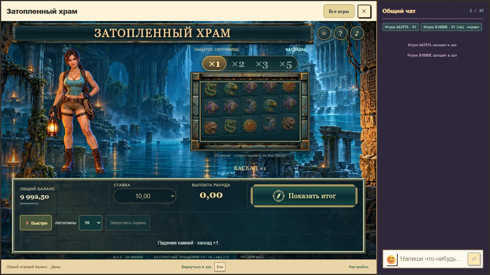
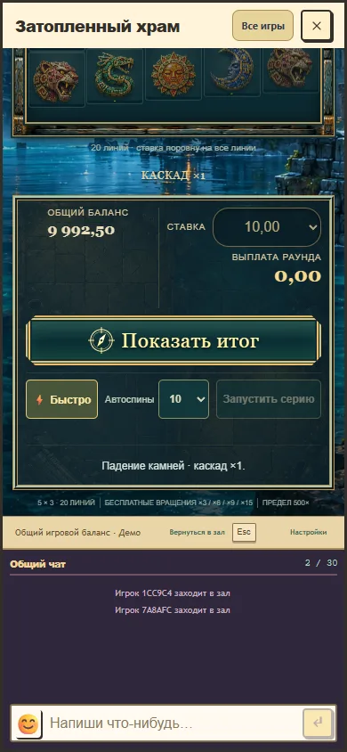

# Flooded Temple 0.9.5: animated quick spins

Verified on 30 October 2026. The previous Quick option selected the same still-summary path as reduced motion, so it omitted every incoming grid. Quick now retains the complete sequence of confirmed falls, line evaluations, winning-union removals, free spins and return to the saved base chain. Its presentation clock runs at twice the normal rate. Drop contact, rebound, amount counters and recorded cue accents share that rate. Quick removes particles and moving line paths, while keeping the stones' fade, gravity and landing visible. Normal pacing and the recorded files are unchanged.

Quick no longer disables the explorer's continuous mesh motion. The system reduced-motion preference still selects a still summary, including when Quick is enabled. Switching Quick during a presentation applies to the next plan and does not cancel the active fall. Show result remains the explicit skip action for the full accepted paid round. This is a visual timing change; no paytable, probability, stake, cost, RNG, bonus rule, qualification proof or settlement code changed. The automatic 550 ms request guard is retained. Timings are design choices for this game, not scientific thresholds.

Package: `0.9.5-76d19e8e4cc3`, API/rules/progress 1/2/2. Full source digest and compact measured evidence are in [the verification record](flooded-temple-quick-verification.json). Development started from synchronized main `493409500718374c67837c4c193ed1ca6f2c555b`, preserving the earlier Temple motion fix and concurrent Caribbean/Hong Kong Warrior changes.

All 9 browser scenarios passed in one run: ordinary fixture; connected Royal with chat at 1280 by 720 and 390 by 844 in both normal and quick modes; quick sound accents plus reduced motion, preference switching, pause and quiet reopen; a full 31-fall bonus in each speed; and exactly ten quick autoplay paid rounds. The bonus returned the identical 30250 integer units with one paid start and zero-cost continuation in both speeds. Ten blank autoplay rounds produced ten distinct starts, ten displayed falls and the exact 9900.00 remaining demo balance. Synthetic accounts and isolated local databases were used; no chat message or production wager was sent.

The quick desktop and narrow profiles retained their cabinet, portrait canvas and primary control nodes. Board and explorer bounds relative to the game root changed by zero CSS pixels. The incoming top stone was captured at 29 distinct visible positions on desktop and 31 on the narrow profile. The narrow iframe separately moved one CSS pixel due to pointer-focus scrolling. These samples are evidence of visible motion, not a physical-device performance guarantee. The unchanged normal bonus scenario took 27.8 seconds and quick took 15.9 seconds in this browser run; these observed end-to-end times include requests and audio lead and are distinct from the exact 2x event-clock rate.

All 56 Temple tests, all 7 module/resource checks, the module typecheck and the full application build passed. The audio latency regression now covers both speeds with simulated 20/300/700 ms output latency. Dense normal/quick PCM mixes remained within the existing headroom assertion, with bounded voice overlaps. `check:rtp` verified 18 registered profiles; the 114 frozen legacy identities remain explicitly unqualified. Windows Chrome viewport checks do not certify a physical phone, Safari, Bluetooth or subjective listening quality.

The active local stand is `http://127.0.0.1:5233/tests/fixtures/temple-preview.html?lang=ru&version=0.9.5`, retaining its existing synthetic database and isolated cookies. The loaded immutable version was checked in the user's browser and Quick was enabled without starting a paid round. The displayed demo balance at that check was 9632.50. No production installation occurred; a publication requires fresh release preparation from its chosen committed source.

Temporary scope: `artifacts/work/temple-quick-motion/`, with ownership and cleanup condition in `OWNER.txt`. No archives, source staging copies or dependency copies were created. Current preview data, the active immutable package and compact final evidence remain available until review ends. Earlier rejected cleanup targets and other chats' local servers are excluded from this scope.

Final preservation: GitHub branch `codex/flooded-temple` was verified at `d4f2ce3deeb8a51c6c06a61d3e0956b296c89a2c`, including synchronized main `afbb4a9906868550ee6dae610c1ab2960c901975`. That synchronization added independent Hong Kong Warrior music and deployment tooling, with no Temple source changes. The full build and all 7 module/resource checks passed again after synchronization. The Temple manifest and its 39 media hashes remained unchanged.

When work resumed, the previous shared dependency directory no longer contained esbuild or TypeScript. Only this checkout's `node_modules` junction was redirected to the existing installation in `C:/Users/Aorus/.codex/worktrees/new-slot/royal/node_modules`, already used by another active checkout. Versions of esbuild, TypeScript, Vite, Playwright, embedded PostgreSQL, Colyseus core, Phaser, pg and Noble hashes were checked against this checkout's lockfile. No dependencies were copied or installed, and neither target's contents were modified. The final full build passed with the reused installation.

The earlier localhost process had also stopped before the user's continuation. The owned preview was restarted on 5233/2633 with its established cookie namespace and a fresh disposable test database; its new account receives the existing 10000 demo-coin preview deposit. This is separate from production wallets and does not assert persistence of the previous disposable database's balance.

Cleanup after verified GitHub preservation removed 7 task-owned files totaling 395773 bytes: `browser.log`, `build.log`, `temple-tests.log`, `host-1280.webp`, `host-390.webp`, `host-1280-quick.webp` and `host-390-quick.webp` under `artifacts/work/temple-quick-motion/`. Removed directories: 0. Removed archives: 0, 0 bytes. The two useful falling-state captures were moved into the tracked report assets before cleanup. Measured C: free space was 197082628096 bytes before removal and 197083033600 after. These volume readings can include concurrent activity; no separate physical-space attribution is claimed. Compact JSON evidence, cleanup inventory/result, current normal build outputs, the live preview database and current immutable package are retained for review. Previously rejected targets were not retried.
