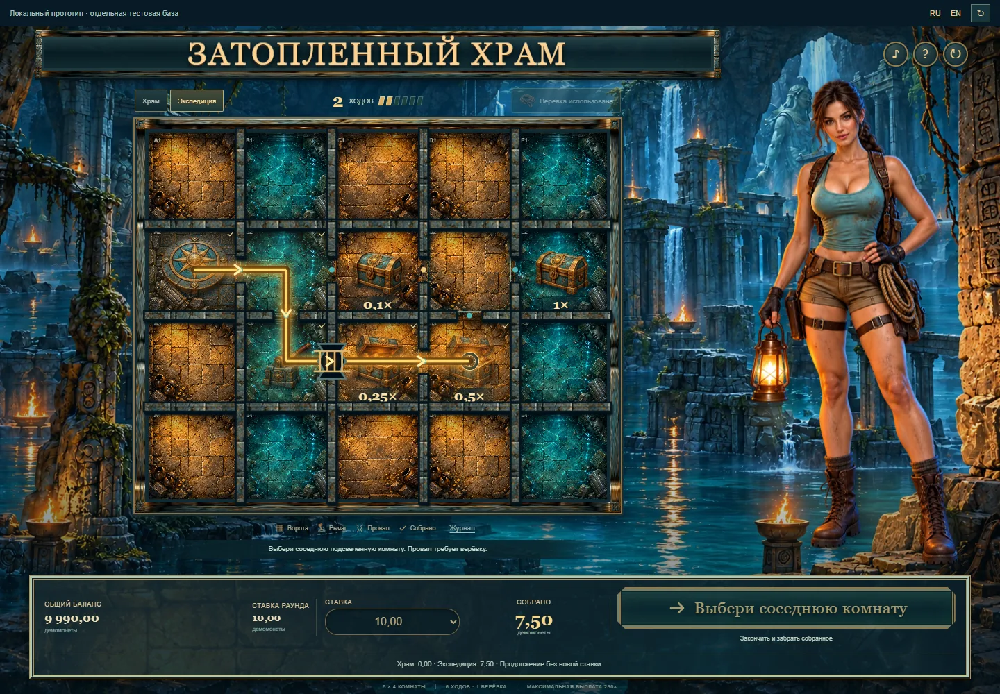

# Затопленный храм: соответствие референсу

Доработка версии 0.4.0, начата 27 и продолжена 28 октября 2026 года по просьбе пользователя следовать утверждённому изображению и заменить ретро-звучание. Сохраняются взрослая героиня с фонарём, затопленный храм, реальные комнаты 5×4, правила и квалифицированная математика. Основной ориентир: `docs/assets/flooded-temple/approved-concept.png`.

| Расхождение версии 0.3 | Изменение и проверяемый результат |
| --- | --- |
| Плоские одноцветные плитки | Четыре нарисованных пола с камнем, водой, керамикой и обломками. Компасный пол используется только у входа. Декор не задаёт проходы или награды. |
| Маленькие условные значки | Объёмные сундуки и реликвия, парные состояния сундука и рычага. Награды и доступные переходы по-прежнему принадлежат серверной карте. |
| Разреженная композиция и большой блок управления | Поле занимает большую долю сцены; название находится на каменной табличке над ним. Героиня крупнее, панель управления ниже и компактнее. |
| Слабый золотой след | Светлый маршрут со стрелками в реальных дверях, движение компаса и прорисовка нового участка. |
| Однофазные отклики | Сундук переходит в открытое состояние с коротким свечением и шестью искрами, рычаг меняет положение перед подъёмом решётки, верёвка натягивается до перехода. Частицы ограничены и принадлежат общей шкале. |
| Синусоидальные музыкальные сигналы | Полная оркестровая композиция Scott Buckley и предметные эффекты из лицензированных записей. Процедурные осцилляторные заготовки удалены из текущего микса. |

Новые материалы созданы встроенным `image_gen.imagegen` с утверждённым концептом как референсом стиля. Задания и техническое преобразование сохранены в [reference-polish-prompts.json](../assets/flooded-temple/reference-polish-prompts.json). Рабочие файлы: `public/assets/flooded-temple/rooms.webp` и восемь прозрачных ресурсов в `props/`. Изображения фона и героини сохранены.

Визуальные длительности являются художественными гипотезами: посадка ряда 100 мс с акцентом на 72 мс; движение 180 мс и прибытие 55 мс; сундук 420 мс; рычаг 140 мс, решётка 420 мс; верёвка 520 мс с креплением на 330 мс; реликвия 1000 мс и смена карты 420 мс. Нейтральные итоги остались короткими; положительный и крупный итог занимают 1100 и 1900 мс и допускают пропуск. Это не научные пороги.

Все конечные эффекты продвигаются общим clock и освобождаются при пропуске, паузе, закрытии и смене аккаунта. Время подготовки аудио включает смещение акцента внутри нового файла. Reduced motion сохраняет один статический итог без движения и частиц. Частичный возврат не получает наградную тему. Сбор сундука остаётся предметным событием и не изображает новое зачисление в кошелёк.

Звуки воспроизводятся исходником `scripts/design/temple-audio.mjs`. Новое [превью тембров](../assets/flooded-temple/reference-sound-preview.wav) длится 16 секунд и не является записью раунда. WAV используют общий AudioContext и настройки Royal. Измерения сигнала не заменяют человеческое прослушивание; телефоны, проводные наушники и Bluetooth будут отмечены отдельно от браузерных технических проверок.

## Музыкальное направление и источники

После замечания пользователя о старом игровом звучании выбран другой подход. Основа: [Memories Of Stone](https://www.scottbuckley.com.au/library/memories-of-stone/) by Scott Buckley, CC-BY 4.0. Автор описывает струнно-духовую композицию как музыку об исследовании руин исчезнувшей цивилизации. Это основание художественного выбора, а не измеренная оценка предпочтений игрока. Сохранён полный неизменённый MP3 master длительностью около 5:30. Он играет внутри сцены, не перезапускается при ходах и не декодируется целиком в отдельный большой AudioBuffer. Музыка не публикуется самостоятельным аудиопревью.

Музыкальный поток проходит через существующие AudioContext и выход Royal. Mute, нулевая громкость, скрытие и пауза останавливают его с сохранением позиции; закрытие освобождает media source. Главные события приглушают фон. Атрибуция, источник и ссылка CC-BY 4.0 доступны в разделе правил «Музыка и звук» и рядом с игровыми ресурсами.

Предметные слои: Kenney Impact Sounds / RPG Audio (CC0), stone door by bonebrah (CC0), верёвка, всплеск и металлические подвески Joseph SARDIN / BigSoundBank (CC0), цепь DenisChardonnet / BigSoundBank (CC0), cave ambience JaggedStone / OpenGameArt (CC0). Сохранены только используемые исходные фрагменты, сведения об авторах, URLs и SHA-256 в `games/flooded-temple/assets/audio-source/sources.json`. Миксы подготовлены в стерео PCM16, 48 кГц. Свободная лицензия проверена по первичным страницам авторов; при HTTP 403 у Kenney выбранные оригинальные OGG и лицензии получены из явно указанного CC0 зеркала.

Короткий звук сундука состоит из защёлки, скрипа и негромкого движения монет; решётка сочетает цепь и каменное трение, верёвка имеет звук натяжения и крепления. Реликвия и крупный итог используют металлические резонансы и подвески, без синтезированного арпеджио. Частичный возврат остаётся нейтральным. Превью содержит только CC0 эффекты, а оркестровую тему следует оценивать вместе с игровой сценой либо на странице композитора.

Проверка проводится на тех же подготовленных исходах без реальных ставок: обе карты, сундук, рычаг, верёвка, шестой ход, частичный возврат, крупный итог, восстановление и потерянный ответ. Сравниваются версия 0.3 и новый вариант на одинаковых размерах окна Royal с активным чатом, RU/EN и при reduced motion. Изменение материала, композиции и тембра выполнено совместно по просьбе пользователя, поэтому это художественная итерация, а не изолированный эксперимент о влиянии одного параметра.

## Проверки и результат

Пройдены 29 тестов движка, кошелька, HTTP и обратной связи, 26 проверок RTP gate, 6 проверок модульного контракта и 19 браузерных сценариев. Полная сборка прошла с квалификацией 13 профилей, typecheck, всеми 119 модулями, host и backend. Математические исходники, ставки, вероятности, продолжения и расчёт выплат этой итерацией не изменялись. Точные доказательства сохранены; обхода квалификации нет.

В настоящем окне Royal с подключённым чатом проверены desktop и компактный viewport. RU/EN и размеры 1440×1000, 1000×760, 390×844 и 360×740 сохраняют комнаты не меньше 44 пикселей, доступное управление и отсутствие горизонтального переполнения или пересечения поля с консолью. Исправлены увеличение текстуры посещённой комнаты и выход иллюстрации за пределы сцены. На узком экране приоритет отдан карте и управлению; портретная адаптация требует вертикальной прокрутки.

Проверены парные состояния сундука, ограниченные частицы, пропуск эффекта на паузе, отмена при закрытии/смене аккаунта, потерянные ответы и восстановление без повтора наград. Музыкальный поток сохраняет позицию между ходами, следует общим mute/volume и паузе и освобождает свой media source при закрытии. В демонстрационном маршруте после четырёх ходов источник имел readyState 4, время 11,46 с и не сообщал ошибку воспроизведения. Это техническое подтверждение потока, не оценка приятности.

Максимальное кадровое отклонение от запланированного браузерного акцента: 16,91 мс в обычном режиме, 35,00 мс при имитации задержки 200 мс и 55,72 мс при замедлении CPU 4×. Из десяти коротких акцентов обычного прогона одна фаза прибытия 55 мс не получила отдельный кадр; следующая подтверждённая фаза уже показывала правильную текущую комнату. Пропущенные украшения не догоняют игрока очередью. Имитационные прогоны не отмечали пропущенных фаз. Это измерения конкретных прогонов, а не универсальный допуск или физическая акустическая задержка.

Новые WAV занимают 3 715 740 байт; полный MP3 master 13 217 159 байт. SHA-256 master совпадает с файлом автора. Сведения о версиях, проверках, временных шкалах и ограничениях: [машиночитаемый отчёт](flooded-temple-reference-verification.json). Динамики физических телефонов, проводные наушники, Bluetooth, утомление при повторении и человеческая оценка новой подборки не объявляются проверенными.

[Настоящее окно Royal с чатом](../assets/flooded-temple/reference-desktop.webp), [компактный экран с чатом](../assets/flooded-temple/reference-mobile.webp).

## Сохранение и локальный просмотр

Исходники, текущие материалы, неизменённый музыкальный master, атрибуция и исходные фрагменты эффектов сохранены в GitHub, коммит `790801ce14427cef6b31dcf0e7503234c68b45de` ветки `codex/flooded-temple`. Удалённый SHA проверен через `ls-remote`. Общая основа: свежий main `57cac4b61b189c8e037849e111e6c9608d329fd4`. Публикации игры на production не было.

Локальный [стенд версии 0.4.0](http://127.0.0.1:5226/tests/fixtures/temple-preview.html?lang=ru&version=0.4.0) оставлен для просмотра пользователем. Он использует отдельную временную PostgreSQL и демомонеты. Первый клик разблокирует звук. Полный музыкальный master можно слушать в игровой сцене; страница автора доступна из правил. Владелец процесса preview: PID 28908, терминальная сессия 5269. После завершения просмотра остановить этот процесс штатным Ctrl+C, чтобы wrapper освободил свою тестовую базу.

Для очистки проинвентаризировано 131 167 122 байта временных материалов этой итерации и неактивных пакетов. Все ранее заблокированные пути исключены. Автоматическая проверка разрешений отклонила удаление: `blocked by policy`, без подробной причины. Удалено папок, файлов, архивов и байт: 0. Повтора и обхода нет; физическое освобождение диска не заявляется. [Отчёт хранения](flooded-temple-reference-storage.json) содержит точные пути, размеры, замеры свободного места и условия очистки активного стенда. Worktree и общие зависимости сохраняются для продолжения всей игры и одновременной работы других чатов.
