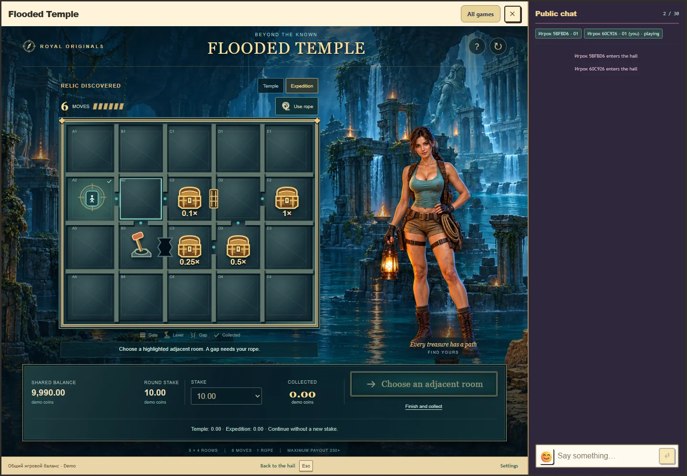

# Затопленный храм: интерфейс этапа 3

Проверено 27 октября 2026 года.

Интерфейс реализован как независимый пакет `games/flooded-temple/` версии 0.2.0. В этой ветке игра доступна из коллекции Royal через общий loader. Она использует существующие места, общий кошелёк, серверные сессии и транспорт; отдельного баланса нет. Публикация не выполнялась. Перед ней необходим совместимый host/backend с поддержкой Temple в ExpansionClient.

Поле 5 × 4 строится по принятой сервером карте. Открытые проходы, стены, ворота, рычаги, провал, постоянный мост, сундуки, реликвия и пройденный маршрут отражают подтверждённый снимок. До первого старта карта не разыгрывается локально. Основное исследование завершается автоматически; его итог можно осмотреть на вкладке «Храм».

В экспедиции игрок выбирает соседнюю подсвеченную комнату и подтверждает переход. Для провала сначала выбирает единственную верёвку. Счётчик показывает оставшиеся ходы, собранный сундук отмечается галочкой. Раннее завершение показывает собранную сумму перед окончательным подтверждением. Простое закрытие оставляет раунд доступным для продолжения.

Клиент сохраняет UUID до запроса, повторяет ту же операцию при неизвестном ответе, проверяет серверную историю и полный конверт результата. Активный раунд и неопределённая операция блокируют изменение ставки. Смена аккаунта очищает чужой снимок. Сумма «Собрано» во время бонуса отделена от начисленной выплаты; итог завершённого раунда явно показывает выплату и результат за вычетом ставки. Сумма следующего исследования указана на кнопке. Недостаточный баланс блокирует новый платный старт, но не бесплатное продолжение.

Фон и взрослая героиня с лицом к игроку получены встроенным `image_gen.imagegen` по одобренному концепту. Ресурсы: [героиня](../../public/assets/flooded-temple/explorer.webp), [храм](../../public/assets/flooded-temple/temple.webp), [обложка каталога](../../public/assets/flooded-temple/cover.webp). [Полные промпты и параметры сохранения](../assets/flooded-temple/generation-prompts.json). Поле, содержимое комнат и проходы отрисованы кодом, без нарисованной карты исходного концепта.

## Проверки

| Проверка | Результат |
| --- | --- |
| `npm run check:rtp` | 11 профилей прошли; математические исходники Temple и доказательство этапа 2 не изменены |
| `npm run test:temple` | 22 проверки: математика, общий журнал, реальный common-wallet HTTP, сохранение, конкурентные операции, откат начисления и строгая клиентская проверка |
| `npm run test:rtp-gate` | 19 проверок, включая запрет устаревших и подделанных доказательств |
| `npm run test:temple:ui` | 6 сценариев Chrome, полный проход UI, сервиса и отдельной PostgreSQL |
| Каталог Royal и регрессия LAST EXIT | 6 проверок |
| Контракты, пакет и границы host | 6 профильных проверок independent-modules |
| `npm run build` | Общая сборка host/backend и всех 118 независимых модулей прошла |

Браузерные сценарии проверяют RU/EN, правила, клавиатуру, 20 комнат, отсутствие горизонтального выхода и перекрытия управления, области комнат не меньше 44 CSS px. Проверены размеры 1440 × 1000, 1000 × 760, 390 × 844 и 360 × 740. На компактном экране внутреннее поле игры прокручивается, чат остаётся в окне host.

Потеря ответа воспроизводится после реального принятия платного старта и бесплатного хода. Повтор сохраняет UUID, ставку и число ходов; перезагрузка и переоткрытие восстанавливают раунд. Маршрут `B2 → B3 → C3 с верёвкой → D3 → D2 → E2` завершает шестой ход и начисляет 17,50 при исходной ставке 10,00 в подготовленном исходе. Другой сценарий возвращается в посещённые комнаты и заканчивает с 1,00, чистым итогом -9,00 и без повторной оплаты сундука.

Реальный host подключён к локальной комнате с двумя участниками и видимым активным чатом. Игра открыта из существующего места Royal, переключение в каталог и обратно восстанавливает бонус, выход возвращает чат в зал. Ошибок JavaScript в проверенных сценариях нет.

[Компактный экран с чатом](../assets/flooded-temple/stage3-mobile.webp).

Это техническая проверка в настольном Chrome с изменением размеров viewport. Физические телефоны и субъективное удобство у участников не проверены. Анимационная шкала, звуковые ресурсы и прослушивание остаются этапом 4. Наличие работоспособного интерфейса не является оценкой приятности звука или удовольствия от игры.

## Локальный запуск

После установки зависимостей выполнить `npm --prefix games/flooded-temple run build`, затем `npm run preview:temple`. Адрес стенда: `http://127.0.0.1:5226/tests/fixtures/temple-preview.html?lang=ru`, английская версия: `?lang=en`. Остановка: Ctrl+C. Стенд запускает отдельную временную PostgreSQL, не загружает `.env` и использует только локальные демомонеты.

`npm run test:temple:ui` запускает воспроизводимые подготовленные исходы только в локальном тестовом стенде с `TEMPLE_TEST_RNG=1`. Этот код не импортируется приложением production. Обычный сервер игры использует `crypto.randomInt`. Подмена исходов в опубликованную игру не добавлена.

Следующий этап: анимации и звук по карточкам событий в [спецификации](../flooded-temple.md) и [game-feedback](../game-feedback.md), без изменения квалифицированной математики.
