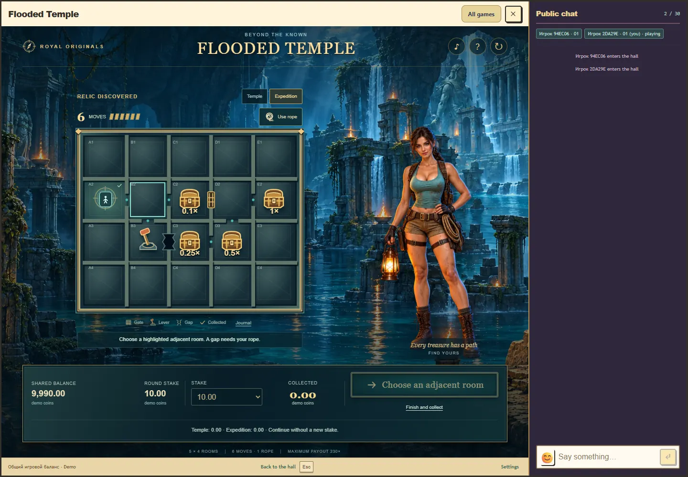

# Затопленный храм: анимация и звук

Этап 4, реализован 27 октября 2026 года. Основа: карточки событий в `docs/flooded-temple.md` и требования `docs/game-feedback.md`. Правила, вероятности, ставки и расчёт выплат этапа 2 не меняются.

## Решения перед реализацией

| Событие | Подтверждение и представление | Звук, главный акцент | Предварительная длительность |
| --- | --- | --- | --- |
| Ожидание запроса | Нейтральные закрытые плитки, без будущих символов и сумм | Тихое начало каменного движения, без наградной гармонии | До ответа API |
| Карта | Четыре ряда последовательно занимают свои места | Низкий короткий каменный удар на посадке ряда | 65 мс на ряд |
| Переход | Маркер проходит только по рёбрам подтверждённого пути; остаётся след | Шаг с водой при прибытии | 170 мс движения, затем 35 мс акцента |
| Сундук | Открывается крышка, видна добавленная сумма; счётчик приходит к точному значению | Металлический акцент при начале открытия; это сбор, а не зачисление | 260 мс |
| Рычаг и ворота | Рычаг поворачивается, связанная решётка поднимается | Щелчок и цепь в момент начала подъёма | 100 мс подготовки, 300 мс подъёма |
| Верёвка | Сначала крепление и мост над выбранным провалом, затем переход | Свист и натяжение при закреплении | 300 мс до перехода |
| Реликвия | Мягкое освещение и отдельный переход к карте шести ходов после основного исследования | Короткая тема открытия, без звука начисления | 600 мс, затем 320 мс перехода |
| Нулевой итог / частичный возврат | Спокойный итог с точными выплатой и чистым результатом | Нейтральное завершение без фанфар | 250 / 350 мс |
| Возврат ставки | Точный нулевой чистый итог | Короткий нейтральный тон | 450 мс |
| Положительный итог | Итог полной принятой ставки, мягкое золотое выделение | Короткая наградная фраза | 700 мс |
| Крупный положительный итог | От 5 исходных ставок; поле остаётся читаемым | Более длинная фраза с большей фактурой, без скачка громкости | 1400 мс |

Длительности и граница 5× являются инженерными и художественными гипотезами этой игры, не научными порогами. Частичный возврат определяется относительно всей исходной ставки со всеми бесплатными продолжениями. Финальная выплата принадлежит серверу; счётчик представления не выполняет денежные операции.

Авторские звуки создаются воспроизводимым генератором PCM: вода, камень, металл, цепь, верёвка и музыкальные фразы. У каждого файла есть заданный акцент и короткий плавный вход/хвост. Звуки подключаются к существующим AudioContext и выходу host. Сохранённые настройки громкости и mute остаются общими; собственный аудиоконтекст не создаётся. Тихая водная атмосфера уступает главным событиям.

Аудиовремя выводится в шкалу performance через `getOutputTimestamp()`, когда timestamp пригоден. Иначе учитываются доступные `outputLatency` и `baseLatency`, а ограничение фиксируется в диагностике. Визуальные события и звуковые акценты получают общий план. Проверка timestamp и кадрового отклонения не равна измерению звука у физического динамика.

Закрытие, смена аккаунта и уничтожение отменяют очередь, голоса и анимации. Пауза сохраняет позицию визуальной шкалы и отменяет звук; возвращение не воспроизводит прошлые акценты. Mute и нулевая громкость не накапливают отложенные звуки. Восстановление и проверка потерянного ответа показывают подтверждённый снимок без повторного празднования. Кнопка пропуска завершает представление без новой ставки. Reduced motion показывает понятный статический итог и журнал без пролётов, вращений и потока эффектов.

## План проверки

Проверить одинаковые подготовленные исходы: основной путь, рычаг и связанные ворота, верёвку и повторное пересечение, сундук без повторной оплаты, реликвию, шестой шаг, раннее завершение, частичный возврат и крупный положительный итог. Отдельно проверить API в ожидании, потерю ответа, восстановление, закрытие в середине события, смену аккаунта, паузу, скрытие, mute, нулевую громкость и изменение reduced motion во время шкалы.

Проверить ограничение числа голосов, освобождение узлов, точный счётчик и отсутствие повтора наград, пики/наложения PCM, связь аудиовремени и визуальных акцентов. Проверить настоящее окно Royal с чатом на desktop и компактном viewport, RU/EN. Физические динамики телефона, проводные наушники, Bluetooth и субъективная приятность требуют отдельного прослушивания и не будут объявлены проверенными по RMS или наличию сигнала.

## Реализация

Модуль версии 0.3.0 сохраняет host API 1, правила 1 и прогресс 1. `presentation.ts` строит план только по подтверждённому снимку и истории сервера. `TempleTimeline.ts` ведёт общую шкалу, `TempleEffects.ts` управляет её визуальными фазами, `TempleAudio.ts` подключает звуки к общему выходу Royal. Декоративные счётчики не меняют кошелёк. Пропуск, пауза, журнал и reduced motion сохраняют точный итог.

Исходные изображения храма и героини сохранены. На карте по очереди появляются ряды, маркер следует физическим проходам, сундук открывает крышку, рычаг поднимает связанную решётку, верёвка закрепляется до перехода. Исследование основной карты завершается перед входом в экспедицию. Нулевой итог и частичный возврат имеют спокойное завершение; положительные итоги оцениваются относительно всей исходной ставки.

Генератор `scripts/design/temple-audio.mjs` воспроизводит 12 оригинальных WAV: стерео PCM16, 24 кГц, суммарно 1 514 456 байт. Есть плавные края и ограничение наложений, атмосфера уступает важным событиям. Пики отдельных исходников находятся в пределах 0,04..0,30; проверенные плотные модельные смеси остаются ниже 0,70. Эти числа характеризуют сигнал и запас уровня, а не приятность звука.

[Превью звуков](../assets/flooded-temple/stage4-sound-preview.wav) длится 12 секунд. Это последовательность тембров: вода, камень, шаг, сундук, рычаг, верёвка, реликвия, нейтральный итог, возврат ставки, положительный и крупный итог. Это не запись игрового раунда.

Восстановление, неизвестный ответ и переоткрытие показывают сохранённый снимок без повторных акцентов. Смена аккаунта отменяет старые запросы представления даже при возвращении к тому же аккаунту. Закрытие освобождает принадлежащие модулю анимации и аудиоузлы. До первого жеста пользователя звук не запускается; поздно загруженные файлы не воспроизводят прошедшие события.

## Проверки итоговой интеграции

Свежий main добавил Caribbean Treasures и изменения общего host. Обе игры сохранены в каталоге, маршрутах, валидаторах и CI. Существующая позиция capability Caribbean в серверном API сохранена, Temple добавлен последним аргументом. Отдельный тест проверяет изоляцию двух capability без изменения баланса и расхода случайности.

Восемь чистых математических файлов обеих игр совпадают с соответствующими исходными коммитами. Политики, цели, допуски, независимые seeds и точные таблицы результатов не менялись. После проверки интеграционных обёрток штатная CLI заново квалифицировала Temple и Caribbean: 22 452 и 4096 серверных воспроизведений соответственно. `check:rtp` принимает 13 профилей; замороженный legacy baseline не менялся. Подробности: [проверка объединения](flooded-temple-stage4-integration.json).

Пройдены 29 тестов Temple, 46 тестов Caribbean, 26 тестов RTP gate, 6 проверок модульного контракта и 16 проверок совместимости общего финансового журнала и прогресса. Полная сборка включает typecheck, все 119 модулей, host и backend. Размер основного bundle вызывает существующее предупреждение Vite; сборка завершилась успешно.

Браузерная проверка использует настольный Chrome, подготовленные исходы и отдельную временную PostgreSQL. В неё входят реальное окно Royal с подключённым чатом, RU/EN, клавиатура, размеры 1440×1000, 1000×760, 390×844 и 360×740, полный бонус, повторные комнаты, верёвка, раннее завершение, потерянные ответы, восстановление и задержанный ответ прежнего аккаунта. Для аудио отдельно проверяются общий clock, пауза, mute, нулевая громкость, изменение reduced motion, закрытие, имитация скрытия страницы, задержки 200 мс и CPU slowdown 4×.

Все 17 браузерных сценариев прошли на итоговой версии. В трёх контрольных раундах записано по 10 визуальных акцентов, пропущенных фаз не отмечено. Максимальное отклонение rAF от запланированного браузерного времени акцента: 14,60 мс в обычном режиме, 11,00 мс при имитации задержки 200 мс и 23,50 мс при CPU slowdown 4×. Это измерения одного прогона, не гарантии для любого устройства и не физическая акустическая задержка. Машиночитаемые результаты: [отчёт проверки](flooded-temple-stage4-verification.json).

[Компактное окно с чатом](../assets/flooded-temple/stage4-mobile.webp) показывает нижнюю часть прокручиваемой игры и управление. Полная карта доступна прокруткой внутри окна; чат остаётся в общем host.

Физические телефоны, акустическая задержка динамиков, проводные наушники, Bluetooth и субъективное повторное прослушивание остаются непроверенными. Эмуляция viewport и выходной timestamp браузера этого не заменяют. Следующий этап 5: приёмка всей игры, включая человеческую оценку визуального темпа и звука. Публикация выполняется отдельно по процессу выпуска.

## Сохранение и временные материалы

Исходники, авторские WAV и итоговые материалы сохранены в GitHub в ветке `codex/flooded-temple`, удалённый коммит `4de2f4a8cfcee51edef9e36062f2e6eb6c3f93cc` проверен через `ls-remote`. Он включает свежие изменения общего проекта, включая запись публикации skins `d898e98`; эти последние изменения относятся только к deployment. Игра этого этапа на сервер не публиковалась. Проверочный стенд остановлен, порты 2626 и 5226 освобождены. Архивы выпуска, копии исходников и зависимостей не создавались.

Для очистки проинвентаризированы только временная папка этапа 4 и неактивные пакеты этого worktree, суммарно 88 324 511 байт. Все активные пакеты сохранены. Ранее заблокированные пути этапов 1 и 3 исключены. Автоматическая проверка разрешений отклонила удаление с ответом `blocked by policy`, без подробной причины. Удалено папок и архивов: 0, байт: 0. Повтор и обход отказа не выполнялись; физическое освобождение диска не заявляется. Пути, размеры и свободное место до и после: [отчёт хранения](flooded-temple-stage4-storage.json).

Активный worktree и junction общих зависимостей остаются для этапа 5 при одновременной работе других чатов в основном checkout. После завершения всей фичи и проверки сохранения GitHub лишний checkout подлежит удалению. Ранее записанные ограничения очистки не обходились.
