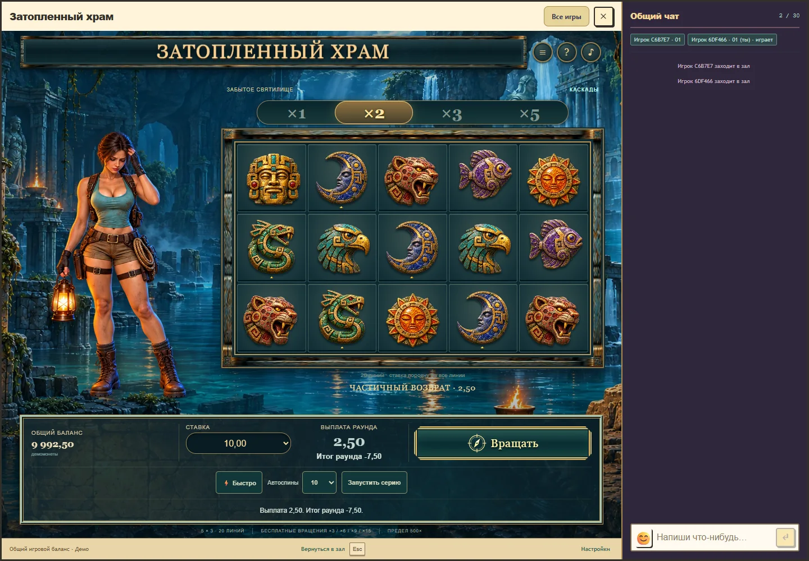

# Flooded Temple: визуальная приёмка

29 октября 2026 года. Третий пункт итоговой приёмки, версия 0.9.3. Проверены читаемость результата, положение героини и последовательность каскадов и бонусов в настоящем Royal с подключённым чатом. Контракт API/rules/progress остаётся 1/2/2. Production не изменён.

## Исправления

Найдена ошибка показа завершённого раунда. При принятой ставке 10,00 и выплате 2,50 выбор следующей ставки 20,00 превращал счётчик выплаты в 5,00, а итог в -17,50. Сервер и кошелёк сохраняли правильные суммы. Теперь все суммы каскадов, история и итог используют исходную принятую ставку. Переключение следующей ставки сохраняет выплату 2,50 и итог -7,50; следующий платный раунд использует новый выбранный размер.

После завершения остаётся явная подпись: без выплаты, частичный возврат, ставка возвращена, выигрыш или крупный выигрыш. Для предела действует отдельная подпись 500×. Рядом с выплатой показан результат за вычетом всей первоначальной ставки. На телефоне он находится отдельной строкой под суммой. Увеличены подписи и строка состояния. Частичный возврат не получает празднование прибыли. Восстановление показывает спокойную сводку, а смена аккаунта очищает прежний результат.

Кнопка «Показать итог» теперь пропускает оставшиеся украшения всего принятого раунда, включая следующие порции бесплатных продолжений. Сервер всё равно завершает необходимые продолжения без новой ставки. На примере 31 выпадения и 20 бесплатных вращений обычный показ и пропуск дают одинаковое полное серверное состояние и выплату 302,50 при ставке 10,00. Следующий платный раунд снова использует выбранный режим анимации.

Существующие длительности фаз, музыка, звуковые записи и реакции героини сохранены. Это проверка инженерной корректности и визуальной читаемости, а не исследование универсальных порогов восприятия или удовольствия.

## Проверка

Семь браузерных сценариев проверяют исходную ставку, пять классов исхода на RU/EN, предел на всех шести ставках, обычный бонус, пропуск всего бонуса, спокойное переоткрытие и очистку аккаунта. Для длинного бонуса отдельно сравнены полные подтверждённые состояния обычного показа и пропуска. В ручном стенде доступны шесть подготовленных примеров; они проверены на синтетическом балансе.

Royal с подключённым чатом проверен в размерах 1440×1000, 1000×760, 768×1024, 390×844, 360×740 и 844×390 в обоих языках. На широком экране героиня полностью находится в левой полосе и не перекрывается полем; на узком сохранён компактный портрет над полем. Чат и его ввод доступны, сообщений от имени пользователя не отправлялось. Высокое содержимое телефона прокручивается, результат доступен возле основной кнопки.

Математические исходники, вероятности, выплаты, серверные правила и кошелёк этой задачей не менялись. Регрессия Temple, тесты RTP-gate, проверки модулей и полная сборка пройдены. Точные числа, хеши пакета и границы проверки находятся в [машинном отчёте](flooded-temple-visual-acceptance-verification.json).

Эмуляция размеров окна работает в настольном Chrome на Windows. Она не заменяет физические телефоны, Safari и прослушивание через динамики или Bluetooth. Физическая часть второго пункта приёмки остаётся неподтверждённой. Визуальная проверка не означает публикацию: подготовка выпуска и сверка production являются следующим отдельным этапом.

[Ручной стенд с подготовленными исходами](http://localhost:5233/tests/fixtures/temple-device-review.html?lang=ru).

[Телефон: результат возле управления](../assets/flooded-temple/visual-acceptance-390.webp). [Телефон: верх поля и портрет героини](../assets/flooded-temple/visual-acceptance-phone-top.webp).

## Локальные материалы

Исходники, отчёты и итоговые изображения сохранены в GitHub, удалённый коммит `19c25bb06e1935c5a5429e49794689f99270716f` проверен. Автоматическая проверка запретила очистку с причиной `blocked by policy`; удалено 0 файлов и 0 байт, повторной попытки другим способом не было. Остались `artifacts/work/temple-visual-acceptance` (107 601 байт), промежуточные пакеты `0.9.3-193f144d3ad0` (20 860 659 байт) и `0.9.3-99f46b64e9c4` (20 860 701 байт). Архивы этой задачей не создавались.

Последнее измерение свободного места перед отклонённой очисткой: 298 201 010 176 байт; после: 298 099 662 848 байт. Освобождение диска не заявляется. Текущий пакет и рабочая папка нужны для подготовки выпуска; стенд прослушивания остаётся до окончания физической проверки. Предыдущие запрещённые области очистки и возможные активные версии не затронуты. Для новой попытки удаления отклонённых целей требуется изменение условий разрешения или политики.
