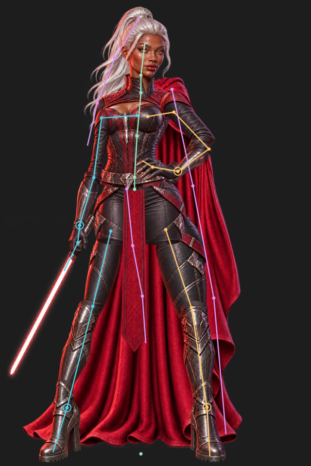

# Общий персонажный риг Star Spin

17 ноября 2026. Рабочий RML-проект для Rive CLI **1.9.2**. Общий каркас содержит **31 кость**, 19 текстурных слотов, четыре IK-цепи и семь реакций с прежней нумерацией `Character.mode`. Первый собранный скин: Дарт Веспера.

После визуального ревью исправлены воротник и плечо, добавлена фиксация кисти на бедре и согласованы веса соседних частей. [Ревью и сравнение](review.md).



## Открыть и проверить

Из корня репозитория, если закреплённый CLI находится в PATH:

```sh
rive games/wild-nudge/animation/shared-rig
node games/wild-nudge/animation/shared-rig/build.mjs
node games/wild-nudge/animation/shared-rig/verify.mjs
```

На этом Mac команда CLI: `~/.rive/versions/1.9.2/rive`. Генератор и проверка находят её автоматически. На другом устройстве можно задать `ROYAL_RIVE_CLI` полным путём. Требуются уже установленные зависимости проекта, включая `sharp`; для записи тестового видео нужен `ffmpeg` в PATH.

Обычный запуск открывает нативное окно и следит за файлами. Генератор собирает `scene.rml`, запускает `--verify`, `inspect --summary` и нативный захват кадра. После изменений JSON повторить обе команды Node. Сам `scene.rml` генерируется: ручные правки будут заменены.

## Что является общим

- `skeleton.json`: имена и родительские связи костей, передний порядок слоёв, размер 640 x 960 и контракт состояний.
- `skins/vespera.json`: мировые координаты суставов в исходной позе, масштаб и положение текстур, сдвиг нижнего края `shearX`, состав костей каждой сетки, зоны весов `weightStops`, оси `weightAxis` и амплитуды движения.
- `build.mjs`: иерархия, матрицы исходной привязки, упаковка весов с суммой 255, сетки, IK, ViewModel и timelines.
- `scene.rml`: готовая сцена с именованными костями и слотами, а не одна деформируемая картинка.

`r` и `l` означают анатомические стороны. Правая рука Весперы находится слева для зрителя. Слоты объявлены спереди назад, как требует RML.

Ветки: корень, таз, позвоночник, грудь, шея и голова; ключица, плечо, предплечье, кисть и оружейное крепление с каждой стороны; бедро, голень и стопа; по три кости для волос, плаща и передней ткани. Кисти, оружие и таз сохраняют жёсткую привязку. Соседние части конечностей плавно делят веса вокруг суставов. Вес считается по оси конечности, поэтому согнутое предплечье не деформируется просто по вертикали PNG. Корпус, низ головы, волосы, плащ и передняя ткань имеют отдельные сетки. Лицо закреплено за головой, нижний край воротника следует за грудью. Верх волос закреплён за головой, верх плаща за грудью, верх передней ткани за тазом.

Для новой героини сохраняются имена костей и номер состояния, но заново настраиваются её поза, пропорции, текстуры, перекрытия и характер движения. У Аэлири сидячая поза, у Никсары боевая стойка: перенос координат Весперы без подгонки неверен. Для отростков и дополнительных аксессуаров нужны дополнительные слоты. Остальные три скина в этом проекте пока не собраны.

## Управление

Artboard: `Vespera`. ViewModel и StateMachine: `Character`.

| mode | Timeline | Поведение |
| --- | --- | --- |
| 0 | `idle` | Цикл ожидания 6 секунд |
| 1 | `spin_wait` | Более сдержанное ожидание запроса |
| 2 | `wild_align` | Короткий акцент руки и оружия |
| 3 | `bonus_enter` | Усиленный акцент при подтверждённом входе в бонус |
| 4 | `bonus_idle` | Цикл активной бесплатной серии |
| 5 | `round_win` | Реакция на положительный итог полного раунда |
| 6 | `select` | Короткое приветствие |

Однократные реакции длятся 90 кадров при 60 fps, возвращаются в исходную позу и не повторяются при неизменном `mode`. Переход в любой другой режим доступен сразу, со смешиванием 160 мс. Хост выбирает актуальное базовое состояние после реакции. Эти времена и амплитуды являются художественными настройками прототипа.

Дополнительные числовые свойства:

| Свойство | Значение |
| --- | --- |
| `rigOpacity` | 0 скрывает кости, 1 показывает кости и цели IK |
| `skinOpacity` | 1 показывает текстуры, 0 оставляет каркас |
| `ikHands`, `ikFeet` | Ручной IK от 0 до 1, по умолчанию 0. При `ikHands=1` обе кисти следуют ручным целям |
| `hipLock` | По умолчанию 1: левая кисть и её угол зафиксированы относительно таза. 0 снимает контакт; `ikHands=1` также полностью снимает его |
| `hand_r_x/y`, `hand_l_x/y` | Мировые координаты запястий для IK |
| `foot_r_x/y`, `foot_l_x/y` | Мировые координаты голеностопов для IK |
| `hand_r_tip_x/y`, аналогично для остальных конечностей | Обратные диагностические значения фактических концов цепей, только для чтения |

В режиме по умолчанию отдельная IK-цепь удерживает левую кисть на бедре. Цель контакта является дочерним узлом таза; положение и поворот кисти согласуются через native constraints. Сила контакта: `hipLock * (1 - ikHands)`, сила левого IK: `max(hipLock, ikHands)`. Менять эти параметры в пределах 0..1. При добавлении нового скина контакт нужно выбирать под его позу.

Диагностические `hip_l_x/y`, `hip_fingers_l_x/y`, `palm_l_x/y`, `grip_r_x/y`, `saber_grip_x/y` читаются обратно из native renderer. Это выходы измерений, их не нужно менять из хоста.

Ручной IK используется для подгонки и небольших жестов. Он решает геометрию двух костей, но не проверяет столкновения, допустимый ракурс нарисованной части или границы экрана. Не перемещать цели за достижимый диапазон цепи. Независимые пальцы и повороты головы в другой ракурс требуют дополнительных текстур.

Пример захвата реакции:

```sh
rive games/wild-nudge/animation/shared-rig --screenshot --data=mode=3 --advance=36
rive games/wild-nudge/animation/shared-rig --screenshot --data=rigOpacity=1 --advance=1
```

Для серии интерактивных проверок:

```sh
rive games/wild-nudge/animation/shared-rig --commands
```

Ввести по одной строке: `data mode=3`, `advance 36`, `screenshot build/bonus.png`, `data rigOpacity=1`, `advance 1`, `screenshot build/rig.png`, `quit`. Это нативный renderer CLI.

## Изображения и результаты

Текстуры берутся по относительным путям из `docs/game-layout/star-spin/vespera-rig/parts`. Скрытые поверхности ранее были дорисованы image_gen; масштаб каждой части подогнан отдельно. Новая платная генерация для этого рига не выполнялась. Упаковка проекта для переноса должна включать исходную папку текстур. Локальная история источника и запросов: [набор Весперы](../../../../docs/game-layout/star-spin/vespera-rig/README.md).

- `preview.png`: собранная исходная поза.
- `preview.mp4`: шесть секунд из нативного renderer, ожидание, вход в бонус и возврат.
- `rig-overview.png`: каркас поверх скина.
- `states-overview.png`: семь состояний и отдельная диагностическая поза IK.
- `review-comparison.png`: общий вид до и после, увеличение воротника и плеча.
- `motion-review.png`: последовательные кадры реакции и ручная IK-поза.
- `verification.json`: SHA-256 входов, результаты компиляции и состав сцены.
- `native-qa.json`: движение всех семи режимов, возврат цикла, прерывание, видимость костей и фактическая ошибка достижения IK-целей.

Проверка сделана в нативном CLI при 640 x 960. На 247 выборках с шагом 6 кадров во всех семи режимах ошибка запястья и контрольной точки кисти на бедре меньше 0,001 px. Контрольные точки хвата и оружия совпадают, опорные точки голеностопов не смещаются. Ручной IK достигает проверенных целей с ошибкой меньше 0,001 px. Это инженерная проверка геометрии и переключения состояний. Она не заменяет художественную оценку каждой позы, проверку в браузерном runtime или host на телефоне.

Это основа для дальнейшей анимации. Текстуры имеют фиксированный ракурс; при больших отклонениях видны ограничения нарезки. Моргание и сменные эмоции ещё не перенесены на новое реконструированное лицо. Для финального использования нужны их отдельная подготовка и визуальная проверка стыков на выбранном диапазоне движений.

## Экспорт и подключение

CLI 1.9.2 сохраняет локальный `.riv` через `--publish=local`, а `.rev` для редактора через `--rev`. Оба действия требуют входа `rive login`. На этом Mac вход не выполнен, поэтому бинарный экспорт не создавался. Текущие ограничения проверены по `rive docs publishing`: устаревший `--once` удалён. [Официальная документация экспорта](https://rive.app/docs/cli/publishing).

После входа локальный экспорт:

```sh
rive games/wild-nudge/animation/shared-rig --publish=local
rive games/wild-nudge/animation/shared-rig --rev=build/star-spin-shared-rig.rev
```

Проект содержит только кости, изображения, timelines и ViewModel, без Luau, AnimaScript и собственного звука. Игра пока продолжает использовать прежние ресурсы. Новый риг не подключён к `StarSpinCharacter.ts` и не опубликован на сервере. Совпадение имён контракта не является проверкой совместимости с закреплённым web runtime 2.49.0. Интеграция потребует проверки фактического экспорта, fallback, паузы, закрытия и настоящего host с чатом.
