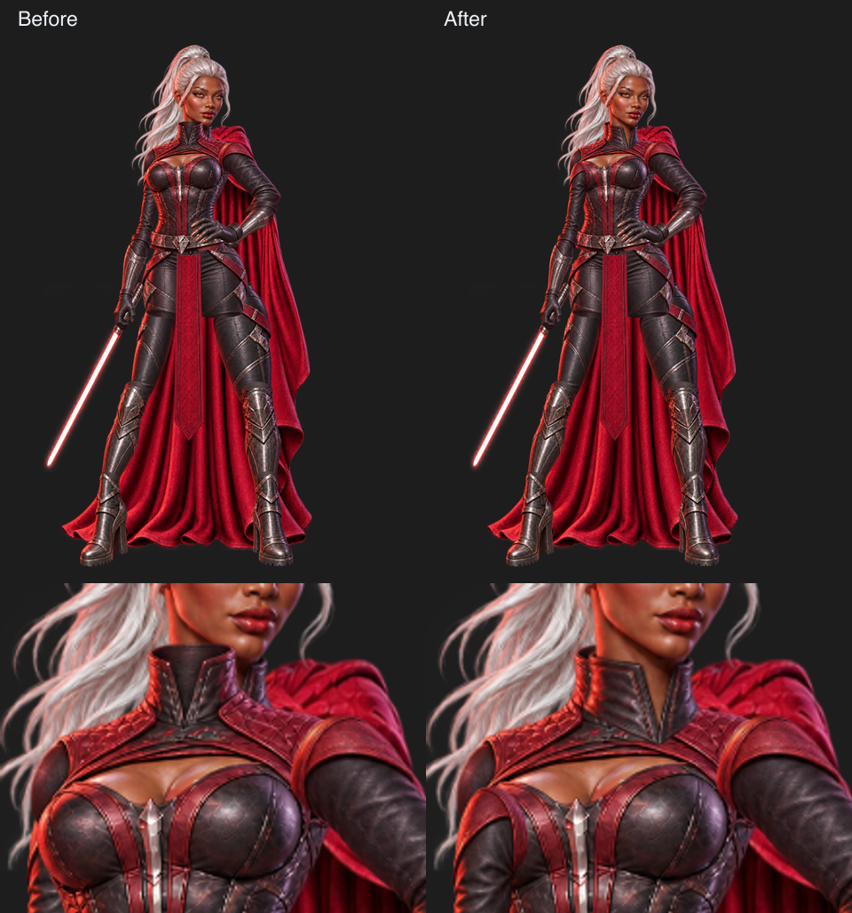
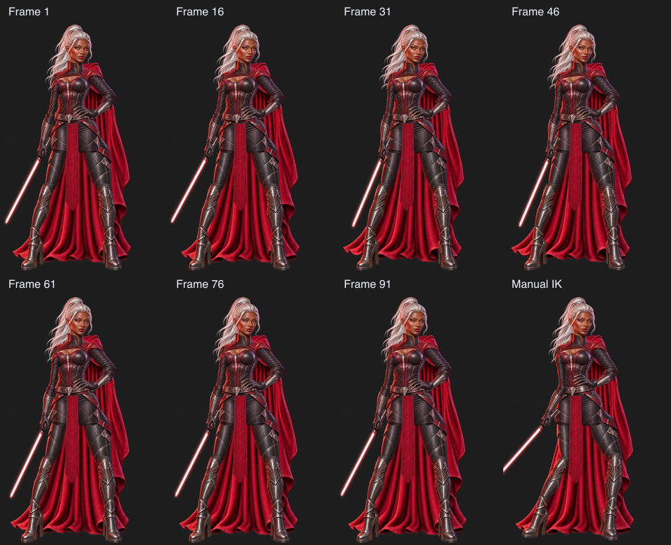

# Веспера: ревью сборки и синхронизация

17 ноября 2026. Проверен общий силуэт, затем крупно шея, плечи, локти, запястья, пояс, колени и обувь. Основа сравнения: предыдущая сборка `2abf267680d976f23e011483b670d59c404ac172`. Изображения получены нативным renderer Rive CLI 1.9.2. Текстуры не перерисовывались.

## Исправления

| Область | Найдено при ревью | Изменение |
| --- | --- | --- |
| Шея | Корпус перекрывал шею непрозрачной чёрной полостью пустого воротника | Голова перенесена перед корпусом. Нижняя часть её воротника плавно привязана к шее и груди, лицо остаётся на кости головы |
| Правое плечо, слева для зрителя | Поверх рукава оставался виден пустой торец плечевого отверстия корпуса | Рукав перенесён перед корпусом. Верх рукава следует за ключицей, низ делит веса с предплечьем |
| Левая кисть на бедре | Кисть наследовала движение груди и смещалась относительно неподвижного таза | Цель запястья закреплена в системе таза. IK удерживает положение, RotationConstraint удерживает угол кисти |
| Локти и запястья | Соседние PNG были полностью жёсткими и могли поворачиваться независимо на перекрытии | Добавлены сетки и переходы весов через соседние кости. Вес считается вдоль каждой конечности, включая согнутую руку |
| Колени и верх обуви | Жёсткая привязка каждой отдельной детали давала разное движение краёв в ручном IK | Бёдра, голени и обувь делят веса около соответствующих суставов |
| Волосы, плащ, передняя ткань | Равномерный переход весов начинал деформировать верх деталей слишком близко к креплению | Верхние зоны закреплены соответственно за головой, грудью и тазом. Цепи двигают свободную часть |
| Пояс и низ корпуса | Переход весов корпуса доходил до таза без отдельной фиксированной зоны | Нижняя часть корпуса закреплена за тазом, плечи за грудью |

Общий силуэт и исходная асимметричная стойка сохранены. На просмотренных кадрах воротник закрывает шею, рукава закрывают плечевые отверстия, кисть лежит на поясе, меч остаётся в хвате. Реконструированный скин сохраняет отличия от исходной игровой иллюстрации, включая рисунок плаща и деталей костюма.

## Проверка движения

Нативная проверка снимает значения из реально вычисленных мировых координат узлов, а не только анализирует иерархию. Шаг 6 кадров при 60 fps, полный цикл каждого циклического режима и весь диапазон каждой короткой реакции: всего 247 выборок. Результат сохранён в [native-qa.json](native-qa.json).

| Проверка | До | После |
| --- | --- | --- |
| Максимальное смещение запястья относительно контакта на бедре | 0,5653 px | 0,000593 px |
| Максимальное смещение контрольной точки кисти, учитывающее её поворот | Не измерялось | 0,000754 px |
| Расхождение контрольных точек хвата и оружия | Не измерялось | 0 px |
| Смещение опорных точек голеностопов в семи штатных реакциях | Не измерялось | 0 px |
| Максимальная ошибка ручного IK для четырёх проверенных целей | Меньше 0,001 px | Меньше 0,001 px |

При `hipLock=0` контрольный сдвиг снова составляет 0,5670 px. Это подтверждает, что удержание создаёт контактная привязка. При `ikHands=1` ручные цели вновь управляют обеими руками, контакт с бедром полностью освобождается.

Дополнительно проверены переходы между режимами, возврат idle после прерывания, видимость каркаса и возврат реакции `bonus_enter` в исходное положение: ошибка положения правого запястья после 91 кадра меньше 0,0001 px. Обновлены нативное видео и изображения состояний. `--verify` и `inspect --summary` завершились без ошибок и замечаний.

Это проверка небольших штатных жестов и выбранной диагностической IK-позы. Числа измеряют геометрию контрольных точек, они не доказывают отсутствие каждого растрового шва. Большие развороты конечностей, раскрытие пальцев и смена ракурса по-прежнему требуют дополнительных рисунков и отдельной художественной проверки. Риг пока не подключён к игре.
